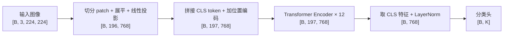
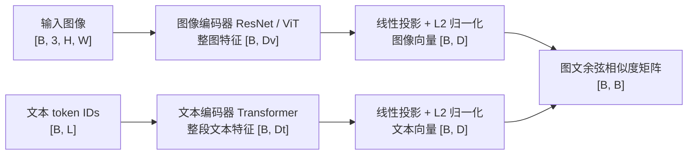

# 简介
一句话总结各个模型 解决了什么问题，用到什么方法思路，核心贡献，结论等

# 一、llm
## 1.1、foundations
```
https://www.bilibili.com/video/BV1BavdBrE1s/?spm_id_from=333.337.search-card.all.click
```

### 1.1.1、vit
> ICLR 2021: An Image is Worth 16x16 Words

1. 解决问题：探索能否使用纯transformer完成图像分类，减少对CNN的依赖
2. 组织架构：先将图像划分为不重叠的一个个patch，每个patch通过线性映射为token embedding，在序列前加入可学习的分类token，再加上位置编码，送入transformer encoder，将输出的cls token送入cls head完成图像分类
3. 核心贡献：验证了使用transformer进行视觉图像建模的可行性，证明在大规模预训练下，能够弥补transformer相比CNN缺少局部性等归纳偏置的不足，为后续transformer引入视觉和VLM任务奠定基础


模块总览流程图（以 ViT-B/16 为例，B 为批量大小，K 为类别数）：



每层 Encoder：`LN → 多头自注意力 → 残差相加 → LN → MLP → 残差相加`。

### 1.2、clip
> ICML 2021: Contrastive Language–Image Pre-training 

1. 解决问题：主要解决传统视觉模型需要大量人工标注、只能识别预定类别等问题。Clip利用海量互联网图文对进行自然语言监督，通过对比学习建立视觉与语言之间的语义联系
2. 组织架构：使用双编码器，图像编码器ResNet/ViT，文本编码器Transformer，分别提取特征，通过线性变换到相同维度。训练时，通过对比损失提高匹配图文的相似度、降低不匹配图文的相似度。推理时，将候选类别转化为提示文本，通过比较图像与各类别文本的相似度完成零样本分类，无需针对目标数据集重新训练
    * 图像->resnet/vit->线性投影->归一化->图像向量
    * 文本->transformer->线性投影->归一化->文本向量
    * 计算图像向量和文本向量的相似度 
3. 核心贡献：提出图文对比预训练范式，推理时仅通过类别文本描述进行零样本分类。验证了大规模语言监督与图文对比预训练的有效性，证明自然语言监督可以代替固定类别标签，为后来VLM发展奠定基础

模块总览流程图（B 为批量大小，L 为文本长度，D 为共享嵌入维度，Dv / Dt 为两种编码器的特征维度）：



训练：相似度经可学习的温度缩放后，计算双向对比损失。零样本分类：将 K 个类别写成提示文本，得到 `[B, K]` 相似度矩阵，选择最匹配的类别。

### 1.3、Flamingo
> NeurIPS 2022 Flamingo: a Visual Language Model for Few-Shot Learning


### 1.4、blip
> ICML 2022：Bootstrapping Language-Image Pre-training for Unified Vision-Language Understanding and Generation


### 1.5、blip2
