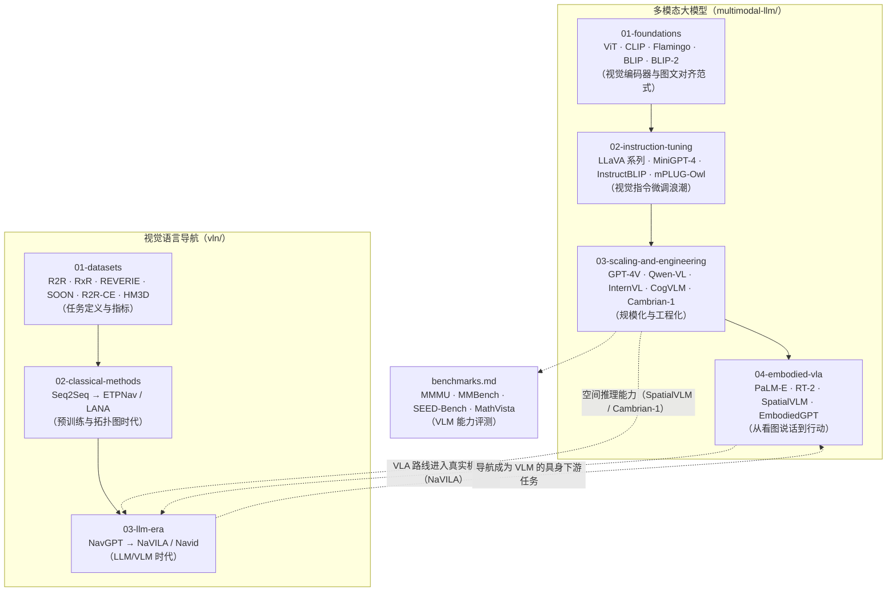

# Related Work —— VLM 与 VLN 领域调研

> 本目录按 [research-workflow](https://github.com/skJack/research-workflow) 的约定组织：每篇重要论文一个条目（含经过验证的 arXiv ID），配合 `download-papers.sh` 可一键把 PDF 下载到对应分类目录。调研截止时间：**2026-09**。

## 调研目标

从零进入「多模态大模型（VLM / MM-LLM）」与「视觉语言导航（VLN）」方向，第一轮需要回答：

1. VLM 是怎么从 CLIP/BLIP 演进到 LLaVA/Qwen-VL/InternVL 的？核心技术分歧点在哪？
2. VLN 任务的定义、数据、指标是什么？从 2018 到 2025 方法经历了哪几个阶段？
3. 两条线在哪里汇合（LLM/VLM 进入导航、具身智能 VLA）？有哪些可切入的 gap？

## 领域地图



## 核心脉络（三句话版）

- **VLM 主线**：CLIP 提供视觉编码器 → BLIP-2/Q-Former 与 LLaVA/MLP 给出两种"视觉接进 LLM"的范式 → 2024 后竞争焦点转向**视觉编码器规模**（InternVL、Cambrian-1 证明视觉才是瓶颈）与**数据**（LLaVA-1.5 证明学术数据足够刷榜）。
- **VLN 主线**：R2R 定义任务与指标 → 2018-2022 靠预训练（PREVALENT）与图/记忆（HAMT、DUET、ETPNav）把离散环境刷到接近上限 → 2023 起 LLM/VLM 入场（NavGPT、Navid、NaVILA），重点转向**连续环境（VLN-CE）与真实机器人**。
- **汇合点**：VLM 需要空间推理与"行动"能力（SpatialVLM、PaLM-E、RT-2 的 VLA 路线）；VLN 需要通用视觉-语言理解（NaVILA 直接把 VLM 当导航策略）。**VLM × VLN 的交叉地带（空间推理、动作 token 化、去地图导航）是当前最活跃的 gap 区。**

## 文件结构

```
related_work/
├── README.md           本文件：总览、领域地图、阅读指南
├── benchmarks.md       VLM 通用评测基准（MMMU 等 8 个）
├── download-papers.sh  批量下载本目录所有论文 PDF（curl 直连 arXiv）
├── multimodal-llm/     多模态大模型
│   ├── README.md       该方向脉络与阅读顺序
│   ├── 01-foundations.md
│   ├── 02-instruction-tuning.md
│   ├── 03-scaling-and-engineering.md
│   └── 04-embodied-vla.md
└── vln/                视觉语言导航
    ├── README.md       该方向脉络与阅读顺序
    ├── 01-datasets.md
    ├── 02-classical-methods.md
    └── 03-llm-era.md
```

## 每篇论文的条目模板

```markdown
### N. 短名 · 《论文标题》
- **出处**：arXiv `xxxx.xxxxx` · 会议/年份 · 机构
- **一句话**：这篇文章解决了什么
- **方法**：核心思路与关键技术（3~5 点）
- **关键结论**：论文给出的证据/数字（定性为主）
- **局限**：论文自身或公认的不足
- **对本方向的启示**：与 VLM / VLN 的关系、可借鉴点
```

## 怎么用（workflow 节奏）

1. **泛读**：先读两个方向的 `README.md`，建立时间线心智模型。
2. **精读**：挑 3~5 篇"枢纽论文"（建议：BLIP-2、LLaVA-1.5、ETPNav、Navid、PaLM-E）下载 PDF 细读。
3. **下载 PDF**：
   ```bash
   bash related_work/download-papers.sh            # 全部下载
   bash related_work/download-papers.sh vln        # 只下载 vln 目录
   ```
   PDF 按 arXiv ID 命名，落在各分类目录下；如已安装 research-workflow 的
   `fetch-paper.sh`，可用它替代（额外下载 LaTeX 源码）。
4. **扩展调研**：新论文按上方模板追加到对应文件，arXiv ID 用
   `https://export.arxiv.org/api/query?id_list=<id>` 验证后再写。

## 已知局限（调研诚实声明）

- 覆盖到 2026-09 为止；LLM 领域月度级更新，重点期刊论文（TPAMI 等）的后续版本未逐一核对。
- 条目内容基于论文摘要与社区共识撰写，**数字结论以原文为准**；精读与复现后如有出入，按 AGENTS.md 第 4 条追加勘误。
- 每个条目未单独下载 PDF（可用 `download-papers.sh` 补齐）。
