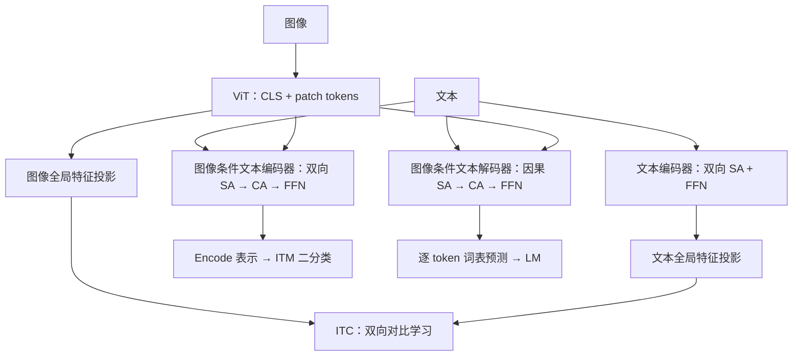

# BLIP 论文超详细精读：统一理解与生成，以及用模型改进训练数据

> **论文**：Junnan Li、Dongxu Li、Caiming Xiong、Steven Hoi，*BLIP: Bootstrapping Language-Image Pre-training for Unified Vision-Language Understanding and Generation*。  
> **出处**：ICML 2022，PMLR 162:12888–12900，Salesforce Research。  
> **arXiv**：[2201.12086][arxiv]；本地 PDF 为 v2，2022-02-15；首次提交为 2022-01-28。ID、标题、作者已经与 arXiv 官方页面及 [PMLR 会议页面][pmlr] 交叉核对。  
> **原文**：[本地 PDF](2201.12086.pdf) · [ICML 正文与附录][paper] · [官方实现][repo]。  
> **笔记日期**：2026-09-27。本文讨论的是 **2022 年的 BLIP**；与 BLIP-2 的区别见第 16 节。  
> **版本口径**：章节、附录和实验结果以 PMLR 正式版为准；本地 arXiv v2 的差异单独记录于第 20.2 节。  
> **证据约定**：标为“论文事实”的内容来自正文、图表或附录；“教学展开”是为了理解而补充的数学表达和例子；“实现补充”来自官方代码；“个人分析 / 待验证”不属于论文已经证明的结论。所有实验数字均为作者报告，**本项目未复现这些结果**。

## 0. 按项目模板记录

### 1. BLIP · 《BLIP: Bootstrapping Language-Image Pre-training for Unified Vision-Language Understanding and Generation》

- **出处**：arXiv `2201.12086` · ICML 2022 · Salesforce Research。
- **一句话**：通过可切换的编码器—解码器架构统一图文理解与文本生成，再用生成描述和过滤错配文本的 CapFilt 流程改善预训练数据。
- **方法**：① MED 支持单模态编码、图像条件文本编码、图像条件文本解码；② 联合优化 ITC、ITM、LM；③ 文本编码器与解码器共享除自注意力外的参数；④ 从预训练模型分别微调 captioner 和 filter；⑤ 用清洗后的网络文本、合成文本及人工标注重新训练模型。
- **关键结论**：作者的消融表明生成与过滤结合能改善所测的检索和描述任务；参数共享方式、生成多样性、数据处理过程均影响结果。图文模型还可迁移到若干视频任务。结论限于论文实验条件，详见第 12～13 节。[论文表 1–13][paper]
- **局限**：过滤器会犯错；合成描述受生成器能力限制；视频迁移没有显式时间建模；多数任务需分别微调；论文未验证通用指令跟随、导航策略或机器人闭环控制能力。
- **对本方向的启示（个人分析）**：学习如何同时设计表征、生成目标和数据处理流程；对 VLN，可考虑将图文匹配或描述能力作为感知组件，但导航所需的空间关系、历史记忆与行动决策必须另外验证。

## 阅读路线与目录

第一次阅读建议按 **1 → 3 → 4～8 → 9 → 11 → 13 → 18** 的顺序。已有 CLIP 基础可从第 3 节开始；准备看代码时重点读第 14 节。

1. [论文到底在解决什么问题](#s1)
2. [必要背景、术语和符号](#s2)
3. [MED 总体结构](#s3)
4. [自注意力、交叉注意力与参数共享](#s4)
5. [ITC：把图文表示对齐](#s5)
6. [ITM：判断一对图文是否匹配](#s6)
7. [LM：给定图像生成描述](#s7)
8. [三个目标怎样联合训练](#s8)
9. [CapFilt：数据自举的完整过程](#s9)
10. [数据、模型规模和训练配置](#s10)
11. [如何迁移到七类下游任务](#s11)
12. [指标与主要实验结果](#s12)
13. [六组关键消融：证据究竟支持什么](#s13)
14. [官方代码阅读与教学伪代码](#s14)
15. [逐图、逐表阅读索引](#s15)
16. [CLIP、ALBEF、BLIP、BLIP-2 的关系](#s16)
17. [局限、未来工作与 VLN 启示](#s17)
18. [常见疑问与知识自测](#s18)
19. [最后应记住的知识框架](#s19)
20. [来源与引用信息](#s20)

<a id="s1"></a>

## 1. 论文到底在解决什么问题

### 1.1 两个相互关联的问题

**论文事实：模型层面，作者希望一个预训练框架能同时服务理解任务和生成任务。**

- 图文检索要求比较图像与文本是否对应，最好还能先独立编码以加速大规模搜索。
- 图文匹配、视觉推理等任务需要更细的图文交互。
- 图像描述生成要求模型根据图像逐词输出句子。

这几类任务对信息流的要求不同。独立编码擅长高效相似度计算；融合编码便于检查细节；自回归解码负责生成。BLIP 通过 MED 在同一预训练模型内提供这些计算方式。[论文 §1、§3.1，图 2][paper]

**论文事实：数据层面，网络图片附带的文字经常不是对可见内容的准确描述。**

网页的 alt-text 可能包含地点、商品推广、作者经历、页面标题，也可能漏掉图中最有用的信息。增大图文对数量可以带来收益，但配对文字的质量仍然值得改进。作者因此提出 CapFilt：生成新的图像描述，并检查原有描述与新描述是否匹配图片。[论文 §1、§3.3，图 1、3][paper]

### 1.2 一个贯穿全文的教学例子

假设照片里是“一只黑猫坐在红椅子上”，原始网页文字是“周末生活记录”。

| 处理方式 | 对这一样本提出的问题 | 希望得到的结果 |
|---|---|---|
| ITC | 这张图与哪条候选文字的整体语义最接近？ | 真正相关的文字在特征空间更接近 |
| ITM | “黑猫坐在红椅子上”与这张图具体匹配吗？ | 预测 matched |
| LM | 给定图像和已生成前缀，下一个词是什么？ | 逐步生成图像描述 |
| Captioner | 原网页文字信息不足，能否另写一句描述？ | 生成一个候选 caption |
| Filter | 原文和新生成的文字各自是否匹配图片？ | 分别保留或丢弃 |

这里的猫、椅子和句子是教学示例。论文没有据此证明模型一定能区分任意颜色、数量、方向关系。

### 1.3 两个贡献怎样互相支持

MED 学到生成能力，才能充当 captioner；学到细粒度匹配能力，才能充当 filter。CapFilt 改进数据后，又可以训练新的 MED。理解这个关系，就能看出论文为什么同时讨论架构和数据。[论文图 3][paper]


图中画出论文验证的一轮数据自举流程。多轮自举属于作者列出的未来方向。

<a id="s2"></a>

## 2. 必要背景、术语和符号

### 2.1 先分清五组概念

1. **预训练与微调**：预训练从大量图文对学习可迁移能力；微调利用某一下游任务的数据和目标调整模型。BLIP 的不同下游实验通常对应不同的微调模型。
2. **编码与解码**：编码是把输入变成表示；本文的解码是按从左到右的条件概率生成文本。Transformer 是否用于解码，取决于注意力可见范围、输入和训练目标。
3. **对齐与融合**：ITC 在向量空间建立跨模态对应；融合编码通过 cross-attention 让每个文本位置读取视觉信息。向量接近不等于已经完成逐 token 的信息交互。
4. **人工标注、网络文字与合成文字**：三者都是监督来源，但获取方式和错误分布不同。BLIP 的全流程包含 COCO 等人工标注数据，不能描述为完全没有人工监督。
5. **零样本与没有任何训练**：本文的 zero-shot 主要指没有在目标数据集 / 目标视频任务上进行相应训练，不表示模型此前没有做图文预训练或其他任务微调。

### 2.2 常用术语

| 名称 | 全称或含义 | 在 BLIP 中的作用 |
|---|---|---|
| VLP | Vision-Language Pre-training | 图像—语言预训练 |
| MED | Multimodal mixture of Encoder-Decoder | 提供三种计算模式的模型架构 |
| ITC | Image-Text Contrastive learning / loss | 独立图文表示之间的对比学习 |
| ITM | Image-Text Matching | 图文对的二分类匹配 |
| LM | Language Modeling | 图像条件下的自回归文本预测 |
| MLM | Masked Language Modeling | 根据上下文恢复被遮盖词；用于解释与 LM 的区别 |
| SA | Self-Attention | 文本内部或视觉 token 内部的信息交互 |
| CA | Cross-Attention | 文本表示读取视觉表示 |
| FFN | Feed-Forward Network | Transformer 中逐位置的非线性变换 |
| CapFilt | Captioning and Filtering | 合成描述并过滤图文对 |
| Momentum encoder | 动量编码器 | 用参数的指数移动平均产生稳定特征与软目标 |
| Hard negative | 困难负样本 | 语义相近、较容易被误判为匹配的负例 |
| Nucleus sampling | Top-p 采样 | 在累计概率达到阈值的候选词集合中采样 |

### 2.3 后文使用的符号

| 符号 | 含义 |
|---|---|
| $I,T$ | 一张图像及一条文本 |
| $B$ | 一个用于说明的 batch 中的图文对数量 |
| $N$ | 图像 patch 数，不含图像 `[CLS]` |
| $L$ | 文本 token 序列长度 |
| $V=f_v(I)$ | ViT 输出的完整视觉 token 序列 |
| $v_i,t_i$ | 经过投影与归一化的图像 / 文本全局特征 |
| $\tau$ | ITC 的可学习温度参数 |
| $\theta,\bar\theta$ | 在线模型参数、动量模型参数 |
| $\alpha,m$ | 软目标混合权重、动量更新系数 |
| $D_h,D_w$ | 人工标注数据、网络图文数据 |
| $T_w,T_s$ | 原始网络文本、合成文本 |

后面的损失公式是根据原文与官方实现进行的教学展开，不是把论文中不存在的公式编号补写成“原论文公式”。

<a id="s3"></a>

## 3. MED 总体结构

### 3.1 图像编码器：ViT 提供两种粒度的信息

图像经过 patch embedding 和 Transformer，得到：

$$
V=f_v(I)=[h^v_{\mathrm{cls}},h^v_1,\ldots,h^v_N]
\in\mathbb R^{(N+1)\times d_v}.
$$

- **全局 `[CLS]` 特征**用于 ITC，经投影后与文本的全局特征比较。
- **完整视觉序列**用于 cross-attention，供文本读取更细的视觉信息。

以 `224×224` 输入和 `/16` 的 patch 大小为例，patch 数为 `14×14=196`，加 `[CLS]` 后为 197 个视觉 token。输入为 `384×384` 时，对应 `24×24+1=577` 个 token；VQA 的 `480×480` 对应 901 个。这些数量是由分辨率和 patch 大小计算所得。[论文 §3.1、§4.1、附录 B][paper] · [官方视觉编码器构建][code-core]

BLIP 直接使用 ViT，不依赖先运行一个目标检测器来获得 bounding-box region features。因此视觉 token 通常对应图像 patch，不能直接把它们解释成“每个 token 就是一个对象”。

### 3.2 三种模式放在一起看

| 模式 | 文本 self-attention | 是否读图像特征 | 主要输出 | 预训练目标 |
|---|---|---|---|---|
| Unimodal encoder | 双向 | 文本塔不通过 CA 读图 | 图、文各一个全局向量 | ITC |
| Image-grounded text encoder | 双向 | 每层 CA 读视觉序列 | 一对图文的融合表示 | ITM |
| Image-grounded text decoder | 因果 | 每层 CA 读视觉序列 | 每个位置的词表分布 | LM |

“Unimodal encoder”这一路包含图像编码器和文本编码器各自的单模态计算；它不是“整个模型只接受一种模态”。[论文 §3.1，图 2][paper]



这幅图展示计算路径，不表示画出的每个文本模块都拥有一套完全独立的参数。参数共享见第 4 节。

### 3.3 单模态编码：先让图和文可以直接比较

文本编码器基于 BERT，使用双向自注意力。输入开始处放 `[CLS]`，输出的对应位置汇总文本信息。此时不开启读图像的 cross-attention，所以同一条文本的向量可以离线计算。[论文 §3.1][paper]

这个模式最适合做第一阶段候选检索：事先把数据库的图像或文本变成向量，查询到来时计算相似度。

### 3.4 图像条件文本编码：联合检查一对图文

在文本 Transformer 的每层 self-attention 与 FFN 之间加入 cross-attention。文本处理过程中可以反复读取视觉序列。前置特殊 token `[Encode]` 的输出作为融合表示，送入 ITM 线性分类头。[论文 §3.1–3.2][paper]

因此，ITM 中同一句话搭配不同图片，会产生不同的融合表示；不能只把这句话编码一次，就得到适用于所有图片的 ITM 结果。

### 3.5 图像条件文本解码：把图像变成一串词

文本解码器将双向 self-attention 改为因果 self-attention，生成位置只能读到已有前缀；cross-attention 仍然可以读取图像信息。`[Decode]` 表示开始生成，结束 token 表示句子终止。[论文 §3.1][paper]

**实现补充**：论文用说明性名字 `[Encode]` / `[Decode]`；官方 tokenizer 的实际 token 是 `[ENC]` / `[DEC]`，结束生成使用 BERT 的 `[SEP]`。写代码时应读取 tokenizer 的 ID，不要把论文示意字符串直接当成实现中的固定 ID。[官方 `init_tokenizer` 与生成代码][code-core]

### 3.6 MED 中的 mixture 应如何理解

此处指一个架构可以按目标启用不同功能。论文没有引入稀疏专家路由、按 token 选 expert 的机制。理解 MED 时，重点是三种信息流以及共享与独立的参数集合。

<a id="s4"></a>

## 4. 自注意力、交叉注意力与参数共享

### 4.1 Attention 的共同形式

教学展开：忽略多头拼接、残差连接和 LayerNorm，一个 attention 操作可写成：

$$
\operatorname{Attention}(Q,K,U;M)
=\operatorname{softmax}\left(\frac{QK^\top}{\sqrt{d_k}}+M\right)U.
$$

这里用 $U$ 表示 value，避免与视觉序列 $V$ 混淆；$M$ 是注意力 mask，被屏蔽的位置加上负无穷。

### 4.2 双向 SA 和因果 SA 的区别

文本 hidden states 为 $H$ 时，self-attention 的 query、key、value 都由 $H$ 投影得到。

双向编码时，一个位置可以读取所有非 padding 的文本位置。因果解码时：

$$
M_{ij}=\begin{cases}0,&j\le i,\\-\infty,&j>i.\end{cases}
$$

以四个位置为例，`1` 表示允许读取：

```text
双向 self-attention        因果 self-attention
1 1 1 1                    1 0 0 0
1 1 1 1                    1 1 0 0
1 1 1 1                    1 1 1 0
1 1 1 1                    1 1 1 1
```

教学例子：理解“黑猫坐在红椅子上”时，“猫”的表示可读取后面的“红椅子”；预测下一词时则不能提前读取答案后缀，否则训练中会泄露未来信息。

### 4.3 Cross-attention 到底由谁查询谁

在 BLIP 的图像条件文本模块中：

$$
Q=H W_Q,\qquad K=V W_K,\qquad U=V W_U.
$$

也就是**文本位置提供 query，图像 token 提供 key 和 value**。若文本长度为 $L$，视觉 token 数为 $N+1$，每个头的注意力矩阵大小就是 $L\times(N+1)$。

文本和视觉 hidden size 不一定相同；各自的线性投影把它们变成可计算注意力的尺寸。图像 token 不必先离散化成文本词表里的“词”。[论文图 2；官方 cross-attention 实现][code-med]

### 4.4 什么共享，什么独立

**论文事实：预训练时，文本 encoder 与 decoder 共享除 SA 之外的参数。**

| 部分 | Encoder / Decoder 是否共享 | 如何理解 |
|---|---|---|
| 文本 embedding | 共享 | 两种功能使用共同的词表示基础 |
| Self-attention | **不共享** | 双向表示学习和从前缀预测下一个词采用不同参数 |
| Cross-attention | 共享 | 两种功能都要读取视觉信息 |
| FFN | 共享 | 共享后续的表征变换 |
| 图像编码器 | 使用共同的视觉主干 | 为三个目标提供视觉表示 |

单模态文本编码模式与图像条件文本编码模式使用编码侧的参数，区别在于是否启用 CA。解码侧另有自己的 SA 参数。[论文 §3.2、§4.4，图 2、表 3][paper]

这比“切换一下 attention mask”更完整：除了可见范围不同，编码侧和解码侧的 SA 权重本身也不同。共享 CA 与 FFN 则让理解与生成的梯度都能更新这些共同模块。

### 4.5 作者为什么这样设计

作者的解释是：编码要构建当前输入的上下文表示，解码要根据前缀预测未来词，差异主要由 SA 承担；读图和特征变换则可以共享。表 3 对比了全部共享、只分开 CA、只分开 SA、完全独立四种方案，支持在所测设置下使用“只分开 SA”。这是一个有实验证据的设计选择，不是所有编码—解码任务都必须遵循的数学定理。[论文 §4.4、表 3][paper]

### 4.6 两种“共享”不能混在一起

- **MED 内部共享**：描述一个模型中用于 ITM / LM 的文本模块怎样复用参数。
- **CapFilt 的 captioner / filter 独立**：描述两个数据处理模型在 COCO 微调阶段是否仍绑在一起。

BLIP 同时采用前者的部分共享和后者的独立微调；它们发生在不同阶段，涉及不同层级的模型关系。

<a id="s5"></a>

## 5. ITC：把图文表示对齐

### 5.1 先从不含动量模型的基本式理解

对 batch 中第 $i$ 对图文，提取全局表示并投影：

$$
v_i=\operatorname{normalize}(W_v f_v(I_i)_{\mathrm{cls}}),\qquad
t_i=\operatorname{normalize}(W_t f_t(T_i)_{\mathrm{cls}}).
$$

两者维度相同且 L2 长度为 1，因此点积就是余弦相似度。定义 logit：

$$
s_{ij}=v_i^\top t_j/\tau.
$$

图像找文本与文本找图像的概率分别为：

$$
p^{i2t}_{ij}=\frac{\exp(s_{ij})}{\sum_{k=1}^{B}\exp(s_{ik})},\qquad
p^{t2i}_{ij}=\frac{\exp(t_i^\top v_j/\tau)}{\sum_{k=1}^{B}\exp(t_i^\top v_k/\tau)}.
$$

后一式中的第一下标指文本 query，第二下标指图像 candidate。若只有配对位置是正例，则：

$$
\mathcal L_{\mathrm{ITC,hard}}
=-\frac{1}{2B}\sum_{i=1}^{B}
\left[\log p^{i2t}_{ii}+\log p^{t2i}_{ii}\right].
$$

这是理解对比学习的起点，**BLIP 的实际预训练还加入了动量编码器、特征队列与软目标**。[论文 §3.2；官方预训练实现][code-pretrain]

### 5.2 为什么需要软目标

假设 batch 中两张不同照片都是“一只狗在草地上奔跑”。数据只给每张图配了一条文字，但另一张图对应的文字也可能适用。机械地把所有非配对项都压到零，会制造假负例。

BLIP 延续 ALBEF 的做法，利用动量编码器产生相似度分布，将语义上可能合理的非配对项赋予部分目标概率。这不会保证消除全部错配，但使目标不必完全等于严格的 one-hot。[论文 §3.2][paper]

### 5.3 动量编码器如何更新

在线参数为 $\theta$，动量参数为 $\bar\theta$：

$$
\bar\theta\leftarrow m\bar\theta+(1-m)\theta.
$$

动量分支不通过常规反向传播训练，而是跟随在线参数的指数移动平均。若 $m$ 接近 1，参数变化较慢，产生的候选特征和软目标更平滑。

**实现补充**：官方 `blip_pretrain.py` 的默认动量为 `0.995`；参与动量更新的模块包括图像 / 文本编码器及对比投影层。[官方代码][code-pretrain]

### 5.4 Feature queue：扩大候选集合

设当前 batch 加上历史特征队列后有 $K$ 个候选。动量文本特征为 $\bar t_j$，动量图像特征为 $\bar v_j$。在线图像 query 比较的是动量文本 keys：

$$
p^{i2t}_{ij}
=\operatorname{softmax}_{j=1\ldots K}(v_i^\top\bar t_j/\tau).
$$

动量图像 query 则产生教师分布：

$$
\bar p^{i2t}_{ij}
=\operatorname{softmax}_{j=1\ldots K}(\bar v_i^\top\bar t_j/\tau).
$$

反向同理。队列存放过去若干步的特征，不需要重新运行那些历史图像；代价是它们来自较早的模型状态。动量模型有助于减小这种变化带来的不一致。[官方预训练实现][code-pretrain]

### 5.5 软标签与真正使用的损失

令 $y_{ij}$ 表示数据配对的硬目标，$\alpha\in[0,1]$ 表示软目标比例：

$$
q^{i2t}_{ij}=(1-\alpha)y_{ij}+\alpha\bar p^{i2t}_{ij},\qquad
q^{t2i}_{ij}=(1-\alpha)y_{ij}+\alpha\bar p^{t2i}_{ij}.
$$

最终取两个方向的交叉熵平均：

$$
\boxed{
\mathcal L_{\mathrm{ITC}}
=-\frac1{2B}\sum_i\sum_{j=1}^{K}
\left(q^{i2t}_{ij}\log p^{i2t}_{ij}
+q^{t2i}_{ij}\log p^{t2i}_{ij}\right)
}.
$$

软目标停止梯度；反向传播主要更新在线 query 所在的模型及可学习温度。这里的式子按官方代码展开，原文对 ITC 主要用文字说明并引用 ALBEF。[官方 `forward`][code-pretrain]

**教学数值例子**：硬目标为 `[1,0,0]`，动量分布为 `[0.7,0.2,0.1]`，$\alpha=0.4$，则目标变为 `[0.88,0.08,0.04]`。配对位置依然占主导，但第二条潜在合理描述不被强制赋零。

### 5.6 实现中的具体默认值

| 设置 | 官方代码 / 配置中的值 | 注意事项 |
|---|---:|---|
| 对比特征维度 | 256 | 不等于视觉或 BERT hidden size |
| 特征队列大小 | 57,600 | 队列候选不等于 ITM 负样本池 |
| 初始温度 | 0.07 | 可学习；代码限制在 `[0.001, 0.5]` |
| Momentum | 0.995 | 参数指数移动平均系数 |
| `alpha` 配置 | 0.4 | 训练脚本在前两个 epoch 逐步增大到此值 |

这些是官方实现补充，不是论文正文逐项报告的实验超参数。分布式实现会收集特征入队；在读代码时还要区分当前进程 batch、跨进程收集以及历史 queue。[模型][code-pretrain] · [配置][code-config] · [训练循环][code-loop]

### 5.7 ITC 学到什么，又没有显式要求什么

它要求全局匹配图文在共享空间中更接近，适合检索和候选召回。损失本身没有逐词生成的目标，也没有要求给出对象坐标。即使两个向量接近，也不能据此保证模型区分了所有对象、数量和关系。


<a id="s6"></a>

## 6. ITM：判断一对图文是否匹配

### 6.1 从独立相似度到融合判别

ITM 将图像和文本送入图像条件文本编码器，取特殊起始 token 的输出：

$$
z_{I,T}=f_{\mathrm{enc}}(T;V)_{\mathrm{Encode}}.
$$

线性分类头给出两类 logits，再经 softmax 得到：

$$
p_{\mathrm{match}}(I,T)
=\operatorname{softmax}(W_{\mathrm{ITM}}z_{I,T}+b)_1.
$$

标签 $y=1$ 表示匹配，$y=0$ 表示不匹配。对正负图文对集合 $\mathcal B_{\mathrm{ITM}}$，教学写法为：

$$
\mathcal L_{\mathrm{ITM}}
=-\frac1{|\mathcal B_{\mathrm{ITM}}|}
\sum_{(I,T,y)\in\mathcal B_{\mathrm{ITM}}}
\left[y\log p_{\mathrm{match}}+(1-y)\log(1-p_{\mathrm{match}})\right].
$$

官方实现使用两个 logits 的 cross-entropy，与上述二分类概率写法对应。[论文 §3.2；官方 ITM 计算][code-pretrain]

### 6.2 为什么要困难负样本

对猫的照片，用“飞机起飞”作为负例通常较容易区分；用“狗坐在红椅子上”作为负例，可能更能促使模型检查对象及关系。

论文让**对比相似度较高的非配对项更容易被抽中**。因此 ITC 除了训练独立表示，还为 ITM 提供负样本抽样的依据。[论文 §3.2][paper]

教学化地写，对图像 $I_i$ 抽负文本的概率为：

$$
P(j\mid I_i,\ j\ne i)\propto\exp(s_{ij}),\qquad P(i\mid I_i)=0.
$$

官方代码在概率上还有一个很小的正数修正，并用 multinomial 抽样。它不是始终选择相似度最大的那个负例。[官方负样本采样代码][code-pretrain]

实现中复用 ITC 的在线 query 与动量 keys 得到的 logits，截取当前进程 batch 对应的前 $B$ 列构造抽样分布；选出负例索引后，真正的融合判别仍使用在线图像特征和相应文本。抽样步骤不回传梯度。

### 6.3 一次训练中的正负对数量

官方预训练实现对本进程 batch 的 $B$ 个正图文对，另外构造：

- 每张图像配一个负文本：$(I_i,T_i^-)$。
- 每条文本配一个负图像：$(I_i^-,T_i)$。

因此 ITM 分类一共处理 $B$ 个正例和 $2B$ 个负例。负例来自当前进程 batch；不要把 ITC 历史 queue 误当成 ITM 进行图文融合的全部负例池。[官方预训练模型][code-pretrain]

### 6.4 ITC 与 ITM 为何同时存在

| 比较维度 | ITC | ITM |
|---|---|---|
| 图文何时交互 | 编码后比较全局向量 | 文本编码过程中经 CA 读取图像 |
| 训练问题 | 正配对在一组候选中是否靠前 | 当前图文对是否 matched |
| 输出 | 相似度 / 候选上的分布 | 图文融合后的二分类结果 |
| 能否独立缓存候选特征 | 可以 | 不能用一个独立文本向量替代每对图文的融合 |
| 推理用途 | 快速召回 | 对少量候选精排，或过滤图文对 |

ITC 的 softmax 概率依赖候选集合；ITM 的分数也不自动等于“描述真实正确的校准概率”。二者不宜混作同一个通用置信度。

### 6.5 困难负样本的边界

语义相近的非配对项也可能是真实合理的描述。BLIP 的动量软目标主要用于 ITC；ITM 抽样规则仍可能构造假负例。训练标签来自数据组织方式，不是人工逐一确认过所有负例的语义错误性。

<a id="s7"></a>

## 7. LM：给定图像生成描述

### 7.1 条件概率分解

将文本写为 $T=(w_1,\ldots,w_L)$，其中可包含终止 token。自回归生成定义：

$$
p_\theta(T\mid I)=\prod_{k=1}^{L}p_\theta(w_k\mid w_{<k},I).
$$

忽略 label smoothing 时，负对数似然为：

$$
\mathcal L_{\mathrm{LM,NLL}}
=-\sum_{k=1}^{L}\log p_\theta(w_k\mid w_{<k},I).
$$

不同于 ITC / ITM，监督直接落在每个位置的词表预测上。模型必须把图像信息组织成可连续输出的语言。[论文 §3.2][paper]

### 7.2 Teacher forcing：训练不必串行生成整句

教学例子：

    输入位置： [DEC]  a  black  cat
    预测目标： a      black  cat  [SEP]

训练时把正确前缀提供给模型，用因果 mask 防止读取后面的答案。所有位置的预测可以在一次前向中并行计算。推理时只能使用模型自己已经生成的词，逐步得到完整序列。

官方实现将最后一个位置之前的 logits 与第一个位置之后的 labels 对齐，完成 next-token prediction。Padding 的 label 设为 −100，不进入 loss。[官方 decoder loss][code-med] · [输入与标签准备][code-pretrain]

### 7.3 Label smoothing 为 0.1

论文的 LM 使用 label smoothing 0.1。若词表大小为 $|\mathcal V|$，目标词为 $w_k$，与官方实现对应的教学表达为：

$$
q_k(u)=(1-\epsilon)\mathbf1[u=w_k]+\frac\epsilon{|\mathcal V|},
\qquad \epsilon=0.1.
$$

于是每个有效位置的损失为：

$$
\ell_k=-\sum_{u\in\mathcal V}q_k(u)\log p_\theta(u\mid w_{<k},I).
$$

官方预训练默认对非忽略位置的损失取均值；前面的序列求和式用于解释负对数似然，不能直接拿未归一化的总和冒充代码中的 loss 尺度。

它避免把全部监督概率压在一个 token 上，是正则化方式。它不等于 ITC 的动量软目标：前者在词表类别上做固定平滑，后者由动量模型产生图文候选上的分布。[论文 §3.2；官方损失实现][code-med]

### 7.4 与 MLM 的区别

| 目标 | 可用文本上下文 | 预测内容 | 与自由生成的关系 |
|---|---|---|---|
| MLM | 被遮盖位置左右两边的上下文 | 部分被遮盖 token | 优化补全能力，不能直接等同于从左到右生成 |
| 图像条件 LM | 已有文本前缀 + 图像 | 后续每个 token | 训练形式直接对应自回归生成 |

论文用 LM 为 MED 提供描述生成能力，从而得到 CapFilt 所需的 captioner。本文没有证明“LM 对所有理解任务都优于 MLM”。[论文 §3.2][paper]

### 7.5 生成流畅句子还不等于视觉事实一定正确

LM 可以利用语言中的常见共现关系，生成流畅但图中不存在的对象、属性或关系。CapFilt 因而也过滤合成文本；但若生成器与过滤器同时犯错，错误仍可能进入训练集。这是对流程能力边界的分析。

<a id="s8"></a>

## 8. 三个目标怎样联合训练

### 8.1 总目标

官方训练脚本把三个标量损失直接相加：

$$
\boxed{\mathcal L=\mathcal L_{\mathrm{ITC}}+\mathcal L_{\mathrm{ITM}}+\mathcal L_{\mathrm{LM}}}.
$$

论文描述三目标联合优化；等权相加的具体写法可在训练脚本核实。ITC 中的 $\alpha$ 是软标签混合系数，不能误写成三个总损失之间的加权系数。[训练脚本][code-loop]

### 8.2 一对数据提供三种监督

同一正配对可以用于：

1. 独立编码图文，学习相对其他候选更高的对齐分数。
2. 加入抽样的负图文对，学习匹配判别。
3. 把 caption 当作生成目标，学习图像条件下的下一词预测。

从信息形式看，ITC 是候选级别的比较，ITM 是图文对级别的判别，LM 是 token 级别的序列预测。这个分类是教学概括，不是论文新定义的三个评价指标。

### 8.3 共享模块怎样接收梯度

| 模块 | 主要收到的预训练监督 |
|---|---|
| 在线图像编码器 | ITC、ITM、LM |
| 编码侧 SA | ITC、ITM |
| 解码侧 SA | LM |
| 共享文本 embedding / FFN | 来自对应编码、解码路径的监督 |
| 共享 CA | ITM、LM；单模态 ITC 路径跳过 CA |
| 各任务头的独有参数 | 各自任务的监督；与共享词 embedding 绑定的 LM 输出矩阵除外 |
| 动量模型 | EMA 更新，不是常规 loss 反传更新 |

“共享”不表示所有参数都会被每一个损失使用。表中按默认预训练路径概括。官方 LM 词表输出权重与输入 embedding 绑定，而 embedding 又在编码 / 解码间共享；因此这部分权重也会随 ITC / ITM 的梯度更新。[官方模型][code-pretrain] · [LM 权重绑定][code-med]

### 8.4 一次视觉、三种文本功能如何理解

正文指出，可以为三个目标复用图像编码结果，启用三种文本功能。这解释了为什么不需要为每项在线任务各建一套独立视觉模型。[论文 §3.2][paper]

**实现补充**：完整训练还包含动量视觉 / 文本前向、ITM 正负例融合等操作。不能据正文的概念性描述，认为整个 step 严格只有一次 ViT 调用和三次文本网络调用。[官方前向实现][code-pretrain]

<a id="s9"></a>

## 9. CapFilt：数据自举的完整过程

### 9.1 输入数据和目的

初始数据包括人工标注对 $D_h$ 和网络图文对 $D_w$。目标是用已有模型的视觉—语言能力，为网络图像补充更合适的文字，并删掉不匹配的配对。[论文 §3.3][paper]

这里的 bootstrapping 指用模型产出的描述和判断改善数据，进而训练下一模型。它与统计学中“有放回抽样估计不确定性”的 bootstrap 不是同一个操作。

### 9.2 第一步：先训练基础 MED

使用原始人工标注与网络图文数据，优化 ITC + ITM + LM，得到已具有理解和生成能力的预训练模型。CapFilt 并非从没有训练过的随机生成器开始造文本。

### 9.3 第二步：从相同起点得到两个独立模型

| 模型 | 使用的功能 | COCO 上的微调目标 | 后续职责 |
|---|---|---|---|
| Captioner | 图像条件文本解码 | LM | 给每张网络图生成一个描述 |
| Filter | 单模态对齐 + 图像条件文本编码 | ITC + ITM | 判断候选文字是否匹配图像 |

它们从同一预训练 MED 初始化，但分别端到端微调。独立是指不把二者在这一步继续绑成同一组共享参数，不表示其初始化、数据或错误模式完全独立。[论文 §3.3、§4.4][paper]

### 9.4 第三步：每张网络图生成一条新 caption

对网络图像 $I_w$，captioner 生成 $T_s$。论文实验中，每张图生成 **一条**合成描述。原始网络文本 $T_w$ 并不会立即被替换或删除。[论文 §3.3][paper]

### 9.5 第四步：原始文本和合成文本分别过滤

Filter 分别评估 $F(I_w,T_w)$ 与 $F(I_w,T_s)$。如果 ITM head 预测某个图文对为 unmatched，就丢弃该配对。虽然 filter 的微调同时使用 ITC 和 ITM，论文给出的**筛选规则是 ITM 判别**。[论文 §3.3][paper]

论文没有报告一个需要照抄的“0.9 过滤阈值”。0.9 出现在 nucleus sampling 中，不是这里的过滤置信度阈值。

按流程可知，同一张网络图有四种结果：

| 原始文本通过 | 合成文本通过 | 网络部分保留的训练对 |
|---|---|---|
| 是 | 是 | 同一图像对应两条文本 |
| 是 | 否 | 仅原始文本 |
| 否 | 是 | 仅合成文本 |
| 否 | 否 | 这两条候选均不保留 |

过滤的单位是图文对。只丢弃一条文字不一定意味着整张图片从最终数据中消失。

### 9.6 第五步：组成新训练集

用 $\uplus$ 表示合并训练记录，强调这里不宣称执行了严格集合去重：

$$
\begin{aligned}
D_{\mathrm{boot}}=\;&D_h\\
&\uplus\{(I_w,T_w):F(I_w,T_w)=\mathrm{matched}\}\\
&\uplus\{(I_w,T_s):F(I_w,T_s)=\mathrm{matched}\}.
\end{aligned}
$$

人工标注对在此流程中保留，网络原文与合成文本通过筛选后加入。最终文本数量可能增加，同时过滤也可能删掉原来的部分配对。

### 9.7 第六步：在新数据上训练新的 MED

作者选择训练新模型，而不是默认接着生成数据的旧 VLP checkpoint 继续优化。“新”是重新开始视觉—语言预训练；仍然沿用 ImageNet ViT 和 BERT 初始化，不能理解成所有参数都从随机值开始。[论文 §4.1、附录 A、表 13][paper]

CapFilt 所生成的数据集是模型之间的连接方式。它不是将下游 loss 通过离散文字采样和保留 / 删除决策一路反传到 captioner 的可微联合训练。

### 9.8 为什么选择 nucleus sampling

将下一词概率从大到小排列，选择一个最小前缀词集合 $\mathcal V_p$，使累计概率达到或超过 $p$：

$$
\sum_{w\in\mathcal V_p}P(w\mid I,w_{<k})\ge p.
$$

然后只在集合内重新归一化并采样。BLIP 的 CapFilt 设置 $p=0.9$，正式版还报告 0.85、0.9、0.95 的预训练结果接近。[论文 §4.3][paper]

例如概率依次为 [0.50, 0.25, 0.15, 0.06, 0.04]，top-p=0.9 将使用前三个词，而不是固定保留 90% 的词表。候选数随分布形状变化。

Beam search 追踪有限条较高得分序列，偏向高概率输出；top-p 采样会产生更多变化。作者观察到采样方案的下游成绩更好，并解释为合成文本提供更多样的信息。实验支持该设置下的选择，但没有单独证明“多样性是唯一原因”。

### 9.9 为什么“拒绝比例更高”也可能得到更好数据

Beam 方案的 filter noise ratio 为 19%，nucleus 为 25%，但 nucleus 下游成绩更好。该比例是**模型过滤器判定的噪声 / 拒绝比例**，不能代替人工核验错误率；原文未提供足以重建所有统计细节的完整口径。[论文表 2][paper]

一种与作者解释一致的直觉是：多样化采样既产生有价值的新说法，也产生更多坏样本；过滤后留下的样本可能更有信息量。因此不能只按“生成器被拒绝得更少”评价整个系统。

### 9.10 与知识蒸馏、数据增强的关系

**作者的解释**：captioner 通过语义丰富的文本把知识传给下一模型；filter 通过去除噪声影响下一模型的监督，因此 CapFilt 可从知识蒸馏角度理解。生成新描述也是语言侧的数据增强。[论文 §2.2–2.3][paper]

需要区分：

- ITC 动量模型在训练过程中提供连续的特征和软标签。
- CapFilt 在独立数据处理阶段提供离散文本与保留 / 删除决定。

后者改善训练记录，前者调整当前对比目标；二者不是同一个 teacher。

<a id="s10"></a>

## 10. 数据、模型规模和训练配置

### 10.1 版本说明：本地 arXiv v2 与 ICML 正式版有差别

本文后续实验表和附录定位以 **PMLR 正式版**为准。本地 PDF 是 arXiv v2：其 VG 文本数量、部分视频比较基线和附录组织与正式版不同。具体差异见第 20.2 节，避免混用两个版本的数字。

### 10.2 预训练数据的实际规模

下表来自正式版附录 C、表 15，数值为作者报告的近似量：

| 数据源 | 图像数量 | 文本数量 | 文本来源 |
|---|---:|---:|---|
| COCO | 113K | 567K | 人工描述 |
| Visual Genome | 100K | 821K | 人工文本标注 |
| SBU | 860K | 860K | 网络图文 |
| CC3M | 3M | 3M | 网络图文 |
| CC12M | 10M | 10M | 网络图文 |
| LAION 子集 | 115M | 115M | 网络图文 |

数据来源：[论文附录 C，表 15][paper]。

几种经常混淆的数量：

- **14M images**：不含额外 LAION 子集的数据池的图像数量级。
- **129M images**：加入约 115M LAION 图像后的数量级。
- **15.3M / 24.7M texts**：表 12 中原始与自举数据的文本训练记录数量。
- **CC12M 的名字**：不代表本实验实际取到 12M 图像；表 15 给的是约 10M。

同图多描述使“图像数”与“图文训练记录数”不同，不能互相替换。

### 10.3 LAION 的采样细节

作者从 LAION400M 下载短边大于 256 像素的图片，得到约 115M 图像。由于该子集较大，**每个预训练 epoch 只使用其中的 1/5**。[论文 §4.1 脚注][paper]

因此“129M 数据池训练 20 epochs”不能简单换算成完整扫描全部 129M 样本 20 遍，也不能据此和其他论文的 epoch 做完全等价的预算比较。

### 10.4 模型变体怎样命名

| 名称 | 最终被评测模型的视觉骨干 | 用于生成 / 过滤数据的视觉骨干 |
|---|---|---|
| BLIP | 默认 ViT-B/16 | 对应默认 CapFilt 配置 |
| BLIP CapFilt-L | **ViT-B/16** | Captioner 与 Filter 使用 ViT-L/16 |
| BLIP ViT-L | ViT-L/16 | 论文相应大模型配置使用 ViT-L CapFilt |

**CapFilt-L 的 L 描述数据处理模型的规模，最终学生仍为 ViT-B。**更大模型可以通过处理数据帮助较小模型，部署时不必同时带上生成数据的 captioner 和 filter。[论文表 1、5、7][paper]

### 10.5 论文预训练设置

| 项目 | ViT-B 配置 | ViT-L 配置 |
|---|---|---|
| 图像骨干 | ViT-B/16 | ViT-L/16 |
| 视觉初始化 | ImageNet 预训练 ViT | ImageNet 预训练 ViT |
| 文本初始化 | BERT-base | BERT-base |
| Epoch | 20 | 20 |
| 总 batch size | 2,880 | 2,400 |
| 学习率 warmup 后达到 | 3e-4 | 2e-4 |
| 优化器 | AdamW | AdamW |
| Weight decay | 0.05 | 0.05 |
| 预训练图像 | 随机裁剪到 224×224 | 随机裁剪到 224×224 |
| 计算资源描述 | 两个各含 16 GPU 的节点 | 同一论文资源描述 |

学习率衰减部分，正文写为以 0.85 的 rate 衰减。仅凭这句话不补造完整 scheduler；应结合所用代码版本确认调度方式。[论文 §4.1][paper]

**实现补充**：官方模型构造中，ViT-B 使用 DeiT 的 ImageNet 权重，ViT-L 使用 ImageNet-21k 预训练配置；文本侧加载 bert-base-uncased。新增跨模态层需要另外初始化。[官方模型初始化][code-pretrain]

### 10.6 论文设置与仓库默认配置分开记录

当前官方预训练配置中可见 lr_decay_rate=0.9、batch_size=75。后者由脚本用于每个分布式进程的数据加载，不能直接当成论文总 batch size；也不能把当前配置的 0.9 静默替换成论文中的 0.85。[官方配置][code-config] · [训练脚本][code-loop]

这说明“找到官方配置并直接运行”与“精确复现论文训练预算”还有距离。本文记录方法与配置出处，未运行预训练或评测。

### 10.7 下游微调设置

正式版附录 B、表 14：所有列出任务使用 AdamW、weight decay 0.05 和 cosine 学习率调度。

| 任务 | 初始 LR：ViT-B | 另行给出的 ViT-L LR | Batch size | Epoch |
|---|---:|---:|---:|---:|
| Retrieval | 1e-5 | 5e-6 | 256 | 6 |
| Captioning | 1e-5 | 2e-6 | 256 | 5 |
| VQA | 2e-5 | 未单独给出 | 256 | 10 |
| NLVR2 | 3e-5 | 未单独给出 | 256 | 15 |
| VisDial | 2e-5 | 未单独给出 | 240 | 20 |

通常图像分辨率为 384×384，**VQA 使用 480×480**。不要把正文中概括性的“微调提高到 384”覆盖到 VQA 例外上。[论文附录 B，表 14][paper]


<a id="s11"></a>

## 11. 如何迁移到七类下游任务

“统一”意味着共同预训练框架能重新组合成不同任务模型。它不意味着论文训练了一个无需改变结构、无需任务微调、统一回答所有指令的聊天模型。[论文 §5，图 5][paper]

### 11.1 图文检索：ITC 召回，ITM 重排

**输入 / 输出**：

- TR（Text Retrieval）：给图像，找对应文本，即 image-to-text。
- IR（Image Retrieval）：给文本，找对应图像，即 text-to-image。

**训练**：在 COCO 或 Flickr30K 上，用 ITC + ITM 微调。

**推理**：

1. 分别编码查询和数据库候选，计算特征相似度。
2. 选取前 $k$ 个候选。
3. 对候选逐对做图文融合，根据 ITM 分数重排。

论文使用 COCO $k=256$、Flickr30K $k=128$。COCO 的 Karpathy 划分为 113K / 5K / 5K 张训练 / 验证 / 测试图像；Flickr30K 为 29K / 1K / 1K。[论文 §5.1、附录 B][paper]

**教学理解**：如果对数据库全部候选都运行 cross-attention，成本会随查询—候选对数增长。先用独立特征缩小范围，再做融合判别，使两种能力配合。纯 ITC、只用 ITM 和二阶段检索是不同的评测配置，不能混用成绩。

**零样本 Flickr30K**：论文先在 COCO retrieval 上微调，再直接评估 Flickr30K。表 5 的 Flickr30K 目标域微调与表 6 的迁移测试要分开看。

### 11.2 图像描述：图像条件文本解码

使用 image-grounded text decoder，在 COCO captions 上按 LM 目标微调。论文在描述开头加入提示前缀 **a picture of**，报告稍有收益。[论文 §5.2][paper]

- COCO：在 Karpathy test split 评测。
- NoCaps：用同一个 COCO 微调模型，在 NoCaps validation 评测。
- 评测生成：beam size=3，最大生成长度=20。[论文附录 B][paper]

**两个解码场景要分清**：CapFilt 合成训练语料使用 top-p=0.9；这里的标准 captioning 评测使用 beam search。论文没有要求训练数据合成与下游评测始终使用同一种解码策略。

**实现补充**：caption 微调时，官方代码将 prompt 位置的目标设为忽略，只对需要生成的正文等有效位置计算 loss。[官方 caption decoder][code-core]

### 11.3 VQA：先编码图像与问题，再解码答案

给定图像 $I$ 和问题 $Q$，先得到图像条件问题表示，再交给答案解码器：

$$
H_Q=f_{\mathrm{enc}}(Q;f_v(I)),\qquad
p(A\mid I,Q)=\prod_k p(a_k\mid a_{<k},H_Q).
$$

答案 decoder 的 cross-attention 读取的是已经融合图像信息的问题表示。训练时对参考答案使用 LM 目标。[论文 §5.3，图 5(a)][paper]

~~~mermaid
flowchart LR
    I["图像"] --> V["ViT"]
    Q["问题"] --> E["图像条件问题编码器"]
    V --> E
    E --> D["答案解码器"]
    A["已知答案前缀"] --> D
    D --> O["下一答案 token"]
~~~

**数据与协议**：

- VQA v2.0 的训练 / 验证 / 测试图像约为 83K / 41K / 81K。
- 论文使用 train + validation 训练，并加入 Visual Genome 的问答样本。
- 虽然模型按答案生成训练，**表 8 的 VQA 推理使用 decoder 对 3,128 个候选答案排序**。[论文附录 B][paper]

所以“模型结构支持生成答案”与“这个 benchmark 用无限制自由生成评测”是两回事。论文结果应按实际候选排序协议理解。

### 11.4 NLVR2：同一句话同时查看两张图

任务是判断一句话是否正确描述一对图片，输出 true / false。单图预训练结构需要适配两路视觉信息。

每个文本 Transformer block 中设置两路 CA，分别读取两张图片，两路 CA 从相同的预训练权重初始化。之后把两路输出合并并送给 FFN；最后对起始 token 的表示使用 MLP 分类器。[论文 §5.4，图 5(b)][paper]

合并方式按官方 12 层实现可准确写为：

- 索引 0–5，即第 1–6 层：两路输出取平均。
- 索引 6–11，即第 7–12 层：两路输出拼接，再线性投影回 hidden size。

论文原文先写“前六层”，又写“layer 6–12”，层编号存在歧义。这里是依据官方实现作出的编号澄清。[官方 NLVR encoder][code-nlvr-encoder]

**重要观察**：更多网络图像没有稳定提高 NLVR2 的所有指标。作者认为可能存在网络数据与该任务的 domain gap；这是对实验现象的解释，不是已经单独验证的原因。

### 11.5 VisDial：考虑历史的候选答案排序

VisDial 在图像、图像描述、当前问题和历史对话条件下评价答案。BLIP 使用论文所说的 **discriminative setting**：

1. 得到图像特征和图像条件 caption 特征。
2. 拼接图像与 caption 的 embeddings。
3. 将当前问答候选和历史对话送入 dialog encoder。
4. Dialog encoder 经 CA 读取图像—caption 信息。
5. 用 ITM 类判别目标判断候选答案是否正确，再进行排名。[论文 §5.5，图 5(c)][paper]

论文在 VisDial v1.0 train 上微调，在 validation 上报告排名指标。这里的视觉对话成绩不等同于开放式聊天、通用指令跟随或长对话可靠性。

### 11.6 文本到视频检索：复用图像检索模型

从 **COCO retrieval 微调模型**出发，不用目标视频检索训练数据微调，直接在 MSRVTT 1K test split 评测。

每段视频均匀抽取 **8 帧**，编码后把帧特征拼成序列，使图文模型能够读取多帧视觉内容。[论文 §5.6，表 10][paper]

这里的“零样本”是对目标视频任务而言，并不意味着模型没有接受过 COCO 检索监督。

### 11.7 视频问答：复用图像 VQA 模型

从 **图像 VQA 微调模型**出发，每段视频均匀抽取 **16 帧**，拼接帧特征，在 MSRVTT-QA 和 MSVD-QA 上直接测试，报告 top-1 accuracy。[论文 §5.6，表 11][paper]

作者明确指出这种做法没有显式时间建模。多帧中出现的对象、场景或某个关键状态，可能已经足以回答部分问题；成绩好不能自动说明模型理解了动作顺序、速度、运动轨迹或事件因果。

论文讨论可接入具备时间建模能力的视觉网络并用视频数据微调，但这属于进一步改进方向，不能写成已完成的视频实验组件。

### 11.8 把所有“零样本”前提放在一起

| 目标评测 | 迁移前已接受的任务训练 | 未使用的目标任务训练 |
|---|---|---|
| Flickr30K retrieval | COCO retrieval 微调 | Flickr30K retrieval 微调 |
| NoCaps captioning | COCO caption 微调 | NoCaps 训练适配 |
| MSRVTT retrieval | COCO retrieval 微调 | 目标视频检索微调 |
| MSRVTT-QA / MSVD-QA | 图像 VQA 微调 | 目标视频问答微调 |

这是复述本文评测协议，不表示已证明所有预训练图像与目标数据绝对不存在重叠。[论文 §5.1、§5.2、§5.6、附录 B][paper]

<a id="s12"></a>

## 12. 指标与主要实验结果

### 12.1 如何读这些指标

以下是背景知识；这些指标都不是 BLIP 新提出的。

| 指标 | 定义要点 | 越大 / 小越好 | 不能误解成什么 |
|---|---|---|---|
| R@K | 至少一个正确候选进入前 K 的查询比例 | 大 | 所有正确候选被找回的比例 |
| BLEU@4 / B@4 | 结合 1–4 gram 的修正精度与短句惩罚 | 大 | 仅 4-gram 命中率或事实准确率 |
| CIDEr / C | 基于 TF-IDF 加权 n-gram 与多参考描述的一致性 | 大 | 例如 129.7% 的准确率 |
| SPICE / S | 从文本解析语义结构，比较对象、属性、关系等元组 | 大 | 直接比较图像像素，或完整衡量语言流畅度 |
| VQA score | 对标准化后的预测答案与多人参考答案做一致度软评分 | 大 | 单一参考答案的普通 exact-match |
| NLVR2 accuracy | 判断图像对与句子关系的分类正确率 | 大 | 物理世界通用推理能力 |
| MRR | 正确候选排名倒数的平均 | 大 | Mean Rank |
| MR | 正确候选排名的平均 | 小 | 中位数排名 |
| MdR | 正确候选排名的中位数 | 小 | MRR |

BLEU、CIDEr、SPICE 的定义分别可查 [BLEU 原论文][bleu]、[CIDEr 原论文][cider]、[SPICE 作者说明][spice]。

教学公式：

$$
R@K=\frac1{N_q}\sum_{q=1}^{N_q}
\mathbf1[\operatorname{TopK}(q)\cap G_q\ne\varnothing].
$$

其中 $G_q$ 是查询对应的正确候选集合。单一正确候选排名为 $r_q$ 时：

$$
\mathrm{MRR}=\frac1{N_q}\sum_q\frac1{r_q},\qquad
\mathrm{MR}=\frac1{N_q}\sum_qr_q.
$$

表中 R@K、MRR 等通常以乘 100 后的数值展示；MR 和 MdR 仍为名次尺度。

VQA 常被简写为按至少三位标注者的一致回答给满分，但官方实际实现还对每次排除一位标注者后的九人集合做平均。对 10 个答案 $a_1,\ldots,a_{10}$，其形式为：

$$
\operatorname{Acc}(\hat a)=
\frac1{10}\sum_{i=1}^{10}
\min\left(\frac{\sum_{j\ne i}\mathbf1[\hat a=a_j]}3,1\right).
$$

计算前还要按官方规则标准化答案；不能随意用字符串完全相等替代完整评测流程。[VQA 官方评价说明][vqa-eval]

### 12.2 阅读结果前的共同条件

以下均为**论文报告的结果摘录**。表格优先保留核心基线、BLIP 变体及决定结论的比较，不重新抄录所有历史方法。需要完整历史排名时，返回对应原表。

每次比较至少确认四件事：模型规模、预训练数据、目标任务是否微调、测试集与指标是否一致。跨论文差距不能单独归因于某一个组件。

### 12.3 目标域微调后的图文检索：表 5

每个单元格依次为 **R@1 / R@5 / R@10**。COCO 为 5K test；Flickr30K 为 1K test，两者分别使用对应任务微调模型。

| 方法 | 预训练图像 | COCO TR | COCO IR | Flickr30K TR | Flickr30K IR |
|---|---:|---|---|---|---|
| ALBEF | 14M | 77.6 / 94.3 / 97.2 | 60.7 / 84.3 / 90.5 | 95.9 / 99.8 / 100.0 | 85.6 / 97.5 / 98.9 |
| BLIP | 14M | 80.6 / 95.2 / 97.6 | 63.1 / 85.3 / 91.1 | 96.6 / 99.8 / 100.0 | 87.2 / 97.5 / 98.8 |
| BLIP | 129M | 81.9 / 95.4 / 97.8 | 64.3 / 85.7 / 91.5 | 97.3 / 99.9 / 100.0 | 87.3 / 97.6 / 98.9 |
| BLIP CapFilt-L | 129M | 81.2 / 95.7 / 97.9 | 64.1 / 85.8 / 91.6 | 97.2 / 99.9 / 100.0 | 87.5 / 97.7 / 98.9 |
| BLIP ViT-L | 129M | 82.4 / 95.4 / 97.9 | 65.1 / 86.3 / 91.8 | 97.4 / 99.8 / 99.9 | 87.6 / 97.7 / 99.0 |

数据来源：[论文表 5][paper]。

摘要中检索“+2.7”的精确对应为：

$$
\frac{80.6+63.1}{2}-\frac{77.6+60.7}{2}=2.7.
$$

即 **14M 设置下，BLIP 相比 ALBEF 的 COCO 双向 R@1 平均提高 2.7 个百分点**。它不是所有任务都提高 2.7%，也不是 CapFilt 单独贡献了 2.7%。

### 12.4 COCO → Flickr30K 零样本检索：表 6

单元格仍为 R@1 / R@5 / R@10。

| 方法 | 预训练图像 | Flickr30K TR | Flickr30K IR |
|---|---:|---|---|
| CLIP | 400M | 88.0 / 98.7 / 99.4 | 68.7 / 90.6 / 95.2 |
| ALBEF | 14M | 94.1 / 99.5 / 99.7 | 82.8 / 96.3 / 98.1 |
| BLIP | 14M | 94.8 / 99.7 / 100.0 | 84.9 / 96.7 / 98.3 |
| BLIP | 129M | 96.0 / 99.9 / 100.0 | 85.0 / 96.8 / 98.6 |
| BLIP CapFilt-L | 129M | 96.0 / 99.9 / 100.0 | 85.5 / 96.8 / 98.7 |
| BLIP ViT-L | 129M | 96.7 / 100.0 / 100.0 | 86.7 / 97.3 / 98.7 |

数据来源：[论文表 6][paper]。

这些数值表明 BLIP 在该跨数据集检索协议下表现较好。由于 BLIP 使用 COCO 任务微调及 ITM 重排，而对比方法的架构和训练流程不同，不能据此声称“14M 图像普遍等价或优于 400M 图像的训练价值”。

### 12.5 图像描述：表 7

NoCaps 使用 validation，COCO 使用 Karpathy test。下表列出总体指标：

| 方法 | 预训练图像 | NoCaps CIDEr | NoCaps SPICE | COCO B@4 | COCO CIDEr |
|---|---:|---:|---:|---:|---:|
| VinVL | 5.7M | 95.5 | 13.5 | 38.2 | 129.3 |
| LEMON-base | 200M | 106.8 | 14.1 | 40.3 | 133.3 |
| BLIP | 14M | 105.1 | 14.4 | 38.6 | 129.7 |
| BLIP | 129M | 106.3 | 14.3 | 39.4 | 131.4 |
| BLIP CapFilt-L | 129M | 109.6 | 14.7 | 39.7 | 133.3 |
| LEMON-large | 200M | 113.4 | 15.0 | 40.6 | 135.7 |
| SimVLM-huge | 1.8B | 112.2 | 未报告 | 40.6 | 143.3 |
| BLIP ViT-L | 129M | 113.2 | 14.8 | 40.4 | 136.7 |

数据来源：[论文表 7][paper]。

NoCaps 按物体类别与 COCO 的关系区分域内、近域、域外图像，用于观察对新物体描述的迁移。BLIP 各配置的分域结果如下，每格为 **CIDEr / SPICE**：

| BLIP 配置 | in-domain | near-domain | out-domain |
|---|---|---|---|
| 14M | 111.3 / 15.1 | 104.5 / 14.4 | 102.4 / 13.7 |
| 129M | 109.1 / 14.8 | 105.8 / 14.4 | 105.7 / 13.7 |
| CapFilt-L，129M | 111.8 / 14.9 | 108.6 / 14.8 | 111.5 / 14.2 |
| ViT-L，129M | 114.9 / 15.2 | 112.1 / 14.9 | 115.3 / 14.4 |

分域数字来自 [论文表 7][paper]；任务背景可查 [NoCaps 官方项目][nocaps]。

应保留的比较条件：

- 表 7 的 caption 微调均使用 cross-entropy；不要混入额外 CIDEr 强化学习优化后的成绩。
- VinVL、LEMON 还依赖在 2.5M 人工框标注图像上预训练的 detector，并使用 800×1333 输入；BLIP 为 detector-free，caption 输入为 384×384。
- SimVLM-huge 的数据量和视觉骨干都更大。
- BLIP 并非每个指标最高：例如 COCO CIDEr 136.7 低于 SimVLM-huge 的 143.3，NoCaps overall 113.2 也略低于 LEMON-large 的 113.4。[论文表 7 及 §5.2][paper]

摘要中的“CIDEr +2.8”不应当成固定通用收益。表 7 中可算出 109.6−106.8=2.8，但两行模型与数据条件不同；笔记优先保留明确的配置和原始数字，不把它冒充同条件的 CapFilt 消融增益。

### 12.6 VQA 与 NLVR2：表 8

| 方法 | 预训练图像 | VQA test-dev | VQA test-std | NLVR2 dev | NLVR2 test-P |
|---|---:|---:|---:|---:|---:|
| ALBEF | 14M | 75.84 | 76.04 | 82.55 | 83.14 |
| SimVLM-base | 1.8B | 77.87 | 78.14 | 81.72 | 81.77 |
| BLIP | 14M | 77.54 | 77.62 | 82.67 | 82.30 |
| BLIP | 129M | 78.24 | 78.17 | 82.48 | 83.08 |
| BLIP CapFilt-L | 129M | 78.25 | 78.32 | 82.15 | 82.24 |

数据来源：[论文表 8][paper]。

**VQA 的精确差值**：14M BLIP 相比 ALBEF，test-dev 为 +1.70，test-std 为 +1.58。正文出现的 +1.64 恰好等于两列差值的平均；正文没有明确说明这一平均口径，因此不要写成“test-std 提升 1.64”。

**NLVR2 的限定**：ALBEF 使用额外定制预训练；BLIP 扩大网络数据后的收益不稳定。14M → 129M 时 dev 从 82.67 降到 82.48，test-P 从 82.30 升到 83.08。更大的 CapFilt 教师也没有在该表带来一致提升。

表 8 没有 BLIP ViT-L 一行。CapFilt-L 仍是 ViT-B 学生，不能擅自补出未报告的大模型 VQA 结果。

### 12.7 VisDial：表 9

| 方法 | MRR↑ | R@1↑ | R@5↑ | R@10↑ | MR↓ |
|---|---:|---:|---:|---:|---:|
| VD-BERT | 67.44 | 54.02 | 83.96 | 92.33 | 3.53 |
| VD-ViLBERT | 69.10 | 55.88 | 85.50 | 93.29 | 3.25 |
| BLIP | 69.41 | 56.44 | 85.90 | 93.30 | 3.20 |

数据来源：[论文表 9][paper]。VD-ViLBERT 的比较设置额外使用了 VQA 数据。

该表报告候选答案排名，不是自由生成聊天的人工评分；表中也没有给出 NDCG，不能替作者补写。

### 12.8 文本到视频检索：表 10，采用 ICML 正式版

| 方法 | 在目标视频检索任务上微调 | R@1↑ | R@5↑ | R@10↑ | MdR↓ |
|---|---|---:|---:|---:|---:|
| VideoCLIP | 否 | 10.4 | 22.2 | 30.0 | 未报告 |
| FiT | 否 | 18.7 | 39.5 | 51.6 | 10 |
| ALPRO | 否 | 24.1 | 44.7 | 55.4 | 8 |
| BLIP | 否 | 43.3 | 65.6 | 74.7 | 2 |
| ClipBERT | 是 | 22.0 | 46.8 | 59.9 | 6 |
| VideoCLIP | 是 | 30.9 | 55.4 | 66.8 | 未报告 |
| ALPRO | 是 | 33.9 | 60.7 | 73.2 | 3 |

数据来源：[论文表 10][paper]，MSRVTT 1K test。

正式版中，BLIP 的 R@1 比表内目标域微调 ALPRO 高 $43.3-33.9=9.4$ 个百分点。这是对**表内方法和该协议**的比较，不表示超过所有视频模型。BLIP 自己已经在 COCO retrieval 上微调；各方法的预训练数据也不同。

### 12.9 视频问答：表 11

| 方法 | 在目标视频 QA 数据上微调 | MSRVTT-QA | MSVD-QA |
|---|---|---:|---:|
| VQA-T | 否 | 2.9 | 7.5 |
| BLIP | 否 | 19.2 | 35.2 |
| HME | 是 | 33.0 | 33.7 |
| HCRN | 是 | 35.6 | 36.1 |
| VQA-T | 是 | 41.5 | 46.3 |
| ALPRO | 是 | 42.1 | 45.9 |

数据来源：[正式版表 11][paper]，数值为 top-1 test accuracy。

BLIP 的迁移显著超过表中零样本 VQA-T，但并没有超过大多数针对目标视频 QA 微调的结果。可以报告迁移潜力，不能把“视频检索较强”的结论直接移植成“视频问答已超过有监督方法”。

**共同记录限制**：表 9–11 没有逐行明确标出 BLIP 的预训练图像规模，本文不自行填入 14M 或 129M；默认视觉骨干仍按正文约定理解为 ViT-B。


<a id="s13"></a>

## 13. 六组关键消融：证据究竟支持什么

阅读消融应先问：**改变了什么，控制了什么，观察到了什么，还有哪些解释没有被排除？** 下文将作者的观察与解释分开。

### 13.1 生成与过滤各自有用吗：表 1

先固定 14M 图像和 ViT-B 学生。所有行都使用同一 MED 目标体系，只改变数据处理方式。

| Captioner | Filter | COCO TR@1 | COCO IR@1 | Flickr ZS TR@1 | Flickr ZS IR@1 | COCO B@4 | COCO CIDEr | NoCaps CIDEr | NoCaps SPICE |
|---|---|---:|---:|---:|---:|---:|---:|---:|---:|
| 无 | 无 | 78.4 | 60.7 | 93.9 | 82.1 | 38.0 | 127.8 | 102.2 | 13.9 |
| 无 | ViT-B | 79.1 | 61.5 | 94.1 | 82.8 | 38.1 | 128.2 | 102.7 | 14.0 |
| ViT-B | 无 | 79.7 | 62.0 | 94.4 | 83.6 | 38.4 | 128.9 | 103.4 | 14.2 |
| ViT-B | ViT-B | 80.6 | 63.1 | 94.8 | 84.9 | 38.6 | 129.7 | 105.1 | 14.4 |

数据来源：[论文表 1][paper]。COCO 检索 / caption 有目标域微调，Flickr / NoCaps 为前述迁移协议。

**直接观察**：

- 只过滤原始数据，有收益。
- 只加入生成描述，有收益。
- 两者结合，这组实验的八个指标都高于无 CapFilt 基线。
- 联合方案相对基线，COCO TR / IR 的 R@1 分别 +2.2 / +2.4；COCO CIDEr +1.9，NoCaps CIDEr +2.9。

**可以支持**：合成文本与筛选文本在这些实验中具有互补作用。

**不能直接支持**：所有数据集都同样获益；生成与过滤的收益具有固定可加性；数据质量已被证明是压倒架构和规模的唯一主导因素。

扩大数据或模型后的表 1 摘录：

| 图像池 | 学生骨干 | CapFilt | COCO TR@1 | COCO IR@1 | COCO CIDEr | NoCaps CIDEr |
|---|---|---|---:|---:|---:|---:|
| 129M | ViT-B | 无 | 79.6 | 62.0 | 130.1 | 105.4 |
| 129M | ViT-B | B/B | 81.9 | 64.3 | 131.4 | 106.3 |
| 129M | ViT-B | L/L | 81.2 | 64.1 | 133.3 | 109.6 |
| 129M | ViT-L | 无 | 80.6 | 64.1 | 135.5 | 112.5 |
| 129M | ViT-L | L/L | 82.4 | 65.1 | 136.7 | 113.2 |

数值来自同一 [表 1][paper]。B/B、L/L 分别表示 captioner / filter 的视觉骨干。

这支持 CapFilt 在较大数据和视觉骨干设置下仍可发挥作用。但**更大的教师并非每项都更好**：ViT-B 学生从 B/B 换为 L/L，COCO R@1 略降，caption 指标提高。任务之间的收益要分别看。

### 13.2 生成多样性：表 2

固定 14M 设置，对比合成文本的解码方式。

| 方式 | Filter noise ratio | COCO TR@1 | COCO IR@1 | Flickr ZS TR@1 | Flickr ZS IR@1 | COCO CIDEr | NoCaps CIDEr |
|---|---:|---:|---:|---:|---:|---:|---:|
| 不生成 | 不适用 | 78.4 | 60.7 | 93.9 | 82.1 | 127.8 | 102.2 |
| Beam search | 19% | 79.6 | 61.9 | 94.1 | 83.1 | 128.9 | 103.5 |
| Nucleus sampling | 25% | 80.6 | 63.1 | 94.8 | 84.9 | 129.7 | 105.1 |

数据来源：[论文表 2][paper]。

**直接观察**：Nucleus 方案被过滤器拒绝的比例更高，但其预训练数据带来的下游结果更好。

**作者解释**：Beam 倾向生成更常见、更保守的描述；采样提供多样的信息，可能更有助于学习。

**证据边界**：表格没有把所有相关变量独立控制，也没有给出人工核验的真实噪声率，因此不能把 noise ratio 当成数据错误率的准确测量。

### 13.3 MED 怎样共享参数：表 3

这组实验在 14M 原始图文数据上进行，用于研究预训练架构。参数量是表中相应模型的计数，不是每个部署任务都必须携带的固定大小。

| 文本 encoder / decoder 共享方式 | 参数量 | COCO TR@1 | COCO IR@1 | Flickr ZS TR@1 | Flickr ZS IR@1 | COCO CIDEr | NoCaps CIDEr |
|---|---:|---:|---:|---:|---:|---:|---:|
| 全部共享 | 224M | 77.3 | 59.5 | 93.1 | 81.0 | 125.9 | 100.9 |
| 除 CA 外共享 | 252M | 77.5 | 59.9 | 93.1 | 81.3 | 126.1 | 101.2 |
| **除 SA 外共享** | **252M** | **78.4** | **60.7** | **93.9** | **82.1** | **127.8** | **102.2** |
| 完全独立 | 361M | 78.3 | 60.5 | 93.6 | 81.9 | 127.4 | 101.8 |

数据来源：[论文表 3][paper]。

**直接观察**：只分开 SA 的方案在所列指标上较好，参数也少于完全独立方案。

**作者解释**：理解与生成在 SA 层承担不同功能；共享 CA、FFN 等部分能利用多任务训练的共同信息。

**证据边界**：这支持本架构的经验选择，不证明所有 Transformer 的编码器与解码器都应采用同一共享策略，也不能把少参数直接换算成精确的训练耗时降幅。

### 13.4 CapFilt 的两个模型为什么要解耦：表 4

| Captioner / Filter 关系 | Filter noise ratio | COCO TR@1 | COCO IR@1 | Flickr ZS TR@1 | Flickr ZS IR@1 | COCO CIDEr | NoCaps CIDEr |
|---|---:|---:|---:|---:|---:|---:|---:|
| 像 MED 预训练一样共享部分参数 | 8% | 79.8 | 62.2 | 94.3 | 83.7 | 129.0 | 103.5 |
| 分别微调、相互解耦 | 25% | 80.6 | 63.1 | 94.8 | 84.9 | 129.7 | 105.1 |

数据来源：[论文表 4][paper]。

**直接观察**：共享方案的拒绝比例更低，但下游结果更差。

**作者解释**：生成器产生的错误在共享过滤器看来更容易“合理”，形成 confirmation bias。让二者独立微调可以缓解这一问题。

**证据边界**：独立训练没有消除共同初始化和共同微调数据带来的相关错误；25% 也不是应当追求的通用最优拒绝率。

### 13.5 收益会不会只是因为训练更久：表 12

CapFilt 增加了文本样本数，相同 epoch 数可能对应更多训练 step。作者通过重复原网络文字，把无 CapFilt 数据也补到相同文本量。

| CapFilt | 文本记录数 | COCO TR@1 | COCO IR@1 | Flickr ZS TR@1 | Flickr ZS IR@1 | COCO CIDEr | NoCaps CIDEr |
|---|---:|---:|---:|---:|---:|---:|---:|
| 无 | 15.3M | 78.4 | 60.7 | 93.9 | 82.1 | 127.8 | 102.2 |
| 无，重复原文本 | 24.7M | 78.3 | 60.5 | 93.7 | 82.2 | 127.7 | 102.1 |
| 有 | 24.7M | 80.6 | 63.1 | 94.8 | 84.9 | 129.7 | 105.1 |

数据来源：[论文附录 A，表 12][paper]。

**直接观察**：简单重复原始文字不能复现 CapFilt 的收益。

**可以支持**：收益并非仅由这组对照中的“更多重复样本 / 更长训练”解释，新增和筛选后的文本内容发挥了作用。

**不能支持**：CapFilt 不需要额外算力。最初 MED 训练、两模型微调、生成和过滤的成本依然存在；这张表不是完整端到端成本比较。

### 13.6 继续训练旧模型，还是训练新模型：表 13

| 从已有 VLP 模型继续训练 | COCO TR@1 | COCO IR@1 | Flickr ZS TR@1 | Flickr ZS IR@1 | COCO B@4 | COCO CIDEr | NoCaps CIDEr | NoCaps SPICE |
|---|---:|---:|---:|---:|---:|---:|---:|---:|
| 是 | 80.6 | 63.0 | 94.5 | 84.6 | 38.5 | 129.9 | 104.5 | 14.2 |
| 否，重新训练新 VLP 模型 | 80.6 | 63.1 | 94.8 | 84.9 | 38.6 | 129.7 | 105.1 | 14.4 |

数据来源：[论文附录 A，表 13][paper]。

**直接观察**：新模型在多数所列迁移指标上略好或持平，但 COCO caption CIDEr 反而是继续训练的 129.9 高于新模型的 129.7。

**作者选择**：使用自举数据训练新模型。

**解释边界**：

- 不能写成新模型在每项指标都严格胜出。
- “新模型”仍使用单模态预训练初始化。
- 原文将其联系到知识蒸馏经验，不应推广成“学生绝对不能从教师初始化”的普遍定律。
- 论文没有为这些小差值给出多随机种子的标准差，不能把微小差异解释成已证明的稳健优势。

### 13.7 把消融结论压缩成六句话

1. 同时生成和过滤，在本文受控设置中比只使用原网络文字更好。
2. 合成语料的作用不只取决于看起来是否保守、过滤器是否容易接受。
3. MED 编码与解码的 SA 独立，其余适当共享，是作者选定的有效结构。
4. CapFilt 的生成器与过滤器分别微调，可以减少共享参数时出现的互相认可错误。
5. 复制原文增加训练量，无法替代新增和筛选文本的收益。
6. 用新数据重训新 VLP 模型是本文整体采用的流程；结果不构成所有任务的严格支配关系。


<a id="s14"></a>

## 14. 官方代码阅读与教学伪代码

### 14.1 推荐阅读顺序

| 文件 | 建议重点看什么 | 对应本文 |
|---|---|---|
| [models/blip.py][code-core] | tokenizer、视觉骨干、caption decoder 与生成接口 | §3、§7、§11.2 |
| [models/med.py][code-med] | SA / CA、因果 mask、LM logits 与 labels 的 shift | §4、§7 |
| [models/blip_pretrain.py][code-pretrain] | 参数绑定、momentum、queue、ITC、hard negatives、ITM、LM | §5～8 |
| [pretrain.py][code-loop] | alpha 调度、总 loss、优化与学习率调度 | §8、§10 |
| [configs/pretrain.yaml][code-config] | 当前默认配置，与论文设置的差异 | §10 |
| [models/blip_retrieval.py][code-retrieval] | 检索任务微调模型 | §11.1 |
| [models/blip_vqa.py][code-vqa] | 图像条件问题编码、答案 decoder、答案排序 | §11.3 |
| [models/blip_nlvr.py][code-nlvr] | 双图输入与 NLVR2 分类 | §11.4 |
| [models/nlvr_encoder.py][code-nlvr-encoder] | 前六层平均、后六层拼接投影 | §11.4 |

实现补充以笔记日期所查的官方 main 为依据；正式复现时应记录实际使用的 commit、配置和 checkpoint。本文没有安装环境或运行模型。

### 14.2 从 tensor 形状检查是否理解

以 batch size $B$、ViT-B/16、224×224 输入为例：

| 中间量 | 形状或含义 |
|---|---|
| 图像输入 | $B\times3\times224\times224$ |
| ViT-B 完整输出 | $B\times197\times768$ |
| BERT-base 文本输出 | $B\times L\times768$ |
| 图像 / 文本对比特征 | 各为 $B\times256$ |
| ITC logits | $B\times K$，$K$ 包含当前候选与 queue |
| 单个 CA head 的权重 | $B\times L\times197$ |
| ITM 的融合首 token | 每个图文对一个 hidden vector |
| ITM logits | 默认正负采样下共 $3B\times2$ |
| LM logits | $B\times L\times\lvert\mathcal V\rvert$，之后进行 shift |
| LM targets | token IDs；padding 等忽略位置不计入 loss |

视觉 hidden size、文本 hidden size、投影维度和词表大小是不同概念。ViT-L 的视觉 hidden size 为 1024，文本侧仍为 BERT-base；CA 的线性投影负责接口尺寸。[官方视觉构建][code-core] · [MED 配置][code-med-config] · [预训练模型][code-pretrain]

官方预训练 tokenizer 将 caption 截断 / padding 到最大长度 30。这是所查代码中的预训练输入设置；不要和下游 captioning 评测的最大生成长度 20 混淆。[官方输入准备][code-pretrain]

### 14.3 MED 训练：概念伪代码

下面用于理解计算依赖，省略 DDP、AMP、分布式通信、细节 mask 与优化器配置，不是可直接运行的官方复现程序。

~~~python
online = initialize_med_from_imagenet_vit_and_bert()
# 编码侧与解码侧：embedding / CA / FFN 绑定，SA 独立
momentum = copy_alignment_modules(online, requires_grad=False)
queue = initialize_feature_queue()

for images, captions in loader:
    visual_tokens = online.encode_images(images)
    image_features = normalize(online.image_proj(visual_tokens[:, 0]))

    # 单模态文本编码：CLS 起始，不调用视觉 cross-attention
    text_tokens = online.encode_text(captions, mode="text")
    text_features = normalize(online.text_proj(text_tokens[:, 0]))

    with no_grad():
        ema_update(momentum, online)
        image_m, text_m = momentum.encode_and_project(images, captions)
        image_keys, text_keys = combine_current_features_and_queue(
            image_m, text_m, queue
        )
        targets_i2t, targets_t2i = make_mixed_targets(
            momentum_features=(image_m, text_m),
            keys=(image_keys, text_keys),
            paired_labels=True,
            alpha=scheduled_alpha,
        )

    logits_i2t, logits_t2i = contrastive_logits(
        online_features=(image_features, text_features),
        momentum_keys=(image_keys, text_keys),
        temperature=online.temperature,
    )
    loss_itc = bidirectional_soft_cross_entropy(
        logits=(logits_i2t, logits_t2i),
        targets=(targets_i2t, targets_t2i),
    )

    # 本进程当前样本对应前 B 列；不从历史 queue 抽 ITM 负例
    B = len(images)
    negative_indices = sample_hard_negatives_in_local_batch(
        logits=(logits_i2t[:, :B], logits_t2i[:, :B]),
        exclude_paired_positions=True,
        stop_gradient=True,
    )
    negative_images, negative_texts = gather_negative_examples(
        visual_tokens, captions, negative_indices
    )
    # ENC 起始；正对 B 个，加负图/负文各 B 个
    loss_itm = fused_binary_matching_loss(
        visual_tokens, captions, negative_images, negative_texts
    )

    # DEC 起始、因果 mask、图像 cross-attention
    # 真实前缀 teacher forcing；移位标签；label smoothing=0.1
    loss_lm = image_conditioned_next_token_loss(
        visual_tokens, captions, ignore_padding=True
    )

    update_queue_with_gathered_momentum_features(queue, image_m, text_m)
    optimizer.zero_grad()
    (loss_itc + loss_itm + loss_lm).backward()
    optimizer.step()
~~~

对应真实逻辑请对照 [官方预训练模型][code-pretrain] 和 [训练脚本][code-loop]。

### 14.4 CapFilt：概念伪代码

~~~python
base_med = pretrain_med(human_pairs + original_web_pairs)

# 两个独立副本从同一个预训练起点出发
captioner = finetune_captioner(
    independent_copy(base_med), coco_pairs, objective="LM"
)
filter_model = finetune_filter(
    independent_copy(base_med), coco_pairs, objectives=("ITC", "ITM")
)

bootstrapped_pairs = list(human_pairs)

for image, web_caption in original_web_pairs:
    synthetic_caption = captioner.generate(
        image, sampling="nucleus", top_p=0.9, num_captions=1
    )
    for text in (web_caption, synthetic_caption):
        if filter_model.predict_itm_label(image, text) == "matched":
            bootstrapped_pairs.append((image, text))

# 重新使用单模态预训练初始化，不接着 base_med 的 VLP 参数继续
new_med = initialize_med_from_imagenet_vit_and_bert()
new_med = pretrain_med(bootstrapped_pairs, initialization=new_med)
~~~

此处按“一张网络图像的一条原始描述记录”表达流程；真实数据组织应确保符合每图生成一条描述的实验设定。人工标注数据可以是一图多文，流程也不保证去重。来源：[论文 §3.3、图 3][paper]。

### 14.5 读代码与准备复现时最容易出错的地方

1. **特殊 token**：论文的说明性名称与代码的实际 token 拼写不同。
2. **模式**：计算 ITC 时如果打开了图像 CA，得到的就不是原来的独立文本特征。
3. **文本可见范围**：LM 必须有因果 mask；仅切换模型名称不能防止未来词泄漏。
4. **下一词位置**：logits 与 targets 要错开一个位置。
5. **忽略位置**：padding 和 caption 微调中的提示前缀，不应全部算作普通预测目标。
6. **梯度**：动量特征、软标签和队列不按在线参数的方式回传梯度。
7. **参数绑定**：共享是同一参数的复用，不只是初始化时数值相同。
8. **负样本**：排除正配对位置；相似度加权抽样不等于 argmax。
9. **Batch 口径**：本进程 batch、总 batch、跨进程队列更新要分别计算。
10. **Checkpoint 类型**：预训练、COCO caption、retrieval、VQA checkpoint 的接口与适配目标不同。
11. **评测协议**：COCO 5K 与其他规模评测、Flickr 目标域微调与跨域零样本，不能直接混比。
12. **数据核对**：图像数、文本数、实际下载量和每 epoch 使用量必须分开记录。

这些是从方法与代码推导出的检查要点，不表示本项目已经发生过这些错误。

<a id="s15"></a>

## 15. 逐图、逐表阅读索引

### 15.1 六幅图分别在讲什么

| 原文图 | 核心问题 | 阅读抓手 | 本笔记位置 |
|---|---|---|---|
| 图 1 | 为什么网络原文需要改善 | 看图像的可见内容与网页文字是否一致 | §1 |
| 图 2 | MED 怎样统一三种功能 | 关注 SA 的类型、CA 的位置和颜色表示的参数共享 | §3～8 |
| 图 3 | 数据如何从旧模型流向新模型 | 分清预训练、COCO 微调、生成、过滤、重新预训练 | §9 |
| 图 4 | 原文 / 合成文本如何被保留或拒绝 | 示例只是个案，不能当作过滤器准确率估计 | §9、§13 |
| 图 5 | 下游任务怎样重新组合模块 | VQA、双图 NLVR2、VisDial 的输入与信息流 | §11 |
| 图 6 | 更多合成 caption 案例 | 看修复了哪些不描述视觉内容的网页文字 | §9、§17 |

原图及标题见 [正式版 PDF][paper]；本文 Mermaid 图是教学重画，不是论文新增结果。

### 15.2 十五张表的用途

| 原文表 | 内容 | 本笔记位置 |
|---|---|---|
| 表 1 | 生成 / 过滤、数据规模、视觉骨干与教师规模 | §13.1 |
| 表 2 | Beam 与 nucleus sampling | §13.2 |
| 表 3 | MED 编码器 / 解码器的参数共享 | §13.3 |
| 表 4 | CapFilt 生成器 / 过滤器的共享与解耦 | §13.4 |
| 表 5 | 目标数据集微调后的图文检索 | §12.3 |
| 表 6 | 跨数据集零样本图文检索 | §12.4 |
| 表 7 | COCO / NoCaps 图像描述 | §12.5 |
| 表 8 | VQA 与 NLVR2 | §12.6 |
| 表 9 | VisDial | §12.7 |
| 表 10 | 文本到视频检索 | §12.8 |
| 表 11 | 视频问答 | §12.9 |
| 表 12 | 训练文本数量 / 更长训练的对照 | §13.5 |
| 表 13 | 继续训练与重新预训练 | §13.6 |
| 表 14 | 下游微调超参数 | §10.7 |
| 表 15 | 预训练数据统计 | §10.2 |

<a id="s16"></a>

## 16. CLIP、ALBEF、BLIP、BLIP-2 的关系

### 16.1 从 CLIP 到 BLIP，增加了什么

| 维度 | CLIP | BLIP |
|---|---|---|
| 核心计算 | 图像和文本独立编码并做对比 | 独立对齐 + 图文融合匹配 + 条件生成 |
| 预训练文本注意力 | CLIP 原实现采用因果 mask | 编码侧双向，解码侧因果，SA 参数分开 |
| 生成 caption | 原始 CLIP 没有对应文本生成目标与 decoder | LM 训练图像条件生成 |
| 图文细节交互 | 双塔特征之间做相似度比较 | ITM / LM 路径含逐层 CA |
| 数据改进 | 原论文侧重大规模自然语言监督 | CapFilt 显式生成和过滤描述 |
| 典型使用 | 零样本分类、独立特征检索 | 检索、caption、VQA 等不同下游适配 |

比较依据：[CLIP 原论文][clip-paper]、[BLIP §3][paper]。可先读本目录的 [CLIP 精读](clip.md)。

注意：CLIP 虽使用因果文本 mask，但并未因此自动获得文本生成能力。是否具备生成能力还取决于词表输出、训练目标和推理接口。

### 16.2 ALBEF 是理解 BLIP 的重要前置

BLIP 的 ITC 动量软目标和 ITM 困难负例沿用 ALBEF 的思路。ALBEF 强调先对齐图文表示，再用 cross-attention 融合，并通过动量模型改善噪声监督。BLIP 在此相关技术基础上设计 MED 的编码—解码功能与 CapFilt 数据流程。[ALBEF，arXiv:2107.07651][albef] · [BLIP §3.2][paper]

因此，不能把 ITC、ITM、动量蒸馏、困难负样本、ViT 或 nucleus sampling 全写成 BLIP 首次提出。论文的贡献在于具体的统一架构、参数组织与数据自举方法及其验证。

### 16.3 BLIP 与 BLIP-2 不同在哪里

| 维度 | BLIP（2022） | BLIP-2（2023） |
|---|---|---|
| 主要问题 | 统一理解与生成，改善图文预训练语料 | 降低把现成视觉模型与大语言模型连接起来的训练成本 |
| 语言侧 | 基于 BERT 的 MED 编码 / 解码模块 | 已有大型语言模型 |
| 核心接口 | 文本模块中的 cross-attention | Querying Transformer，即 Q-Former |
| 主干训练策略 | 本文采用端到端图文预训练及任务微调 | 强调冻结视觉编码器与 LLM，训练连接部分 |
| 重点流程 | ITC + ITM + LM；CapFilt | 两阶段跨模态表示与生成学习 |

比较依据：[BLIP][paper]、[BLIP-2，arXiv:2301.12597][blip2]。后者的标题、ID 已通过 arXiv 官方页面核对。

读 BLIP 时不应把 Q-Former、冻结的大语言模型或 BLIP-2 的两阶段连接训练塞进 MED 的定义。两篇工作共享研究脉络，但处理的架构问题不同。

<a id="s17"></a>

## 17. 局限、未来工作与 VLN 启示

### 17.1 由论文设置直接可见的范围

- **任务适配范围**：多数结果来自分别微调后的任务模型，不能据此声称一个原始 checkpoint 能按任意自然语言指令完成全部任务。
- **监督来源**：使用人工标注数据、网络图文数据，以及已有单模态预训练模型。
- **过滤依据**：ITM 模型判断，不是人工逐条核实的真值。
- **视频范围**：采用多帧拼接，没有显式时间建模。
- **实验覆盖**：没有 VLN 轨迹、导航动作预测、地图构建或机器人闭环实验。
- **统计报告**：表中没有提供足以判断每个小差值稳健性的多随机种子置信区间。[论文方法与实验][paper]

这些范围说明如何正确使用证据，不等于论文对其他能力做过负面实验。

### 17.2 对方法局限的个人分析

以下是阅读后的分析，不是作者逐项验证的结论。

**（1）描述容易偏向显著对象，遗漏导航相关信息。** 一句语法流畅的 caption 可能告诉我们“房间里有沙发”，却没有说明哪个门口可通行、沙发在目标路线的哪一侧、前方是否被遮挡。

**（2）生成器和过滤器可能共同认可幻觉。** 独立微调可以减轻某种参数共享带来的偏差，但二者仍有共同知识来源，无法保证错误互不相关。

**（3）更一致的描述也可能带来覆盖损失。** 过滤器可能偏爱常见物体和 COCO 风格语言，拒绝长尾对象或不常见描述。论文的下游总体指标不等于对这些群体逐项做过覆盖评估。

**（4）句子表示与注意力不自动构成显式空间模型。** 有 cross-attention 并不保证学到可靠的三维距离、方向、物体可供性或可执行的动作。

**（5）完整流程存在额外离线成本。** CapFilt 的教师微调、合成、筛选以及新模型预训练需要预算；表 12 控制的是特定训练样本量因素，不是总成本。

### 17.3 作者明确列出的未来方向

论文结论提出三项扩展：

1. 多轮数据自举。
2. 每张图生成多条合成描述，进一步增加语料。
3. 使用多个不同的 captioner 与 filter 做模型集成。

这些是未来工作，不应写成本文已经完成并证实持续有效的实验。[论文 §6 Conclusion][paper]

### 17.4 对 VLM 学习的启示：把问题拆开

**个人分析**：

- 要做高效检索，先问是否需要独立可缓存的特征。
- 要判断某对图文的细节，考虑是否需要融合表示。
- 要生成语言，检查训练目标是否真正覆盖下一词预测。
- 要改善大规模训练，除了换模型，也要检查文字是否描述了视觉内容。
- 用模型造数据时，要同时看生成内容、过滤规则、保留数据分布和最终下游结果。

这些是从 BLIP 学到的设计问题，不意味着它给出了所有任务的最优选择。

### 17.5 与 VLN 的可能关系：仅作为待验证方向

| BLIP 提供的能力 | 在 VLN 中可能承担的角色 | 仍然缺少的东西 |
|---|---|---|
| ITC 对齐表示 | 给候选视角与指令片段做粗略匹配 | 指令进度、空间拓扑、可达性 |
| ITM 融合判断 | 重排候选地标描述或观测片段 | 专门的方位 / 顺序负例与导航评测 |
| 图像 caption | 为观测生成文本辅助信息 | 信息完整性、空间精度和稳定性 |
| CapFilt 流程 | 为导航图像补充并筛选描述 | 导航相关监督、覆盖检查与轨迹一致性 |
| 多帧读取 | 作为多视角输入的简单起点 | 时间顺序、记忆、位姿关系和动作状态 |

**尚未验证的例子**：可以设想生成包含左右方位、门口、可通行区域的描述，再用独立检查模型和人工抽样审核筛选。但是“图文匹配”与“导航描述正确”不是同一个标签，现成 BLIP 的 ITM 不能直接作为可靠的导航数据真值。

本项目当前处于读文献阶段。只有实际复现基线并在相同任务和协议下实验，才能讨论这些想法是否改善 SR、SPL、nDTW 等导航指标；本文没有给出这种效果承诺。

### 17.6 对已有阶段概览的精读补充

本目录上级 [阶段概览](../01-foundations.md) 用简短语言概括了 BLIP。依据本次精读，应增加两项限定，原记录保留：

- “数据质量是主导变量”宜收窄为：**CapFilt 在论文受控设置中提供了无法由简单重复文本解释的收益**；原文没有证明数据质量在全部 VLM 任务中主导其他因素。
- “不具备对话能力”应区分任务：BLIP 确实做了 **VisDial 候选答案排序**；论文没有由此建立通用的指令跟随式开放对话能力。

这里新增限定，避免把泛读阶段的概括当作严谨的能力边界。


<a id="s18"></a>

## 18. 常见疑问与知识自测

### 18.1 BLIP 是不是“CLIP 加一个 caption head”？

这个说法遗漏了 MED 的图文融合编码、编码 / 解码参数组织、ITM 困难负例、动量软目标以及 CapFilt 数据流程。可以从 CLIP 的对齐思路入门，但应按三种模式和数据流程完整理解 BLIP。

### 18.2 为什么 ITC 不直接使用已经融合图像的文本表示？

独立文本表示支持候选缓存，也使图文对齐目标具有清楚的单模态输入意义。融合后的文本表示依赖具体图像，适合 ITM 判别，但无法按原来的双塔方式预先编码所有文本。

### 18.3 为什么 ITC 和 ITM 不是重复劳动？

ITC 在候选集合中比较独立向量；ITM 对给定图文对做融合判别。它们的计算、监督和推理成本不同，并可分别承担召回与重排。

### 18.4 ITM 为什么不把每个其他样本都当成负例跑一遍？

对所有 $B(B-1)$ 个非配对项逐一做 cross-attention 成本高。官方预训练为每个样本抽取负图与负文，得到 $B$ 正例和 $2B$ 负例，利用相似度分布使较难的负例更常被抽中。

### 18.5 为什么生成时不能使用双向文本注意力？

预测未来词时如果读取真实后缀，训练会泄漏答案；实际推理没有这些未来词。因果 mask 保证训练每个位置只用可获得的前缀。图像在生成开始前已给定，所以仍可读取完整视觉序列。

### 18.6 Encoder / Decoder 是同一网络只换 mask 吗？

不是完整描述。默认 MED 的 SA 参数本身分开，mask 也不同；embedding、CA、FFN 等参数共享。

### 18.7 Captioner 与 Filter 为什么同源却又必须分别微调？

同源让它们继承已学到的图文能力；分别微调使生成与判别目标可以各自优化。论文表 4 表明保持共享的方案表现较差，但“独立一定最优”仍应限定在本文实验范围。

### 18.8 CapFilt 是否只过滤原始网页文字？

它同时过滤原始文字和合成文字。合成描述也可能不匹配图片。

### 18.9 合成描述是否一定替换原始描述？

不是。原文和合成文本分别通过检查时，可以都保留；最终同一图像可能对应多条训练文本。

### 18.10 Top-p=0.9 是否等于“只留下 90% 正确的句子”？

不是。它控制每个生成位置上候选 token 的累计概率质量，与句子真实正确率、ITM 过滤阈值没有直接等价关系。

### 18.11 为什么采样噪声更多，最后效果还能更好？

采样可以增加描述变化；过滤后保留的文本可能提供更多新信息。这是作者对结果的解释。表中 noise ratio 只是过滤器判断，不能直接断言采样的人工真实错误率为 25%。

### 18.12 模型自己生成的数据，怎么还能教会另一个模型？

生成器经过预训练与 COCO 微调，能把已有视觉—语言知识转化成更适合图像监督的文字；过滤器再改变训练记录的质量和分布。下一模型看到的监督文本与原始网页文字不同。这个流程不保证知识无限增长，也没有创造可见图像之外的真值。

### 18.13 新模型是不是必须全部随机初始化？

不是。论文仍使用 ImageNet ViT 与 BERT 初始化。“新”主要是相对继续旧的视觉—语言预训练 checkpoint 而言。

### 18.14 VQA 既然用生成训练，为什么还有 3,128 个候选答案？

生成式参数化可以为答案序列计算条件概率，因此也能用来排序固定候选。训练形式和评测选择空间是两个维度；论文表 8 使用候选排序协议。

### 18.15 视频成绩较好，能否说 BLIP 已经学会时间推理？

不能。本文视频迁移只均匀抽帧并拼接视觉特征，作者明确没有显式时间建模。要验证顺序、运动或因果能力，需要相应任务和对照。

### 18.16 BLIP 是否已经是导航模型或通用聊天模型？

论文评估了图文和部分视频任务，没有导航动作、轨迹与闭环评测。VisDial 采用判别式排序，也不能等同于通用多轮聊天。把这些能力扩展到 VLN 或指令跟随，需要额外方法与实验。

### 18.17 不看笔记，能否独立回答这些问题？

- 在 384×384、patch size 16 时，视觉序列为什么有 577 个 token？
- 编码侧、解码侧各自的 SA 与 CA 能看到什么？
- ITC 的 one-hot、动量分布和 alpha 各自扮演什么角色？
- ITM 的困难负例为何不是取最大相似度的唯一负例？
- LM 训练为什么可以并行，而推理通常需要逐词生成？
- 一张网络图像在 CapFilt 后为什么可能保留零、一或两个候选配对？
- 表 3 与表 4 的“共享”为什么不能混为一谈？
- 表 12 控制了哪一个替代解释，又没有控制哪些成本？
- CapFilt-L 与 ViT-L 为什么是两种不同的模型规模变化？
- Flickr 零样本检索前做过什么微调？
- arXiv v2 与正式版的 12.4 / 9.4 差异究竟来自哪里？

能清楚回答以上问题，说明已经掌握模型、数据和实验逻辑；不需要先记住每张表的所有数值。

<a id="s19"></a>

## 19. 最后应记住的知识框架

### 19.1 用一条完整因果链复述方法

**原始图文数据 → 三目标预训练 MED → 分别微调生成器与过滤器 → 为网络图像生成描述并检查两类文本 → 合并人工标注与保留配对 → 重新训练 MED → 按任务适配与评估。**

### 19.2 用五句话复述贡献及其边界

1. **MED 提供三种信息流**：独立图文编码、图像条件文本编码、图像条件文本解码。
2. **三个目标承担不同任务**：ITC 做对齐，ITM 做融合判别，LM 做条件生成。
3. **共享方式经过实验选择**：MED 分开 SA；CapFilt 的两个模型分别微调。
4. **CapFilt 改善训练监督**：保留合适原文，补充合成描述，再过滤两者；收益由具体消融支持。
5. **迁移能力要按协议理解**：不同任务有不同结构与微调，零样本是对目标数据 / 任务而言，论文成绩不自动转化为导航或通用推理能力。

### 19.3 从入门到下一步阅读

先用本目录 [ViT 笔记](vit.md) 理解视觉 token，再用 [CLIP 笔记](clip.md) 理解对比目标，回到本文理解融合、生成和数据处理。之后阅读 ALBEF 可补足动量蒸馏背景，阅读 BLIP-2 可理解如何把现成冻结视觉模型接到大语言模型。

这是一条知识衔接路线，不代表已完成这些模型的本地训练复现。

<a id="s20"></a>

## 20. 来源与引用信息

### 20.1 本笔记的来源层次

1. **主要依据**：[ICML / PMLR 正式论文及附录][paper]。
2. **版本与身份核验**：[arXiv 官方摘要记录][arxiv]、[PMLR 书目信息][pmlr]；本地 PDF 对应 [arXiv v2][arxiv-v2]。
3. **实现补充**：[Salesforce 官方 BLIP 仓库][repo]，具体文件在各段直接链接。
4. **背景知识**：CLIP、ALBEF、BLIP-2 原始论文，以及指标作者 / 评测官方说明。
5. **教学推导与个人分析**：公式展开、示例、伪代码、VLN 联系均在正文标明来源性质。

本文不把二手博客中的说法当作原论文证据，也不将代码默认配置与论文全部实验配置视为同一记录。

### 20.2 arXiv v2 与正式版的核对记录

| 项目 | 本地 arXiv v2 | PMLR 正式版 | 本笔记采用方式 |
|---|---|---|---|
| PDF 总页数 | 12 | 13 | 章节 / 附录定位采用正式版 |
| 表 15：VG 文本数 | 769K | 821K | 数据表采用 821K，并保留此版本记录 |
| 表 10：ALPRO | 没有该行 | 增加零样本与微调结果 | 正式版比较表包含 ALPRO |
| 表 11：ALPRO | 没有该行 | 增加目标域微调结果 | 正式版比较表包含 ALPRO |
| 视频检索提升的正文描述 | +12.4 | +9.4 | 分别注明比较基线 |
| 附加消融表 12–13 | 主文 §6 | 附录 A | 按正式版附录 A 定位 |
| Conclusion | §7 | §6 | 按正式版 §6 定位 |

对照来源：[arXiv v2 PDF][arxiv-v2]、[PMLR 正式 PDF][paper]。

视频差值可以直接还原：

- v2：BLIP 43.3 − VideoCLIP 微调 30.9 = 12.4。
- 正式版：BLIP 43.3 − ALPRO 微调 33.9 = 9.4。

**BLIP 自己的该项成绩没有下降；更新的是比较基线。** VG 的文本统计为何变动，论文没有给出解释，本文不猜测为新增数据、重新训练或采样错误。

正式版附录顺序为：

- A：Additional Ablation Study on CapFilt。
- B：Downstream Task Details。
- C：Pre-training Dataset Details。
- D：Additional Examples of Synthetic Captions。

本地 v2 的附录 A 是下游细节，附录 B 是额外描述示例，附录 C 是数据统计。若对照本地 PDF 查找内容，要留意此编号差异。

### 20.3 新增补充文献的身份信息

下列为本文对比所需的背景索引，ID 均与所链接的 arXiv 官方页面核对；没有为仅用于指标释义的历史文献编造 arXiv ID。

| 短名 | 论文标题 | 已核验 arXiv ID |
|---|---|---|
| CLIP | Learning Transferable Visual Models From Natural Language Supervision | [2103.00020][clip] |
| ALBEF | Align before Fuse: Vision and Language Representation Learning with Momentum Distillation | [2107.07651][albef] |
| BLIP-2 | BLIP-2: Bootstrapping Language-Image Pre-training with Frozen Image Encoders and Large Language Models | [2301.12597][blip2] |

### 20.4 BLIP 引用信息

~~~bibtex
@inproceedings{pmlr-v162-li22n,
  title     = {{BLIP}: Bootstrapping Language-Image Pre-training
               for Unified Vision-Language Understanding and Generation},
  author    = {Li, Junnan and Li, Dongxu and Xiong, Caiming and Hoi, Steven},
  booktitle = {Proceedings of the 39th International Conference on Machine Learning},
  pages     = {12888--12900},
  year      = {2022},
  volume    = {162},
  series    = {Proceedings of Machine Learning Research},
  publisher = {PMLR},
  url       = {https://proceedings.mlr.press/v162/li22n.html}
}
~~~

引用信息依据 [PMLR 官方记录][pmlr]。后续发现新的事实差异，应追加带日期的勘误或补充记录，保留本次精读版本。

[arxiv]: https://arxiv.org/abs/2201.12086
[arxiv-v2]: https://arxiv.org/pdf/2201.12086v2
[pmlr]: https://proceedings.mlr.press/v162/li22n.html
[paper]: https://proceedings.mlr.press/v162/li22n/li22n.pdf
[repo]: https://github.com/salesforce/BLIP
[code-core]: https://github.com/salesforce/BLIP/blob/main/models/blip.py
[code-med]: https://github.com/salesforce/BLIP/blob/main/models/med.py
[code-med-config]: https://github.com/salesforce/BLIP/blob/main/configs/med_config.json
[code-pretrain]: https://github.com/salesforce/BLIP/blob/main/models/blip_pretrain.py
[code-loop]: https://github.com/salesforce/BLIP/blob/main/pretrain.py
[code-config]: https://github.com/salesforce/BLIP/blob/main/configs/pretrain.yaml
[code-retrieval]: https://github.com/salesforce/BLIP/blob/main/models/blip_retrieval.py
[code-vqa]: https://github.com/salesforce/BLIP/blob/main/models/blip_vqa.py
[code-nlvr]: https://github.com/salesforce/BLIP/blob/main/models/blip_nlvr.py
[code-nlvr-encoder]: https://github.com/salesforce/BLIP/blob/main/models/nlvr_encoder.py
[bleu]: https://aclanthology.org/P02-1040/
[cider]: https://openaccess.thecvf.com/content_cvpr_2015/html/Vedantam_CIDEr_Consensus-Based_Image_2015_CVPR_paper.html
[spice]: https://panderson.me/spice/
[vqa-eval]: https://visualqa.org/evaluation.html
[nocaps]: https://nocaps.org/
[clip]: https://arxiv.org/abs/2103.00020
[clip-paper]: https://proceedings.mlr.press/v139/radford21a/radford21a.pdf
[albef]: https://arxiv.org/abs/2107.07651
[blip2]: https://arxiv.org/abs/2301.12597

