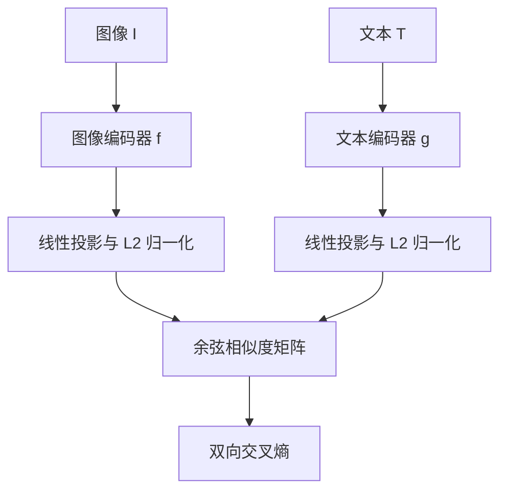

# CLIP 论文超详细解读

> **论文**：Alec Radford 等，*Learning Transferable Visual Models From Natural Language Supervision*，ICML 2021。  
> **模型全称**：Contrastive Language–Image Pre-training（对比式语言—图像预训练）。  
> **原文**：[ICML 论文](https://proceedings.mlr.press/v139/radford21a.html) · [包含更详细正文及附录的 arXiv 版本](https://arxiv.org/pdf/2103.00020) · [官方代码](https://github.com/openai/CLIP)。  
> **阅读建议**：先看第 1、3、5、6 节建立直觉，再看第 4 节推导损失，最后看第 8～12 节理解实验和应用边界。

https://www.bilibili.com/video/BV1xM4m1m7vA/?spm_id_from=333.788.player.switch&vd_source=c9745e4447536b28b2b0735071d30bd6&p=3

https://www.bilibili.com/video/BV1SL4y1s7LQ/?vd_source=5f6bbc1038b075757cb446f800f3cd56

## 目录

1. [一句话与核心问题](#1-一句话与核心问题)
2. [研究背景：为何用自然语言监督](#2-研究背景为何用自然语言监督)
3. [整体框架与训练数据](#3-整体框架与训练数据)
4. [对比学习目标的完整推导](#4-对比学习目标的完整推导)
5. [两个编码器分别做什么](#5-两个编码器分别做什么)
6. [如何做到零样本分类](#6-如何做到零样本分类)
7. [Prompt 设计与集成](#7-prompt-设计与集成)
8. [训练配置与方法选择](#8-训练配置与方法选择)
9. [实验结果与正确解读](#9-实验结果与正确解读)
10. [局限、误解与风险](#10-局限误解与风险)
11. [人形机器人感知中的使用方式](#11-人形机器人感知中的使用方式)
12. [从零实现的伪代码与排错清单](#12-从零实现的伪代码与排错清单)
13. [面试式问答和总结](#13-面试式问答和总结)
14. [原文索引](#14-原文索引)

## 1. 一句话与核心问题

**CLIP 用海量图像—文本配对数据，让图像编码器和文本编码器把匹配内容映射到相近的向量；训练完成后，仅把目标类别写成自然语言，就能构造分类器。**

普通监督分类器的学习过程是：图像 → 特征 → 固定的 `K` 类分类头。假设训练时只规定了“猫、狗、汽车”，要加入“路锥”，通常需要收集路锥标注数据并训练新分类头。CLIP 则把“类别是什么”放进文本输入，例如 `a photo of a traffic cone`。文本编码器生成“路锥”在共享特征空间中的方向，再让图像特征与它比较。

论文要回答两个问题：

1. 能否使用互联网上自然产生的图文配对信息，训练出可迁移的视觉特征？
2. 能否通过语言在推理时指定新任务，在没有该任务标注训练样本的情况下完成分类？

它的答案是“在许多任务上可以做到，并且规模足够大时效果可观”，但**绝不意味着任何文字描述、任意任务、任何场景都能可靠解决**。[1][2]

## 2. 研究背景：为何用自然语言监督

### 2.1 传统分类监督的边界

ImageNet 风格的数据把图片压成一个预先定义的整数类别。标签格式规整，适合训练和评价，但类别集合固定，而且单标签难以表达属性、动作、场景、关系。例如，一张图同时可能包含“人站在蓝色跑道旁，前面有黄色路锥”。只标成“人”或“路锥”会丢掉大量信息。

图文配对中的一句自然语言虽然有噪声、不一定完整，却可能包含对象、颜色、动作、地点和场景。更重要的是，这类数据可以大规模搜集，不要求把每张图片人工映射到一个统一的类别体系。

### 2.2 这里的“监督”是什么意思

CLIP **不是完全无监督**：每个训练样本都提供了“这段文字与这张图片成对”的信号。它也**不是通常意义的逐图人工类别标注**：配对文字来自互联网，内容不受统一类别表约束。因此“自然语言监督”比简单称为“无监督”更精确。

### 2.3 为什么不直接生成 caption

作者首先尝试让模型根据图像预测相应的文字，类似图像描述生成。这个目标要求正确预测具体词序与措辞；同一张图却可以对应很多合理句子。论文中的实验：一个生成式文本 Transformer 在零样本 ImageNet 学习效率上约比词袋预测慢 **3 倍**；从词袋预测换为 CLIP 的图文对比目标，又获得约 **4 倍**的效率提升。这里的倍数是论文设定下的**零样本迁移学习效率比较**，不能解释成任意硬件上的推理吞吐量倍数。[2，第 2.3 节，图 2]

CLIP 把问题简化为：“给定这一批文字，哪一条属于这张图？”这仍迫使模型理解图像与语言的语义关联，却省去了逐词生成。

## 3. 整体框架与训练数据

### 3.1 图文双编码器



图像编码器可以是**改造过的 ResNet** 或 **ViT**；文本编码器是 Transformer。两端各自线性投影到相同的嵌入维度，归一化后做点积。图像与文字之间**没有在编码过程中逐 token 的交叉注意力**；这是双编码器，不是把图文 token 混在一起的融合式模型。正因如此，可以预先计算候选文本特征，反复匹配许多图像。[1，第 2 节][2，第 2.4 节]

### 3.2 WIT：4 亿图文对

作者从多种公开互联网来源收集约 **4 亿（图像，文本）对**，称为 **WIT / WebImageText**。构建时使用约 **50 万查询词**扩大视觉概念覆盖，并对每个查询最多取 **2 万对**，做近似的查询级别平衡。查询来自维基百科中的高频词、部分双词短语、文章标题、WordNet 同义词集等。论文没有公开完整 WIT 数据集，也没有给出可据以逐项复现的全部采集和清洗细节；因此“下载公开 CLIP 权重”和“完整复现原论文数据训练”是两件不同的事。[2，第 2.2 节]

**注意**：50 万查询词不是模型最后的 50 万个固定输出类别；训练目标仍是判断图文配对。每条文字也不必是对图像所有细节的准确、完整描述。数据规模让模型学到广泛概念，同时也引入噪声、偏见和潜在的评测数据重叠。

### 3.3 一个 batch 如何构造正负样本

假设一个 batch 有 `N=4` 对：

| 图像 | 正确文字 | 其余文字在这一行的角色 |
|---|---|---|
| 跑道照片 `I₁` | “a blue running track” `T₁` | `T₂,T₃,T₄` 是 batch 内负例 |
| 路锥照片 `I₂` | “a traffic cone” `T₂` | `T₁,T₃,T₄` 是 batch 内负例 |
| 楼梯照片 `I₃` | “a staircase” `T₃` | `T₁,T₂,T₄` 是 batch 内负例 |
| 垃圾桶照片 `I₄` | “a trash can” `T₄` | `T₁,T₂,T₃` 是 batch 内负例 |

得到 `4×4` 相似度矩阵，对角线是真实配对。一般情况下有 `N` 个对角线正配对、`N²−N` 个矩阵位置代表不匹配配对。**同一张图的多个正确描述如果恰好落在不同配对中，也可能被当成负例**；这是 batch 内负样本机制的潜在“假负例”问题，不代表这些语义相近内容现实中互斥。

## 4. 对比学习目标的完整推导

### 4.1 编码、投影、归一化

设第 `i` 对输入为 `(I_i,T_i)`：

$$
h_i=f_\theta(I_i)\in\mathbb{R}^{d_I},\qquad
r_i=g_\phi(T_i)\in\mathbb{R}^{d_T}.
$$

经可学习的线性投影后：

$$
\tilde v_i=W_I^{\mathsf T}h_i,\quad
\tilde t_i=W_T^{\mathsf T}r_i,\quad
v_i=\frac{\tilde v_i}{\|\tilde v_i\|_2},\quad
t_i=\frac{\tilde t_i}{\|\tilde t_i\|_2}.
$$

其中 `v_i,t_i` 维度相同且长度为 1，因此 `v_iᵀt_j` 就是余弦相似度，范围在 `[-1,1]`。线性投影是可训练的；不能把两个编码器未经处理的输出直接点乘。

### 4.2 相似度矩阵与温度

令温度为 `τ>0`，定义：

$$
S_{ij}=\frac{v_i^{\mathsf T}t_j}{\tau}.
$$

论文伪代码使用等价形式 `S = (V @ T.T) * exp(s)`，其中 `s` 是可学习的**对数尺度**，`exp(s)=1/τ`。训练初始化等价于 `τ=0.07`，限制 logit 缩放系数不超过 100，以防数值不稳定。[2，第 2.3、2.5 节]

温度小意味着 softmax 更尖锐：相似度差异较小时，错误配对也会受到更强的区分压力；温度大则分布更平缓。**温度不是相似度本身，也不是语义阈值。**

### 4.3 图像找文本

对于图像 `I_i`，这一行的 `N` 条文字竞争：

$$
p_{I\to T}(j\mid i)
=\frac{\exp S_{ij}}{\sum_{k=1}^{N}\exp S_{ik}},\qquad
\mathcal L_{I\to T}
=-\frac1N\sum_{i=1}^{N}\log p_{I\to T}(i\mid i).
$$

正确标签是第 `i` 列。这就是对矩阵**每一行**做交叉熵；匹配的对角线相似度应超过该行其他位置。

### 4.4 文本找图像

对于文字 `T_j`，这一列的 `N` 张图像竞争：

$$
p_{T\to I}(i\mid j)
=\frac{\exp S_{ij}}{\sum_{k=1}^{N}\exp S_{kj}},\qquad
\mathcal L_{T\to I}
=-\frac1N\sum_{j=1}^{N}\log p_{T\to I}(j\mid j).
$$

这是对矩阵**每一列**做交叉熵。最后取平均：

$$
\boxed{\mathcal L_{\mathrm{CLIP}}
=\tfrac12(\mathcal L_{I\to T}+\mathcal L_{T\to I})}.
$$

如果只优化图像找文字，文本编码器也会因梯度被更新，但双向目标进一步要求一段文字能够从图像集合里识别它的匹配图像。**“双向”是两个分类方向，不是训练时生成两种模态。**

### 4.5 手算一个 `N=2` 的例子

若 `S=[[4,1],[0,3]]`，图像 1 找文字时正确文字 1 的概率为 `e⁴/(e⁴+e¹)≈0.953`；图像 2 找文字时正确文字 2 的概率为 `e³/(e⁰+e³)≈0.953`。文字 1 找图像时概率为 `e⁴/(e⁴+e⁰)≈0.982`；文字 2 找图像时概率为 `e³/(e¹+e³)≈0.881`。四项负对数概率平均约为 **0.061**。优化时模型同时拉高两个对角值相对各自行列的优势。

### 4.6 从梯度看为什么它能学到语义

单个图像方向损失对 `S_ij` 的梯度为：

$$
\frac{\partial\mathcal L_{I\to T}}{\partial S_{ij}}
=\frac1N\big[p_{I\to T}(j\mid i)-\mathbf1(i=j)\big].
$$

对角线如果预测概率不足，梯度驱动其相似度上升；非对角线如果分数过高，梯度驱动其下降。文本方向同理。梯度经过归一化向量、投影层和两个编码器，让两个模态逐渐形成可比较的表征。它学到的是**有助于区分图文对应关系**的视觉语义，不自动保证精确计数、像素边界、三维几何或因果理解。

## 5. 两个编码器分别做什么

### 5.1 图像端：ResNet 版

作者选用 ResNet-50 / 101，并训练 RN50x4、RN50x16、RN50x64。相比原始 ResNet，论文采用 ResNet-D 式改动、抗混叠 blur pooling，并把末端全局平均池化改为**注意力池化**：先由全局平均特征形成 query，再对空间特征做单层多头 QKV 注意力，输出整张图片的向量。注意力池化**不等于输出像素级注意力图或分割 mask**。[2，第 2.4 节]

### 5.2 图像端：ViT 版

模型包括 ViT-B/32、ViT-B/16、ViT-L/14。`/32`、`/16`、`/14` 表示 patch 边长；以 `224×224` 输入为例，ViT-B/16 有 `(224/16)^2=196` 个图像 patch token，再加 CLS token。ViT 编码后取整图表示并投影到图文共享空间。CLIP 的 ViT 在 patch 加位置编码后增加了一次 LayerNorm，并采用略不同的初始化。论文的最大模型 ViT-L/14 在 336 像素分辨率额外训练一轮，记作 `ViT-L/14@336px`。[2，第 2.4～2.5 节]

**区分 ViT 分类与 CLIP**：ViT 通常把 CLS 输出送入固定类别分类头；CLIP 用整图向量与文本向量匹配。使用 ViT 作为图像编码器，并不意味着把图像 patch 与文本 token 放入一个 Transformer 联合注意力。

### 5.3 文本端

论文基础文本编码器是约 **6300 万参数**、**12 层**、隐藏宽度 **512**、**8 个注意力头**的 Transformer。文本经小写 BPE 切词，词表大小 **49,152**；序列以 `[SOS]` 开始、`[EOS]` 结束，取最后一层 `[EOS]` 位置的激活，再 LayerNorm 和线性投影。采用因果 mask 的自注意力，目的是保留可能加入语言建模目标的空间；**原论文训练 CLIP 的主要目标仍是图文对比损失**，并没有把语言建模辅助目标实现为核心方法。[2，第 2.4 节]

论文说文本最大长度限制为 76；官方 `clip.tokenize` 接口暴露的 `context_length` 默认是 **77**，讨论长度时应注明是正文序列、特殊 token 还是实现中的总上下文长度，不能把它们直接混为一谈。[2，第 2.4 节][3]

## 6. 如何做到零样本分类

### 6.1 把类名变成可编码的文本

假设目标类别为 `C={路锥, 垃圾桶, 台阶, 行人}`。构造英文描述，例如：

```text
a photo of a traffic cone
a photo of a trash can
a photo of stairs
a photo of a pedestrian
```

文本编码器产生归一化原型 `t₁,…,t_K`；测试图像产生 `v`，于是：

$$
z_k=\frac{v^{\mathsf T}t_k}{\tau},\qquad
\hat k=\arg\max_{k\in\{1,\ldots,K\}}z_k.
$$

`softmax(z)` 可得**在这一组候选文本之内**的相对选择概率。若候选只有“路锥”和“垃圾桶”，一张完全无关的墙面仍会被强制选成其中之一；softmax 的高值不能直接当作“图中一定有该物”的可校准置信度。

### 6.2 为何可称“文本生成分类器”

传统线性分类器的类别权重矩阵 `W=[w₁,…,w_K]` 从目标任务标注图像学习；CLIP 中 `W=[t₁,…,t_K]` 由目标类别文字经过**已训练好的文本编码器**生成。对固定候选集，这仍是对图像向量进行点积的线性分类；变化的是**权重的产生方式**。[1，图 1][2，第 3.1 节]

### 6.3 “零样本”的精确定义

论文这里的零样本是：**不在目标数据集的标注训练样本上更新 CLIP 参数或拟合分类头**，直接用类别名称或描述测试。这不意味着模型从未在互联网见过“dog”等概念，也不保证预训练数据和所有测试图像完全没有重叠。论文还承认模型开发过程中使用验证集反馈指导选择，这与严格“从未接触目标任务”的情形有差距。[2，第 5～6 节]

### 6.4 与图文检索的关系

给定一张图片，在许多句子中找最相近者，是**图搜文**；给定一句文字，在许多图片中找最相近者，是**文搜图**；用每个类别的一条或多条文本模板组成固定候选集，是**零样本分类**。三者依赖相同的特征空间，但**排名分数不等于对真实世界事件的绝对概率**。

## 7. Prompt 设计与集成

### 7.1 类名为何不够

单词有歧义：`crane` 可以是起重机或鹤，`boxer` 可以是拳击手或犬种。并且预训练文字通常是一段描述，而不是单独一个类别词。作者发现默认模板 `A photo of a {label}.` 能缓解这种分布差异；单用这条模板，相对裸类名使 ImageNet 准确率提升 **1.3 个百分点**。[2，第 3.1.4 节]

### 7.2 加入任务上下文

细粒度宠物可写 `A photo of a {label}, a type of pet.`；卫星图像可写 `a satellite photo of a {label}`；OCR 任务中给要识别的字符加引号会更合适。这里的 prompt 是**目标类别的文本表示**，和聊天模型中要求逐步执行复杂指令的 prompt 不应直接等同。[2，第 3.1.4 节]

### 7.3 文本特征集成

给类别 `c` 写 `M` 个描述模板，分别编码得到 `u_c^(1),…,u_c^(M)`，可先归一化、平均并再归一化，形成一个类别向量：

$$
\bar t_c=\operatorname{normalize}\left(
\frac1M\sum_{m=1}^M\operatorname{normalize}(g(P_m(c)))
\right).
$$

实现细节以所用权重库为准。**论文强调在嵌入空间进行集成**，而不是在每次图像推理时把若干 softmax 概率再平均；缓存好文本类别向量后，可反复用于图像推理。ImageNet 上使用 **80 个模板**，相比单一默认模板再提升约 **3.5 个百分点**；合计相比裸类名接近 **5 个百分点**。在论文所绘制的 36 个数据集上，prompt 与集成平均提升也接近 5 个百分点。这些都是对应比较设置下的数值，不代表任何自定义场景保证同样增益。[2，第 3.1.4 节，图 4]

## 8. 训练配置与方法选择

| 项目 | 论文设置或结论 |
|---|---|
| 预训练数据 | WIT，约 4 亿图文对；从随机初始化开始训练 |
| 模型族 | 5 个 ResNet 图像编码器 + 3 个 ViT 图像编码器 |
| 主要目标 | `N×N` 图文相似度矩阵上的双向交叉熵 |
| batch size | 32,768 对图文；大 batch 提供许多 batch 内负配对 |
| 训练轮数 | 每个主体模型 32 epochs；ViT-L/14 额外在 336px 训练 1 epoch |
| 优化 | Adam + 解耦权重衰减；余弦学习率衰减 |
| 温度 | 从等价 `τ=0.07` 初始化；限制缩放系数不超过 100 |
| 图像增强 | 训练中采用从缩放图像中随机裁剪方形区域的简化方案 |
| 工程加速 | 混合精度、梯度检查点、部分半精度状态及分片的相似度计算 |
| 最大模型训练成本 | RN50x64：592 张 V100，18 天；最大 ViT：256 张 V100，12 天 |

以上记录的是**原论文大规模训练配置**，不是使用预训练 CLIP 做推理必须具备的硬件。主体论文默认报告的“CLIP”通常指效果最好的 `ViT-L/14@336px`，与常见开源示例 `ViT-B/32` 不是同一模型。[2，第 2.5 节]

### 为什么大 batch 有帮助，也有代价

`N=32,768` 时，每个图像在所在 batch 中有 `32,767` 个其他文本候选。但若完整物化 `N×N` FP32 矩阵，其元素数超过 10 亿，单矩阵约 **4 GiB**（`32768²×4` 字节），还未计激活、梯度与优化器状态。论文通过分片计算等手段控制显存。**从公式看出大 batch 有更多负配对，不能据此推断每个负配对都是独立且准确的真负例。**

## 9. 实验结果与正确解读

### 9.1 与更早的零样本方法比较

论文表 1：

| 数据集 | Visual N-Grams | 最佳 CLIP | 解读 |
|---|---:|---:|---|
| aYahoo | 72.4% | **98.4%** | 零样本分类比较 |
| ImageNet | 11.5% | **76.2%** | 最佳模型的 ImageNet top-1 |
| SUN | 23.0% | **58.5%** | 场景识别迁移 |

作者明确指出两者相隔多年，数据、模型等多种条件并未完全控制。`76.2%` 与经典**有监督 ResNet-50** 的 ImageNet top-1 相当，但不能理解为“CLIP 在所有任务上超越当时最强有监督模型”。这项零样本结果也没有使用 ImageNet 的 **128 万张训练图片的人工类别标签**；模型仍使用了大规模网络图文数据。[1，摘要][2，表 1]

### 9.2 跨任务表现有明显差异

在 27 数据集的比较中，零样本 CLIP 相对**在 ResNet-50 特征上训练的有监督线性分类器**赢了 **16 个**。例如 STL-10 达到 **99.3%**。在 Stanford Cars、Food101 上优势较明显；在 EuroSAT、KITTI Distance、PatchCamelyon、GTSRB、CLEVRCounts、FGVC Aircraft 等任务上可能明显落后。Kinetics700 和 UCF101 的动作识别也显示出语言监督对动词等概念的价值。**各数据集任务、指标和基线不同，不能把单个数据集的差值外推到所有视觉问题。**[2，第 3.1.5 节]

### 9.3 零样本与少样本

作者在有足够样本的 20 个数据集上比较发现：零样本 CLIP 的平均表现与**相同 CLIP 特征上的每类 4 样本线性分类器**相近；与其他公开模型的强 16-shot 基线也接近。语言能直接指定想学的概念，而仅一两张图片往往同时含有多种可能特征。但这不是“0 个样本严格等同于任意模型的 4-shot”，也不是每个任务都成立。[2，第 3.1.6 节]

### 9.4 线性探测区分“表征”和“任务接口”

**Linear probe**：冻结视觉编码器，只用目标数据集的标注样本训练一个线性分类层。它测视觉特征可分性；零样本文本分类更侧重测“通过自然语言调用任务”的能力。论文发现：在 12 数据集的线性探测评估中最大 CLIP 模型相对最强对照平均高约 **2.6 个百分点**；在更广的 27 数据集评估中约高 **5 个百分点**。在论文比较条件下，CLIP ViT 相比 CLIP ResNet 的**计算效率**约高 3 倍。[1，第 3.3 节][2，第 3.2 节]

### 9.5 自然分布偏移下的鲁棒性

论文图 7 把 ImageNet 准确率同为 **76.2%** 的有监督 ResNet-101 与零样本 CLIP 比较：

| 测试集 | ResNet-101 | 零样本 CLIP | 差值 |
|---|---:|---:|---:|
| ImageNet | 76.2 | 76.2 | 0.0 个百分点 |
| ImageNetV2 | 64.3 | 70.1 | +5.8 |
| ImageNet-R | 37.7 | 88.9 | +51.2 |
| ObjectNet | 32.6 | 72.3 | +39.7 |
| ImageNet Sketch | 25.2 | 60.2 | +35.0 |
| ImageNet-A | 2.7 | 77.1 | +74.4 |

**读表条件很重要**：图中某些测试使用了与数据集相适配的类别子集、标签映射及零样本文本设置；不要把上表当作所有公开 ImageNet-A / R 设置下均可复现的通用 CLIP 准确率。论文讨论的是控制原始 ImageNet 准确率后的自然分布偏移表现，并分析在 ImageNet 上适配可能损失部分相对鲁棒性；这不等于它能抵御所有传感器噪声、天气变化或故意攻击。[1，第 3.4 节，图 7][2，第 3.3 节]

### 9.6 预训练数据与评测集重叠

作者在 **35 个**数据集上检测潜在重复：**9 个**未检出重叠；检出的重叠比例中位数 **2.2%**、平均 **3.2%**；估计对整体准确率的影响通常不超过 **0.1 个百分点**，最大检测到的提升为 Birdsnap 上 **0.6 个百分点**。这是基于论文中的重复检测和阈值方法得到的估计；“未检出”不等于数学上证明完全无重叠。[1，第 4 节][2，第 5 节]

## 10. 局限、误解与风险

### 10.1 哪些能力不能直接推出

| 常见说法 | 更准确的理解 |
|---|---|
| “CLIP 识别任何类别” | 候选概念仍受预训练覆盖、图像质量、文本措辞和目标领域影响。 |
| “得分高就一定存在” | softmax 在当前候选集里归一化；需要额外设计开放集拒识及阈值验证。 |
| “CLIP 自带检测框和分割 mask” | 原模型产出整图向量；定位、分割需增加区域候选、密集特征、专门解码器或其他模型。 |
| “零样本等于预训练没见过这些词” | 零样本指目标任务没有标注训练步骤；海量图文预训练可含相关概念。 |
| “它理解句子所有细节” | 图文匹配目标可能更看重显著名词与整体场景，对数量、空间关系和细粒度差别并不可靠。 |
| “ImageNet 76.2% 是 ViT-B/32 的结果” | 原论文代表性最佳值属于 ViT-L/14@336px；换型号要重新测。 |

### 10.2 论文自己讨论的弱项

细粒度类型、计数、距离估计、专业医学图像、卫星图像、交通标志等任务会弱；自然语言也难以完全指定某些复杂任务。论文还指出，目标验证集曾参与模型选择反馈；从零样本换为传统少样本线性分类器可能出现**少量标注反而使表现下降**的现象。大规模数据和算力成本显著，论文当时估计要靠简单扩大算力达到其综合评估上的最优水平，成本可能极高。[1，第 6 节][2，第 6 节]

### 10.3 数据偏见、标签集合与部署责任

网络图文数据可能携带社会偏见。模型预测不仅依赖图片，也强烈依赖候选标签如何写、是否添加备选类别。论文在人像分类实验中观察到，增加一个“child”候选会显著改变某些不恰当类别的归类比例。不能把任意文本分类结果当作对人的可信判断；涉及人员身份和敏感属性的应用需独立评估。[1，第 5 节][2，第 7 节]

## 11. 人形机器人感知中的使用方式

> 本节是基于论文机制的**工程推断与建议**，不是原论文在机器人巡检或跑道场景的实测结论。

对于“蓝色跑道、路锥、垃圾桶、楼梯、可通行区域”等开放类别，CLIP 值得用作**语义候选筛选和标注辅助**，而不是直接作为唯一的避障安全判据。原模型比较整张图片与句子，不能可靠提供障碍边界、自由空间几何或停止距离。

一条可验证的落地链路：

1. **定义任务与候选词**：明确相机视角与环境，写互斥程度较高的描述，例如 `a traffic cone on a blue running track`、`a trash can near a walkway`、`an empty blue running track`；加“其他/背景”的多种负例描述，避免只有两个不完整候选。
2. **先建立场景数据集**：采集不同光照、远近、逆光、运动模糊和遮挡；保留训练/验证/测试的拍摄时段或场地隔离。不要只看公开 ImageNet 准确率。
3. **在具体图像区域上匹配**：用已有检测器或候选框截取区域，再算 CLIP 匹配；若任务是语义/实例分割，需采用具备密集预测能力的结构并单独验证 mask 质量。
4. **融合深度或雷达**：用 D435i、Mid-360 的几何测量确定高度、距离、占用与可通行性；把 CLIP 分数视为一个可解释的语义线索。
5. **明确延迟预算**：图片编码通常是在线成本；固定候选文本特征可离线缓存。不要拿 ViT-L/14@336px 的论文精度直接推断 RK3588 或 i9 的 FPS，需按模型、精度、预处理与硬件实测。
6. **评价该用的指标**：物体候选分类用每类召回率和误报率；检测看 mAP、距离分层召回；分割看 mIoU / mask AP；避障看漏障率、最小可检测距离、误停率和端到端时延。

如果最终任务是**可通行区域分割**，CLIP 可以提供语义先验或协助数据标注，最终仍应评测一个像素级输出模型与几何约束。若要比较中文和英文 prompt，须在同一套机器人现场数据上分别测量；原 CLIP 的论文和模型卡主要围绕英语，不能默认中文描述具有同等效果。[3][4]

## 12. 从零实现的伪代码与排错清单

下面的 PyTorch 代码展示**核心损失**；`image_encoder`、`text_encoder`、投影层、数据加载与分布式训练未展开：

```python
import torch
import torch.nn.functional as F

def clip_loss(image_features, text_features, logit_scale_log):
    # [N, D]；投影到同维度应已在调用前完成
    image_features = F.normalize(image_features, dim=-1)
    text_features = F.normalize(text_features, dim=-1)

    # logit_scale_log = log(1 / tau)，论文训练限制 scale <= 100
    scale = logit_scale_log.exp().clamp(max=100)
    logits_per_image = scale * image_features @ text_features.T
    labels = torch.arange(logits_per_image.shape[0], device=logits_per_image.device)

    loss_image = F.cross_entropy(logits_per_image, labels)      # 每行：图找文
    loss_text = F.cross_entropy(logits_per_image.T, labels)    # 每列：文找图
    return (loss_image + loss_text) / 2
```

分布式训练时，若希望负例来自**全局 batch**，需要正确聚合各设备特征并处理梯度、全局配对索引及跨卡通信；直接对每张卡各自的本地 batch 算损失，训练目标与全局 `N=32768` 的论文设置不同。若一图对应多条正确文字，普通对角线标签会把其他正确配对视为负例，应改造目标或采样方式。

简化的零样本分类：

```python
# 已有一个 image_features: [B, D]，和每类预计算的 text_features: [K, D]
image_features = F.normalize(image_features, dim=-1)
text_features = F.normalize(text_features, dim=-1)
logits = scale * image_features @ text_features.T       # [B, K]
pred = logits.argmax(dim=-1)
relative_probs = logits.softmax(dim=-1)                 # 仅在 K 个候选内归一化
```

**易错点**：`F.cross_entropy(logits, labels)` 默认第二维是类别；图→文喂 `S`，文→图喂 `S.T`；两端都要归一化；候选文本必须与推理任务吻合；CLIP 的图像预处理与所选权重要匹配；全图分类结果不能画成检测框；缺少“无目标”校验时不要把二分类 softmax 当检测置信度。[2，图 3][3]

## 13. 面试式问答和总结

**Q1：CLIP 为什么能“认识”训练类别表以外的词？** 训练任务从来不是预测一个固定整数标签，而是学习图像与配对文字在共同向量空间中的对应。新类别只要能写成可编码的文本，就可以产生新的候选向量；结果好坏仍取决于预训练覆盖和领域差异。

**Q2：两个 Transformer 之间有没有交叉注意力？** 原 CLIP 双编码器各自编码，之后在向量空间点积；图像编码器也可能是 ResNet。其优势是图像、文字可分别缓存并检索，代价是缺少细粒度跨模态交互。

**Q3：为什么要两个方向的交叉熵？** 同时使图像在候选文字中找正确文本，使文字在候选图像中找正确图像，约束矩阵行与列的匹配排名。

**Q4：为什么模板会明显影响精度？** 裸类名既有歧义，也与预训练中的完整图像描述分布不同。上下文补充了图像类型和类别含义，多模板平均可降低单一措辞的偶然性。

**Q5：这篇论文与 ViT 论文最关键的区别？** ViT 说明纯 Transformer 图像编码器可用于图像识别；CLIP 研究使用自然语言图文配对预训练、通过文字构建零样本任务接口，且其图像编码器可选 ResNet 或 ViT。

**最终记忆版**：

$$
\text{海量图文对}\longrightarrow
\text{双编码器 + 单位向量 + }N\!\times\!N\text{ 相似度}
\longrightarrow\text{双向交叉熵}
\longrightarrow\text{文字生成类别原型}
\longrightarrow\text{零样本匹配}.
$$

CLIP 的关键贡献不只是“换了一个图像 backbone”，而是证明大规模自然语言监督和高效图文对比训练能够得到可迁移的视觉表征，并让语言成为可复用的任务指定接口。[1][2]

## 14. 原文索引

- **[1] ICML/PMLR 正式论文**：[论文页](https://proceedings.mlr.press/v139/radford21a.html)、[PDF](https://proceedings.mlr.press/v139/radford21a/radford21a.pdf)。重点：第 2 节方法，第 3 节实验，第 4 节重叠，第 5～6 节影响与局限。
- **[2] arXiv 完整版**：[PDF，含扩展正文与附录](https://arxiv.org/pdf/2103.00020)。重点：第 2.2～2.5 节数据/架构/训练，第 3.1.4 节 prompt，第 3.1.5～3.1.6 节零样本与少样本，附录中的具体评估设置。
- **[3] OpenAI 官方实现**：[openai/CLIP](https://github.com/openai/CLIP)，[README](https://github.com/openai/CLIP/blob/main/README.md)，[prompts](https://github.com/openai/CLIP/blob/main/data/prompts.md)。
- **[4] OpenAI 模型卡**：[CLIP model card](https://github.com/openai/CLIP/blob/main/model-card.md)。说明模型用途与限制，特别是语言和部署边界。

> 文中的手算示例、梯度解释、假负例分析和第 11 节工程方案是依据原文目标做的教学推导或应用推断；具体百分比与训练配置标注了对应论文来源。
