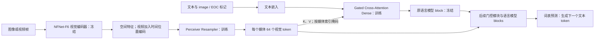
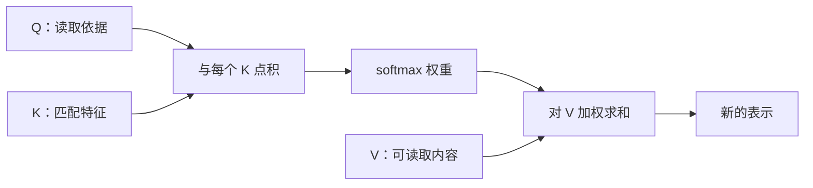
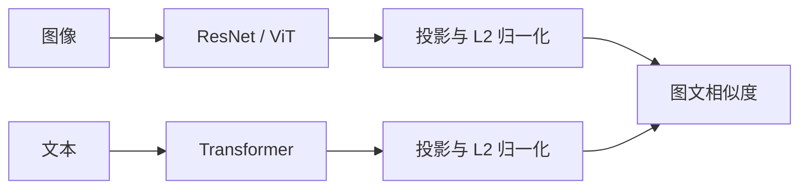
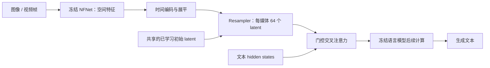

# Flamingo 论文精读：从视觉特征到多模态上下文学习

> **论文**：Jean-Baptiste Alayrac、Jeff Donahue、Pauline Luc、Antoine Miech 等，*Flamingo: a Visual Language Model for Few-Shot Learning*。  
> **出处**：NeurIPS 2022 · DeepMind · arXiv [`2204.14198`][arxiv]。  
> **版本**：首次提交 2022-04-29；精读 arXiv v2（2022-11-15，54 页，含附录），图表与页码均按该版本。  
> **原文**：[完整 PDF][paper] · [NeurIPS 记录][neurips] · [会议正文][conference-paper] · [补充材料][supplement]。  
> **整理日期**：初稿 2026-10-08；结构重整 2026-10-09。[重整前完整版本](flamingo.2026-10-08.before-reorganization.md)保留原精读、追问和勘误记录。  
> **证据约定**：模型方法、配置与结果来自原论文；数字小例子、类比、公式推导与伪代码属于教学展开；VLM / VLN 启示标为个人分析。本项目尚未复现，不根据跨设置的论文分数判定路线优劣。

本文沿着一次模型计算展开：先明确输入包含什么，再看像素怎样成为特征、attention 怎样读取特征、Resampler 怎样生成视觉 latent，以及语言模型怎样使用它们。理解前向过程后，再讨论这些模块怎样训练、怎样少样本推理，以及论文用什么实验证据支持设计。

## 0. 论文条目与阅读路线

### Flamingo · 《Flamingo: a Visual Language Model for Few-Shot Learning》

- **出处**：arXiv `2204.14198` · NeurIPS 2022 · DeepMind。
- **一句话**：冻结预训练视觉编码器与语言模型，训练视觉重采样器和门控交叉注意力，使同一个模型能够根据少量图文示例，完成图像 / 视频问答、描述生成等任务。
- **方法**：① NFNet-F6 提取空间视觉特征；② Perceiver Resampler 将每张图像或每段视频转为 64 个视觉 token；③ 在冻结的语言模型内部插入 Gated Cross-Attention Dense 模块；④ 通过视觉注意力掩码处理图文交错输入；⑤ 混合网页图文、图文对和视频文本对，以条件语言建模训练，推理时进行上下文学习。
- **关键结论**：作者报告模型能在多项图像与视频任务上进行少样本迁移；交错网页数据、冻结预训练骨干、重采样器和门控连接均有消融支持。较大模型和更多示例总体有帮助，但并非所有任务都单调改善。实验适用范围与比较口径见第 11 节。[§3，表 1、3、10][paper]
- **局限**：继承语言模型的幻觉与长上下文问题；对提示示例敏感；分类表现不总是优于对比模型；训练成本高，原始训练代码和数据为专有资产；论文未验证导航闭环控制能力。
- **对本方向的启示（个人分析）**：重点学习视觉信息如何在不更新语言模型原有权重的情况下进入中间层，以及如何组织多帧、多图输入；将其用于 VLN 时，需要另行验证空间记忆、动作预测和实时性。

**首次阅读**：依次读 1～8，建立完整的信息流；再读 9～11，理解训练、推理和实验证据。已熟悉 attention、ViT、CLIP 时，可略读第 5 节。

| 阅读目标 | 章节 |
|---|---|
| 明确论文问题与输入 | [1. 问题与思路](#motivation)、[2. 上下文与符号](#inputs) |
| 理解架构全貌与冻结范围 | [3. 整体架构](#architecture) |
| 跟踪视觉支路 | [4. NFNet 与时空特征](#vision)、[5. attention 基础](#attention)、[6. Resampler](#resampler) |
| 理解文本怎样读取视觉 | [7. 门控交叉注意力](#fusion)、[8. 媒体关联与 mask](#media-mask) |
| 区分学习与使用 | [9. 训练](#training)、[10. 推理与完整示例](#inference) |
| 核对贡献与证据 | [11. 实验与消融](#evidence)、[12. 与相关工作比较及局限](#discussion) |
| 联系研究方向 | [13. VLM / VLN 启示](#vln) |
| 查 shape、实现、原文与勘误 | [附录 A](#implementation)、[附录 B](#figures)、[附录 C](#corrections)、[附录 D](#sources) |

<a id="motivation"></a>

## 1. 研究问题：怎样让视觉语言模型通过少量示例适应任务

<a id="section-1-1"></a>

### 1.1 从图文匹配走向条件文本生成

CLIP 的典型操作是给定一张图像和若干候选文本，比较它们的相似度。它可以通过类别描述进行零样本分类，但其基本接口不负责逐词生成一段新答案。

Flamingo 关注的是：**能否给模型少量图像 / 视频与输出示例，就让它按示例格式完成新任务，而无需为每个任务重新更新模型参数？**

例如，同一个模型可以接收以下不同任务格式：

| 任务 | 给模型的条件 | 希望生成或选择的结果 |
|---|---|---|
| 图像描述 | 图像及若干描述示例 | 一段描述 |
| 视觉问答 | 图像、问题、若干问答示例 | 自由文本答案 |
| 视频问答 | 视频帧、问题、示例 | 关于事件的答案 |
| 多选问答 | 视觉输入、问题、候选答案 | 条件概率最高的答案 |
| 视觉对话 | 图像和已有对话文本 | 下一轮回答 |

这要求模型既有视觉输入能力，又有文本生成能力，还能理解上下文中“这次任务要怎么回答”。[论文 §1、§2.5][paper]

<a id="section-1-2"></a>

### 1.2 少样本适应不等于只用少量数据训练

在“预训练 → 每个任务单独微调”的流程中，新任务通常还需要标注数据、梯度更新、超参数选择和相应模型管理。Flamingo 的主评测改为在推理上下文中放入 support examples，然后预测 query 的输出。

需要区分两个时间尺度：

- **模型构建阶段**：依然经历大规模预训练，计算和数据成本很高。
- **新任务适应阶段**：主实验通过上下文示例适应，无需梯度更新。

因此，“少样本”指目标任务适应时使用的示例数量，不能理解为整个模型只见过几十张图片。

<a id="section-1-3"></a>

### 1.3 三个设计问题与对应思路

1. **表示接口**：分辨率、帧数不同，视觉特征长度会变，怎样提供稳定且可控的输入规模？
2. **融合接口**：怎样让已经预训练好的语言模型读取视觉信息，同时保留其语言能力？
3. **序列接口**：多个图像 / 视频与文本交错时，每个文本位置应该看哪些视觉信息？

论文分别用 Perceiver Resampler、Gated Cross-Attention Dense、按图像 / 视频选择的 attention mask 回答这些问题。

这三个问题对应下文的三个核心模块：第 6 节控制视觉表示数量，第 7 节把视觉接入语言模型，第 8 节确定文本与媒体的对应关系。先从它们共同处理的输入开始。

<a id="inputs"></a>

## 2. 先读懂输入：上下文、媒体、帧和文本 token

<a id="section-2-1"></a>

### 2.1 一条上下文可以包含多张图和多段视频

**上下文（context）是模型预测当前答案时可使用的整段输入。** 在 Flamingo 中，它可以交错包含文本、图像、视频，以及若干示例问答。“上下文”不是一种与“视频”并列的媒体类型；视频可以是上下文中的一部分。

例如以下内容共同构成一条上下文：

```text
图像 A：一只猫。     文本示例：这是一只猫。
图像 B：一只狗。     文本示例：这是一只狗。
图像 C：一只兔子。   待补全文本：这是……
```

这里有三个媒体，前两个是带答案示例，第三个是待回答输入。因此 `M=3`，但示例数量是 2-shot。媒体数不一定等于 shot 数，尤其一个示例本身还可能含多个媒体。

<a id="section-2-2"></a>

### 2.2 张量维度分别表示什么

| 符号 | 含义 | 需要避免的误解 |
|---|---|---|
| `B` | batch 中独立上下文 / 样本的数量 | 不是一条上下文中的图片数 |
| `M` | 一条上下文中的媒体数，一张图或一段视频各算一个 | 一段视频的每一帧不自动算一个媒体 |
| `T` | 一段视频实际送进模型的采样帧数；图像视为 `T=1` | 不是秒数，也不一定等于原视频总帧数 |
| `H,W` | 输入帧的像素高度、宽度 | 不等于末端特征网格尺寸 |
| `H_f,W_f` | 视觉编码器输出网格的高、宽 | 通常比原图小 |
| `S=H_fW_f` | 每帧的空间特征向量数 | 不是物体数量 |
| `N=T×S` | 一个媒体展开后的视觉向量数 | 不是最终 latent 数 |
| `R=64` | Resampler 每个媒体输出的 latent 数 | 不是每帧都输出 64 个供 LM 使用 |
| `D_v,D_r,D_l` | 视觉特征、latent、语言 hidden state 的向量维度 | 不要求全部相同 |
| `L` | 文本序列中的 token 数 | 通常不等于字数或单词数 |

因此：

```text
[B,T,3,H,W]       每个样本一个视频时的简写
[B,M,T,3,H,W]     显式写出每条上下文的媒体维度
```

真实 batch 中，不同上下文的媒体数、不同视频的帧数可能不等长；具体实现需要分组处理，或补齐并配合有效性掩码。上式是讲解信息层级的统一写法，不要求所有原始输入天然一样长。

补充记号：`D_r=1536`；`D_l` 随语言骨干规模变化；`h` 为注意力头数，`d_h` 为每头维度；词表大小写作 `V_vocab`，避免与 attention 的 Value 矩阵 `V` 混淆。`φ(ℓ)` 表示文本位置 ℓ 关联的媒体，0 表示无可用媒体。

对于 `[B,N,D]`，`N` 表示每个样本有多少个向量，`D` 表示每个向量有多少个数。序列长度与向量宽度是两个不同的轴，后文会分别跟踪它们。

<a id="section-2-3"></a>

### 2.3 图文如何交错成输入

以下为教学示例，图片存放在独立视觉张量中，文本中的 `<image>` 只标记位置：

```text
<BOS>
<image> Question: What color is the chair? Answer: red <EOC>
<image> Question: What color is the car? Answer: blue <EOC>
<image> Question: What color is the door? Answer:
```

前两组是示例，最后一组是待回答 query。`<EOC>` 表示一个 chunk 的结束，论文将它加入词表并学习；生成时可用它作为当前回答的结束标记。[§2.4，附录 A.2，图 7～8][paper]

<a id="section-2-4"></a>

### 2.4 文本 token、视觉 token 与学习阶段

这里先把 attention 理解为一次按权重读取信息：Q 是查询，K 提供匹配依据，V 提供读取内容。第 5 节会从数字例子展开计算。

- **文本 token**：分词器产生的词片段或特殊符号，有词表 ID。
- **视觉 token**：连续特征向量，没有“猫”“椅子”等固定词表含义。
- **Self-attention**：Q、K、V 来自同一路序列，语言模型用它处理已有文本上下文。
- **Cross-attention**：Q 与 K、V 来自不同序列，Flamingo 用它让语言特征读取视觉特征。

不要把“64 个视觉 token”解释为检测出 64 个物体，也不要把 `<image>` 标记解释为图片像素本身。

| 概念 | 是否更新参数 | 在本文中的含义 |
|---|---|---|
| 多模态预训练 | 是 | 学习视觉和语言之间的连接 |
| In-context learning（上下文学习） | 否 | 将任务示例放进输入上下文，改变模型的条件预测 |
| Task-specific fine-tuning（任务微调） | 是 | 使用目标任务数据进一步更新允许训练的模块 |

Few-shot 只说明示例少，不自动说明是否更新参数。Flamingo 的主要 few-shot 结果特指 in-context few-shot learning。

接下来可以把输入看成三份相互配合的信息：媒体像素、文本 token、媒体在文本中的位置。架构需要同时处理它们，但三者走的计算路径不同。

<a id="architecture"></a>

## 3. 整体架构：冻结两个骨干，训练视觉与语言的连接

<a id="section-3-1"></a>

### 3.1 先看模块与信息流



**论文事实**：视觉骨干是 NFNet-F6；语言骨干来自 Chinchilla 系列。原始骨干冻结，新加入的 Resampler 和 Gated Cross-Attention Dense 从头训练。各模型的插入频率不同，并非都在每一个语言层前插入。[§2.1～2.2，图 3～4，表 5][paper]

<a id="section-3-2"></a>

### 3.2 视觉内容、文本和媒体索引各走哪条路

视觉内容走“视觉编码器 → Resampler → cross-attention 的 K、V”；文本走“embedding → 新增融合模块与原语言模型 blocks → 词表输出”。

`<image>` 标记告诉系统媒体在交错序列中的位置，用于建立文本和视觉之间的对应关系。真正的视觉内容在另一组连续特征里，由 cross-attention 读取。因而不能把原始 Flamingo 简化成“把所有视觉向量直接拼接到文本 embedding 前面”。

模型输出的是下一个文本 token 的概率分布，连续自回归预测后得到答案。它不需要为每个问答任务重新定义一套固定答案分类头；但在封闭候选任务中，可以给每个候选答案计算条件对数似然，再进行排序。

<a id="section-3-3"></a>

### 3.3 3B、9B、80B 的组件规模

下表整理原论文表 5，单位 B 为十亿参数，M 为百万参数：

| 模型 | 冻结 LM | 冻结视觉骨干 | 可训练 Gated XAttn-Dense | 可训练 Resampler | 总参数约数 |
|---|---:|---:|---:|---:|---:|
| Flamingo-3B | 1.4B | 435M | 1.2B | 194M | 3.2B |
| Flamingo-9B | 7.1B | 435M | 1.6B | 194M | 9.3B |
| Flamingo-80B | 70B | 435M | 10B | 194M | 80B |

各项为论文四舍五入值，不能要求加总与命名严格相等。依据这些约数，可训练参数占比分别约为 **44%、19%、13%**。这是一项算术整理，不是论文新增实验。

所以“仅训练少量胶水层”在功能上容易理解，却容易误导计算预算：80B 模型的新模块仍约有百亿级参数；3B 的可训练占比也相当可观。不能统一写为“只训练总参数的四分之一”。

此处“冻结”指主要多模态预训练与 few-shot 使用路径；论文额外的任务微调会解冻视觉骨干，见第 10.6 节。模块参数固定并不意味着中间表示固定，语言侧如何利用变化后的表示将在第 7 节展开。

<a id="vision"></a>

## 4. 视觉编码器：像素如何变成可读取的时空特征

<a id="section-4-1"></a>

### 4.1 NFNet-F6 的来源、结构与预训练

NFNet 来自 Brock 等人的 **《High-Performance Large-Scale Image Recognition Without Normalization》**，ICML 2021，arXiv [`2102.06171`][nfnet-arxiv]，首次发布于 2021-02-11。Flamingo 使用其中的 **NFNet-F6**；`F6` 是模型规模配置名，不表示只有六层。[NFNet 论文][nfnet-paper]

NFNet 属于卷积残差网络家族，可以沿着 ResNet 的结构思路理解：


其中最后的池化与任务头用于原本的整体图像预测；Flamingo 需要的是仍保留空间位置的特征。

官方 NFNet 实现的 Stem 包含四个 `3×3` 卷积，步长依次为 `2、1、1、2`。主体逐阶段降低空间分辨率、增加表示能力。一个残差块可简写为：

```text
输入 ──────────────────────────────────────────────┐
  → 缩放与激活 → 1×1 卷积 → 3×3 分组卷积            │
  → 3×3 分组卷积 → 1×1 卷积 → SE 通道重标定         │
  → 残差分支缩放 ─────────────────────────────────→ 相加
```

这是省略部分激活、随机深度等细节的结构示意；发生下采样或通道数变化时，shortcut 也需要适配。[官方 NFNet 实现][nfnet-code]

若需要对照具体层数，官方 F6 配置的四个 Stage 分别包含 `7、14、42、21` 个残差块，输出通道数分别为 `256、512、1536、1536`。原分类模型默认还在主体之后使用一个 `1×1` 卷积，将末端通道扩展为两倍，再进行全局池化和分类。这里描述的是 NFNet 官方分类实现；Flamingo 的取特征位置与后续适配需以其论文接口为准，不应仅凭分类实现就把 `D_v` 写死。[NFNet 官方配置][nfnet-config]、[模型实现][nfnet-code]

它的重要设计是无需 BatchNorm 等激活归一化层，结合权重标准化、残差分支的尺度控制等稳定网络；论文还提出自适应梯度裁剪 AGC，帮助稳定训练。权重标准化作用于卷积权重，AGC 作用于训练梯度，不能把二者当成前向传播中的 BatchNorm。[NFNet 原论文][nfnet-paper]

选择视觉骨干时，需要区分训练方法与网络架构：**CLIP 是图文对比训练方法，ResNet、ViT、NFNet 是视觉编码器架构。NFNet 同样可以接受类似 CLIP 的对比训练。** Flamingo 的视觉骨干就是先在 ALIGN、LTIP 图文对上进行对比预训练，然后冻结使用。该阶段的文本编码器是 BERT；负责 Flamingo 最终生成的 Chinchilla 是另一套模型。[Flamingo §2.1、附录 B.1.3][paper]

作者比较过 NFNet-F6、较小 NFNet 和 CLIP ViT-L/14。主配置的效果支持其选型，但比较并未只改变 CNN / Transformer 这一变量；对应数值和适用范围集中放在第 11.11 节。

<a id="section-4-2"></a>

### 4.2 保留空间网格，而不是只取 pooled embedding

视觉编码器的末端通常还存在一个网格：

```text
[B,3,H,W] → NFNet → [B,D_v,H_f,W_f]
```

以示意性的 `10×10` 特征网格为例，每张图像有 100 个位置，每个位置有一个 `D_v` 维向量。它们是已经经过深层卷积提取的表示，不是原始像素，也不是天然对应 100 个物体。

如果做全局平均池化，会对这 100 个位置逐通道求平均：

$$
g_c=\frac{1}{H_fW_f}\sum_{u=1}^{H_f}\sum_{v=1}^{W_f}F_{c,u,v}.
$$

```text
空间特征图                  [B,D_v,10,10]
  → 全局平均池化
整体图像向量                [B,D_v]
  → 可选投影、归一化
用于全局图文匹配的向量       [B,D]
```

这个整体向量适合表达整张图与某段文本是否匹配，但已经没有“第几个空间位置”这一独立轴。不能说所有空间信息都被完全抹除；准确说法是：**后续模块无法再把原来的每个位置向量当作独立条目来读取。**

Flamingo 保留网格并转换布局：

```text
[B,D_v,10,10] → 调整轴顺序并展平空间轴 → [B,100,D_v]
```

这一步只是重新组织同一批数，不进行平均。于是 Resampler 能分别给不同位置分配不同权重，生成多个视觉汇总向量。例如回答“人旁边是什么”时，模型有机会利用不同位置的内容及其已有的空间线索，而非只能依赖一份全局摘要。它仍然会压缩信息，不能保证全部细节都留下。

`10×10` 用于演示，`D_v` 保留为符号；不要把 NFNet 原始分类头的通道配置未经核实地当成 Flamingo 特征接口的全部实现细节。原论文明确支持的是读取空间视觉特征这件事。[Flamingo §2.1、图 5][paper]

<a id="section-4-3"></a>

### 4.3 视频先逐帧编码，再展开时间与空间轴

```text
视频帧                       [B, T, 3, H, W]
  → 每帧经过同一个冻结视觉编码器
每帧空间特征                 [B, T, S, D_v]
  → 加入可学习的时间位置编码
带时间信息的视觉特征         [B, T, S, D_v]
  → 合并时间和空间维度
时空特征序列                 [B, T×S, D_v]
```

NFNet 本身逐帧处理；跨帧的信息汇总交给后续 Resampler。这里的时间编码告诉模型不同特征来自哪个采样帧。[§2.1，附录 A.1.1][paper]

<a id="section-4-4"></a>

### 4.4 排列顺序如何通过时间编码进入 attention

仅保留帧的排列，容易产生一个直觉：“我知道前 `S` 个向量来自第一帧，后 `S` 个来自第二帧，那模型应该也知道。”关键在于：**人知道数组的排列约定，不等于 attention 运算会自动把行号当作特征。**

假设两帧分别拍到“门关着”和“门开着”。独立的 NFNet 可以提取两帧各自的视觉内容，但它逐帧工作，并没有自动获知哪一帧先出现。仅把输出按先后拼成列表，标准 attention 的匹配公式仍只读取向量内容，不读取“这是列表第几行”这一额外事实。

attention 按向量内容匹配与汇总，数组行号本身不会自动进入计算。第 5.1 节在介绍 Q/K/V 后，用重排例子和公式推导这一点。

Flamingo 给同一帧的所有空间特征加上同一份可学习时间位置向量：

$$
\widetilde x_{t,s}=x_{t,s}+e_t.
$$

```text
第一帧：x_1,1 + e_1，x_1,2 + e_1，……，x_1,S + e_1
第二帧：x_2,1 + e_2，x_2,2 + e_2，……，x_2,S + e_2
```

此时“先关门、后开门”对应“关门内容 + 第一位置编码”“开门内容 + 第二位置编码”；反向播放后，内容与位置编码的配对改变，模型便有了区分两种过程的依据。它提供时间位置线索，但不保证模型一定学会正确的动作或因果推理。[Flamingo 附录 A.1.1][paper]

`e_t` 表达采样序列中的帧位置，不应直接理解成精确物理时间戳。具体采样配置见下一小节。

<a id="visual-sampling"></a>

### 4.5 训练与推理采用的采样配置

- 多模态训练输入分辨率为 `320×320`；此前视觉对比预训练使用 `288×288`。
- 视频训练从每段视频采样 8 帧，采样率为 1 FPS。
- 附录给出的推理配置是 30 帧、3 FPS，并对可学习的时间位置编码做线性插值。
- Resampler 使用时间位置编码，没有额外使用显式空间网格位置编码；作者报告加入后未观察到改善。[附录 A.1.1、B.1.2][paper]

因此，“Flamingo 统一按 1 FPS 处理所有视频”是不完整的说法；它描述了训练采样，不能覆盖附录中的推理设置。

现在每个媒体已有一组视觉向量 `X∈ℝ^(T×S×D_v)`。后续需要从这些向量中提取供语言模型使用的信息。先理解一次 attention 如何完成读取，再进入 Resampler 的固定长度汇总。

<a id="attention"></a>

## 5. attention 基础：从加权读取到 ViT / CLIP 的汇总表示

<a id="section-5-1"></a>

### 5.1 Q、K、V 与一次可手算的读取

**attention 做的事情是：根据当前查询，给可读取的信息分配权重，再把内容加权汇总。** 这里的“查询”是数字向量，不必是一句自然语言问题。

先把 Q、K、V 的工作分开：

| 名称 | 作用 | 初学时可以怎样理解 |
|---|---|---|
| Q：Query | 表示当前读取者用什么特征去匹配 | 我这次根据什么寻找信息 |
| K：Key | 与 Q 比较，产生匹配分数 | 每个条目用什么特征供匹配 |
| V：Value | 根据匹配权重，真正参与加权求和 | 每个条目被读取时提供的内容 |

这些向量通常都是模型学出来的。不能把某一维直接命名为“颜色”、另一维命名为“物体”并当成事实；那只能是教学比喻。

**第一步：比较一个 Q 与所有 K。** 为方便手算，先省略实际公式中的 $1/\sqrt{d_h}$ 缩放，暂时只看一个注意力头：

```text
q  = [2,0]

k1 = [1,0]     v1 = [10,0]
k2 = [0,1]     v2 = [0,10]
k3 = [0,0]     v3 = [2,2]
```

点积得到：

```text
q·k1 = 2×1 + 0×0 = 2
q·k2 = 2×0 + 0×1 = 0
q·k3 = 2×0 + 0×0 = 0
```

所以匹配分数是 `[2,0,0]`。

**第二步：用 softmax 将分数变为权重。**

$$
a_j=\frac{\exp(s_j)}{\sum_k\exp(s_k)}.
$$

```text
softmax([2,0,0]) ≈ [0.7870,0.1065,0.1065]
```

权重之和为 1。分数较大的条目获得较大的权重，但并不是只选最大值、扔掉其余内容；未被 mask 的条目通常都参与汇总。

**第三步：用这些权重乘 V，再相加。**

$$
o=0.7870[10,0]+0.1065[0,10]+0.1065[2,2]
\approx[8.083,1.278].
$$

这个输出已经含有 V 的信息。Q 负责影响“怎么读”，K 负责影响“读谁更多”，V 提供实际进入输出的内容。

如果 Q 改成 `[0,2]`，K、V 完全不变，分数会成为 `[0,2,0]`，输出约为 `[1.278,8.083]`。由此可以直接看到：**同一份视觉内容，只要 query 改变，读取出来的摘要就能改变。** 后面多层 latent 更新正是利用了这一点。



**多个 query 只是并行重复这件事。** 一个 query 产生一个输出向量；64 个 query 产生 64 个输出向量。一个 query 可以读很多位置，不要求它与某个位置一一对应。

恢复缩放后的矩阵写法为：

$$
\operatorname{Attention}(Q,K,V)
=\underbrace{\operatorname{softmax}\left(\frac{QK^\top}{\sqrt{d_h}}\right)}_{A\text{：每行是一组读取权重}}V.
$$

假设有 `R` 个 query、`N` 个可读取条目，单头 shape 为：

```text
Q                  [R,d_h]
K                  [N,d_h]
QK^T               [R,N]
softmax 权重 A     [R,N]       每行沿 N 个条目归一化
V                  [N,d_h]
A V                [R,d_h]
```

**输出向量的数量由 Q 的行数决定；可以读取多少条信息由 K/V 的行数决定。** Q 与 K 的最后一维必须相同才能点积，K 和 V 的条目数必须对应。这里为了简洁使用相同的 key/value 头维度。

多头 attention 则学习多组投影，在不同的特征空间并行进行上述操作，然后拼接、投影结果。多个头能提供不同的读取方式，但不能未经分析就认定某个头固定负责某类物体。

**回看时间编码：为什么重排 K/V 不会自动改变读取结果。**

用三个视觉条目说明。固定一个 query，如果计算结果为：

```text
特征顺序：A、B、C
匹配权重：0.6、0.3、0.1
输出：    0.6 v_A + 0.3 v_B + 0.1 v_C
```

把 K 和 V 一起改排为 `C、A、B`，各条目的匹配分数随条目移动：

```text
特征顺序：C、A、B
匹配权重：0.1、0.6、0.3
输出：    0.1 v_C + 0.6 v_A + 0.3 v_B
```

加权结果相同。所以，在没有位置线索或顺序相关掩码的这类读取中，**重排条目并不会改变汇总结果**。对固定 Q，令 $P$ 为重排行的置换矩阵：

$$
\operatorname{Attn}(Q,PK,PV)
=\operatorname{softmax}\!\left(QK^\top P^\top/\sqrt{d_h}\right)PV
=\operatorname{Attn}(Q,K,V).
$$

这不是说任何 Transformer 都不知道顺序。位置编码、因果 mask、时序卷积等都可以引入顺序信息；这里讨论的是逐帧视觉编码之后、缺少时间线索的 attention 汇总。

<a id="section-5-2"></a>

### 5.2 文本与 ViT 的 self-attention 更新哪些位置

**self-attention 的 self 表示 Q、K、V 来自同一组当前输入表示，不表示一个 token 只关注自己。**

假设当前层的输入是 $X\in\mathbb R^{B\times L\times D}$。省略 LayerNorm 和偏置等细节：

$$
Q=XW_Q,\qquad K=XW_K,\qquad V=XW_V.
$$

`W_Q`、`W_K`、`W_V` 是三个可学习的投影矩阵。同一个 token 可以同时扮演读取者与被读取者：它有一个 Q，用来读取别人的内容；也有一个 K 和 V，供别人匹配并读取自己。

以“我 / 喜欢 / 小猫”作为示意分词：

```text
“我”的当前向量      → q_我、k_我、v_我
“喜欢”的当前向量    → q_喜欢、k_喜欢、v_喜欢
“小猫”的当前向量    → q_小猫、k_小猫、v_小猫
```

更新“小猫”位置时，拿 `q_小猫` 与允许读取的各个 K 匹配，再汇总对应 V；“我”和“喜欢”也各自执行同样的计算。真实分词结果取决于 tokenizer，这里只是演示。

BERT 式双向 attention 通常允许读取左右文；GPT 及 CLIP 原始文本编码器使用因果 mask，不能读取未来 token。mask 限制哪些条目可见，通常在 softmax 前将不可见位置的分数设为负无穷。

ViT 的计算来源相同，只是输入 token 代表图像 patch，并额外包含 CLS：

```text
X = [CLS, patch_1, patch_2, …, patch_196]
每个位置分别投影得到自己的 Q、K、V
每个 Q 读取所有可见 K/V，得到该位置的新表示
```

因此 CLS 有 Q、K、V，patch 也各自有 Q、K、V。ViT 并不是“只有 CLS 在提问，patch 永远不变”；各层会同时更新全部 patch 和 CLS。最终只是选择 CLS 输出给分类头或对比投影层。

| 单层操作 | 文本 self-attention | ViT self-attention |
|---|---|---|
| 当前输入 | `[B,L,D_t]` | `[B,N+1,D_v]` |
| Q、K、V 来源 | 当前全部文本位置 | 当前全部 patch 和 CLS |
| 每头分数矩阵 | `[B,h,L,L]` | `[B,h,N+1,N+1]` |
| 更新哪些位置 | 每个文本位置 | 每个 patch 和 CLS |
| 单层后序列长度 | 仍是 `L` | 仍是 `N+1` |

例如 `197` 个 token、宽度 `768`、`12` 个头时，每头宽度为 `64`：Q/K/V 是 `[B,12,197,64]`，注意力矩阵是 `[B,12,197,197]`。多头结果合并、投影后恢复 `[B,197,768]`。

<a id="section-5-3"></a>

### 5.3 ViT：patch embedding、CLS 与特征 shape

**ViT：把图像变成 patch 序列，再让 patch 交换信息。**

ViT 论文最早于 **2020 年 10 月**发布，发表于 **ICLR 2021**，因此“2020 年提出”和“2021 年会议论文”并不矛盾。它探索将 Transformer 直接用于图像分类：图像划成不重叠的 patch，展平并映射成向量，加入可学习的 CLS token 和位置编码，然后输入 Transformer Encoder，最后使用 CLS 位置的输出分类。[ViT 原论文][vit-paper]


以 `224×224` 图像、`16×16` patch、隐藏维度 `768` 为例：

```text
图像                                   [B, 3, 224, 224]
划分为 14×14 = 196 个 patch             [B, 196, 3, 16, 16]
展平每个 patch                          [B, 196, 768]  ← 3×16×16
线性映射到隐藏维度                      [B, 196, 768]  ← 模型选定的 D_v
在前面加入一个 CLS token                [B, 197, 768]
加位置编码、经过 Transformer Encoder     [B, 197, 768]
取最后一层的 CLS 位置输出                [B, 768]
经过分类头                              [B, 类别数]
```

这里两个 `768` 数值相同只是该配置的巧合。一般形式是：

$$
[B,N,3P^2]\xrightarrow{W_{patch}\in\mathbb R^{3P^2\times D_v}}[B,N,D_v],
\qquad N=(H/P)(W/P).
$$

图像尺寸和 patch 大小主要决定 `N`；`D_v` 是模型设计时选定的隐藏维度。并不是把 `H`、`W` 简单乘起来，就自动得到 `D_v`。

ViT 的核心贡献可理解为：验证了 Transformer 直接处理图像 patch 序列的可行性，并展示大规模预训练下的良好扩展能力。它比 CNN 缺少局部性、平移等方面的一部分结构先验，因此更依赖数据来学习这些规律。**“归纳偏置”是正确术语；“打破 CNN 归纳偏执”应修正为“减少对卷积结构先验的依赖，在足够数据下学习有效视觉表示”。** ViT 本身仍有 patch 划分等设计先验，并非完全没有归纳偏置。[ViT 原论文 §3～4][vit-paper]

**为什么需要专门的 CLS 位置，而不直接取某个 patch 做分类？** 多层 attention 让信息可以流动到每个位置，但它不负责产出一个整体表示——分类头需要一个代表全图的向量，从哪里取、怎么取属于读出设计问题。取某个固定 patch 有三个结构性问题：所有 patch 处理管线完全相同、结构上对称，没有任何理由让某个位置承载全局信息；patch 表示带空间位置编码，天然偏向图像的特定区域；该位置的内容随图而变，有的图恰好是背景。CLS 则是一个专门为此设置的可学习槽位：额外插入、与 patch 一起逐层更新，每层的分类监督信号都流向它，训练自然把它塑造成全局汇总角色，并可通过 attention 权重做“可学习的加权汇总”。CLS 并非唯一解：ViT 原论文也验证了全局平均池化（GAP）所有 patch 输出同样有效，后续不少工作直接用 GAP。三者的关系是：选 patch 依赖偶然的结构位置，GAP 是固定的对称平均，CLS 是 GAP 的“可学习加权版”。

**为什么 ViT 不只更新 CLS，还要逐层更新全部 patch？** 因为 ViT 的 patch 是未加工的浅材料：初始表示只是像素块的线性投影，几乎不含语义；每层 self-attention 让每个 patch 读其他 patch 并更新自己，“关系的关系”只能通过材料逐层深化来建立。若只更新 CLS，它每层面对的都是同样的浅 patch，只是换投影方式去读——浅信息读再多次仍是浅信息。对照地，Flamingo 的 Resampler 敢把视觉特征 X 固定，是因为 X 已是 NFNet-F6 84 个残差块加工过的深特征：“加工”外包给了卷积骨干，Resampler 只负责汇总。规则可以概括为：材料没加工完 → 逐层更新材料（ViT）；材料已加工完 → 固定材料、只更新读者（Resampler，6.6 节）。这印证了 CLS 与 Resampler latent 的同构：读者都逐层更新，差别在于被读材料还需不需要逐层加工。

<a id="section-5-4"></a>

### 5.4 CLIP：全局读出、线性投影与共享嵌入空间

**CLIP：两个编码器各自汇总，再学习可比较的图文表示。**

以 ViT 图像分支为例，CLIP 的 shape 可以写成：

```text
图像分支：
[B,3,H,W]
  → patch embedding                    [B,N,D_v]
  → 加 CLS、位置编码，经过 ViT           [B,N+1,D_v]
  → 取 CLS 输出并进行相应归一化处理       [B,D_v]
  → 图像投影 W_i                        [B,D]
  → L2 归一化                           [B,D]

文本分支：
文本 token ID                           [B,L]
  → token embedding 查表、加位置编码     [B,L,D_t]
  → 文本 Transformer                    [B,L,D_t]
  → 取 EOT 位置输出并进行相应归一化处理   [B,D_t]
  → 文本投影 W_t                        [B,D]
  → L2 归一化                           [B,D]
```

其中 `EOT` 是文本结束 token。CLIP 原始实现采用其位置的表示作为文本整体表示；不是直接对所有词求平均。图像分支也可采用改进的 ResNet，此时使用 attention pooling 汇总，细节不同于上面的 ViT 分支。[CLIP 论文 §2.3][clip-paper]、[官方模型实现][clip-code]

`[B,L] → [B,L,D_t]` 是 embedding 查表：词表里的每个 token ID 对应一个长度为 `D_t` 的可学习向量。`L` 仍然保留，直到最后选取 EOT 位置才得到 `[B,D_t]`。同理，ViT 的 Transformer 并不会自动把所有 patch 变成一个向量；是后续“取 CLS 位置”的操作选出了一个整体表示。**`B` 始终保留，各样本独立编码；CLIP 损失再比较 batch 内的图文配对。**

“线性映射到共享嵌入空间”可以拆成两步理解。首先，令图像整体特征为 $h_i\in\mathbb R^{D_v}$，文本整体特征为 $h_t\in\mathbb R^{D_t}$：

$$
u_i=h_iW_i,\quad W_i\in\mathbb R^{D_v\times D};
\qquad
u_t=h_tW_t,\quad W_t\in\mathbb R^{D_t\times D}.
$$

矩阵乘法把两者都变成 `D` 维。但**维度相同只让比较成为可能，不会自动让语义对齐**。还需要对比训练，使匹配图文在这个空间中更接近，不匹配图文相对更远。归一化之后，点积就是余弦相似度；实际 CLIP logits 还使用可学习的尺度系数。



一个 batch 中 `B` 个图像向量与 `B` 个文本向量两两比较，得到 `[B,B]` 相似度矩阵。零样本分类时，将 `C` 个类别写成提示文本，得到 `[C,D]`，再与 `[B,D]` 图像向量比较，得到 `[B,C]` 类别分数。

**为什么 CLIP 也用 CLS，明明不是分类训练？** CLS 是一个可学习的汇总位置，它的名字不限定最终任务。它进入 self-attention 后读取其他 patch，最后得到随图像变化的整体表示。ViT 用分类损失训练这个表示；CLIP 用图文对比损失训练它。初始 CLS 参数可以相同，但经过不同图像的 attention 后，最终 CLS 输出不同。这个区别也正是理解 Resampler 初始 latent 的入口。

补充表述边界：CLIP 的贡献宜写成“将大规模自然语言监督与图文对比学习结合，系统验证零样本视觉迁移”，避免将已有的对比学习思想本身归为 CLIP 首创；自然语言监督减少了对固定类别人工标签的依赖，也不能泛化成任何视觉任务都不再需要标注。[CLIP 原论文][clip-paper]

这两种汇总方式为 Flamingo 提供了对照：普通逐位置投影主要改变向量宽度；取 CLS / EOT 得到一个整体表示；Resampler 则让多个可学习查询读取视觉序列，生成固定数量、随当前媒体变化的汇总表示。

<a id="resampler"></a>

## 6. Perceiver Resampler：把可变长视觉特征整理成 64 个 latent

本节先区分[初始参数与当前表示](#section-6-2)，再演示[视觉信息怎样进入 latent](#section-6-3)，随后看[完整一层](#section-6-4)、[latent 之间的交互](#section-6-5)与[多层更新](#section-6-6)。理解机制后，再核对图像、视频的输出数量及计算成本。

<a id="section-6-1"></a>

### 6.1 为什么需要固定数量的视觉表示

如果直接让每个文本位置读取所有视觉特征，视觉序列越长，cross-attention 的开销就越大。视频还会把特征数从 $S$ 放大到 $TS$。

Resampler 用固定数量的可学习 latent queries，从大量视觉特征中提取供语言模型使用的表示：

$$
X\in\mathbb R^{TS\times D_v}
\quad\longrightarrow\quad
Z\in\mathbb R^{64\times1536}.
$$

**64 是输出 token 数，1536 是每个 token 的维度，两者不是同一个概念。** 每张图像或每段视频分别输出 64 个 token；一条包含 $M$ 个媒体的上下文通常有 $M\times64$ 个视觉 latent，而不是整个上下文只剩 64 个。[§2.1，附录 A.1.1，表 4][paper]

<a id="section-6-2"></a>

### 6.2 初始 latent 参数与当前 latent 表示

现在已经知道一个 query 能从许多 V 中汇总出一个向量，Resampler 的设计就更容易理解：**准备固定数量的可学习初始向量，让它们读取视觉特征，得到固定数量的视觉表示。**

Flamingo 准备的初始参数为：

$$
Z^{(0)}\in\mathbb R^{64\times1536}.
$$

可以把它理解为 64 个尚未装入当前媒体信息的汇总位置。但它们不是全零的空容器，也不是人写的 64 个问题，而是可学习的数字向量。这里的 latent 指内部隐表示；它们没有预先给定的类别名称或自然语言文本。

处理每个媒体时，模型都从同一组已经学好的初始参数出发，再读取该媒体自己的视觉信息。为了区分参数与中间结果，记：

```text
Z^(0)             共享的初始 latent 参数
Z^(1)(X)          读入当前视觉 X 后，第 1 层的输出
Z^(2)(X)          第 2 层输出
…
Z^(6)(X)          最终供语言模块使用的视觉表示
```

**“latent query”是对这类可学习向量的称呼；实际 attention 中的 Q，仍由当前 latent 经过投影产生。** 在后续层，输入 latent 已经带有本次媒体的信息，不能把所有层的 Q 都理解成未变的初始随机向量。

固定模型、忽略训练中的随机扰动时，第一层由初始 latent 得到的 Q 可以对不同图片相同；但图片的 K/V 不同，读取权重与输出依然不同。下一层的 Q 则已经能够随图片变化。Resampler 的这些查询也不直接来自用户的问题文本；问题相关的读取发生在后面的语言侧 cross-attention。

**初始参数在训练中学习。**

训练开始前，初始 latent 参数 $Z^{(0)}$ 被随机初始化，Resampler 的投影矩阵等新参数也需要初始化。这时它们通常没有有用的语义读取策略。训练会调整这些参数；推理时使用的是调整后的参数，不会每遇到一张图片就重新随机生成 64 个 query。[Flamingo §2.1、图 5][paper]

```text
训练开始：  随机初始化 Z^(0)、Resampler 参数等
训练过程：  根据大量样本的文本预测损失，反复更新参数
训练结束：  保存已经学好的 Z^(0) 和其他模型参数
推理新图：  从保存的 Z^(0) 出发，计算这张图自己的 Z^(1)…Z^(6)
```

**区分共享参数与当前媒体的表示。**

| 比较项 | 初始 latent 参数 Z⁽⁰⁾ | 处理当前媒体得到的 Z⁽¹⁾…Z⁽⁶⁾ |
|---|---|---|
| 是什么 | 模型参数 | 本次前向计算的中间 / 输出激活 |
| 怎么改变 | 训练时由优化器更新 | 当前媒体经过各层计算后生成 |
| 是否因输入图片不同而直接不同 | 一次固定模型中相同 | 通常不同 |
| 推理时是否更新模型参数 | 不更新 | 只是计算新的表示，不是优化器更新 |
| 是否自动成为下一张图的起点 | 所有媒体都使用这组参数 | 不会自动接替下一媒体的初始参数 |
| 保存模型 checkpoint 时保存什么 | 保存这组学习后的参数 | 通常不把每张图的输出作为参数保存 |

因此，“图像信息保存到 Z 中”主要指当前媒体的 hidden representation 带上了视觉信息，不是把每张图永久写进共享的初始参数。训练会让参数积累可泛化的读取方式；推理会用这些参数计算当前输入的表示。

<a id="section-6-3"></a>

### 6.3 一次读取怎样把视觉信息带入 latent

即使 query 尚未学到有用语义，输出 $AV$ 也可以依赖图像，因为 V 来自视觉特征。它是否对最终任务有用，与它是否含有来自图像的数值，是两个不同问题。

再用一个只展示“信息怎么进入”的玩具例子。省略多头、投影、归一化与 FFN，假定：

```text
当前 latent z0 = [0.1,-0.2]
视觉 value v1 = [1,0]
视觉 value v2 = [0,1]
视觉 value v3 = [1,1]
本次 attention 权重 = [0.6,0.3,0.1]
```

则：

$$
o=0.6[1,0]+0.3[0,1]+0.1[1,1]=[0.7,0.4],
$$

$$
z_1=z_0+o=[0.8,0.2].
$$

新的 `z1` 直接包含了从视觉 V 读取来的数值。这里的权重是假设值，不是从上面 `z0` 自动推出来的；完整模型需要通过 Q/K 计算它们。这个例子只是说明 **“保存到 latent”在计算上就是生成一个融合了视觉内容的新向量**，不需要额外的写入指令。

这个设计能成立，源于 attention 的两个基本性质。其一，**输出永远是 V 的加权求和**：$o_i=\sum_j a_{ij}v_j$，“信息从哪里来”由 V 决定。只要 V 来自视觉 token，输出就天然是视觉内容的汇总，无需任何写入指令；Q 与 K 只决定权重 $a_{ij}$，即“读谁更多”。其二，**输出行数由 Q 的行数决定**：64 个 latent 产生 64 行输出，无论视觉条目数 $N$ 如何变化。这正是“固定数量重采样”的实现方式——不是从视觉 token 中挑出 64 个，而是用 64 个查询各做一次加权汇总。对照可以帮助理解：若 Q、K、V 全部来自 latent，输出只是把已有 latent 重新混合，没有任何来自图像的新数值进入；把“信息源”放在 V 的位置，是视觉内容得以进入 latent 的根本原因。这一机制对应 6.4 节的完整公式，那里的 K/V 还拼接了 latent 自身，属于对该核心信息流的扩展。

如果换另一张图，V 会改变；K 通常也会改变，于是权重也可能改变。权重为什么变？因为 $a_{ij}=\exp(q_i^\top k_j/\sqrt{d_h})/\sum_k\exp(q_i^\top k_k/\sqrt{d_h})$ 是 Q 与 K 的函数，而 K 来自视觉特征的投影 $k_j=x_jW_K$：图换了，$x_j$ 就换，$k_j$ 随之改变。即使第一层的 Q 由共享初始参数产生、两张图完全相同，同一个查询匹配不同的 Key，分数依然不同。例如固定 $q=[2,0]$：图 A 的 Key 为 $[1,0],[0,1],[0,0]$，分数为 $[2,0,0]$，softmax 权重约为 $[0.787,0.107,0.107]$；图 B 的 Key 换成 $[0,1],[1,0],[1,1]$，分数变为 $[0,2,2]$，权重约为 $[0.063,0.468,0.468]$——Q 没动，读取重点却完全改变。softmax 的分母是所有条目的总和，一处分数变化引发整行权重重新归一化，因此权重是对整个材料集合的重新匹配，不是逐条独立计算的。到第二层以后，Q 来自上一层输出、已带本图信息，权重变化又多了一重来源：K 变与 Q 变同时作用。因此即使两张图从相同的初始参数出发，仍然可以得到不同结果：

$$
Z_A^{(6)}=\operatorname{Resampler}_\theta(X_A,Z^{(0)}),\qquad
Z_B^{(6)}=\operatorname{Resampler}_\theta(X_B,Z^{(0)}).
$$

这里共享的是参数 $\theta$ 和初始 $Z^{(0)}$，不是最终输出。

<a id="section-6-4"></a>

### 6.4 完整一层：Q/K/V 来源、残差、FFN 与 shape

Flamingo 的 Resampler 让 Q 来自当前 latent，而 K/V 同时来自视觉内容与当前 latent。将当前层记为 $\ell$，省略归一化后可写成：

$$
Q_\ell=Z^{(\ell)}W_Q^{(\ell)},
$$

$$
K_\ell=[XW_{K,x}^{(\ell)};Z^{(\ell)}W_{K,z}^{(\ell)}],
\qquad
V_\ell=[XW_{V,x}^{(\ell)};Z^{(\ell)}W_{V,z}^{(\ell)}].
$$

分号表示沿“条目数”这一轴拼接。这是明确来源与维度的教学写法，不承诺原始实现一定用四个独立命名的 K/V 矩阵。若原始视觉与 latent 宽度不同，需要先映射到兼容空间，不能直接拼接最后一维不一致的原始张量。[Flamingo 图 5、附录 A.1.1][paper]

下标记法的含义：$W$ 是权重矩阵，下标第一个字母表示投影目标（Q、K、V），逗号后的来源标记中 $x$ 表示视觉特征、$z$ 表示 latent，上标 $(\ell)$ 表示该层独立拥有的一份。例如 $W_{K,z}^{(\ell)}$ 把第 $\ell$ 层的当前 latent 投影为 Key，与 $W_{K,x}^{(\ell)}$（视觉特征投影为 Key）各自成路，投影结果沿条目数轴拼接。

入门叙述中常见“Q 来自 latent，K/V 来自视觉 token”的简化说法。它抓住了主干：视觉信息主要通过 V 的视觉部分进入输出，Q 的 latent 身份锁定输出行数。但完整设计的 K/V 还拼接了 latent 自身，因此“latent 只变成 Q”并不准确。简化版与完整版的关系是：前者抓住信息流主干（6.3 节），后者在此基础上增加 latent 之间的交流通路（6.5 节）。真正的纯 cross-attention 在第 7 节的语言侧：Q 全来自文本、K/V 只来自视觉 latent，两次读取不要混为一谈。

每层先计算读取结果并残差相加，再经 FFN 和残差相加：

$$
\widehat Z^{(\ell)}=Z^{(\ell)}+
\operatorname{MHA}_\ell(Z^{(\ell)},X),
\qquad
Z^{(\ell+1)}=\widehat Z^{(\ell)}+\operatorname{FFN}_\ell(\widehat Z^{(\ell)}).
$$

其中 $\operatorname{MHA}_\ell$ 表示使用上面的 Q/K/V 完成多头 attention，并经输出投影恢复 latent 宽度。上式仅说明运算关系；完整实现包含相应归一化。更直接的伪代码是：

```python
z = initial_latents_for_this_media
for layer in resampler_layers:
    z = z + layer.attention(q=z, kv=visual_features_and(z))
    z = z + layer.ffn(z)
```

`visual_features_and(z)` 表示构造视觉与当前 latent 对应的 K/V，不代表在任何维度下都能直接执行原始张量拼接。

**一层内部的完整计算可以拆为十步。** 以下为教学展开，归一化位置按常见的 Pre-LN 形式说明；原论文图 5 展示有归一化，Pre-LN / Post-LN 的具体细节以原始实现为准。

1. **归一化（注意力子层前）**：对每个 latent 的 1536 维分量做 LayerNorm，只在一个向量内部求均值与方差，不跨 64 个 latent、不跨 batch。$\operatorname{LN}(z)=\gamma\odot(z-\mu)/\sqrt{\sigma^2+\epsilon}+\beta$，$\gamma,\beta$ 是可学习的缩放与平移。
2. **Q/K/V 投影与拼接**：Q 由归一化后的 latent 经 $W_Q$ 产生；K 与 V 由视觉特征（$W_{K,x},W_{V,x}$）与 latent（$W_{K,z},W_{V,z}$）两路投影后，沿条目数轴拼接为 $N+64$ 个条目。
3. **拆多头**：1536 维拆给 16 个头，每头 $d_h=96$。Q 变为 `[B,16,64,96]`，K/V 变为 `[B,16,N+64,96]`。多头即在 16 个子空间并行做 16 次独立读取，各头投影不同。
4. **分数与缩放**：$\operatorname{scores}=QK^\top/\sqrt{96}$，形状 `[B,16,64,N+64]`。除以 $\sqrt{d_h}$ 防止点积过大使 softmax 饱和；视频有 padding 帧时，帧有效性掩码在这一步把无效分数置为 $-\infty$。
5. **softmax**：沿最后一个维度归一化，每个查询对 $N+64$ 个条目的权重和为 1。
6. **加权求和、并头、输出投影**：$A\,V$ 得到 `[B,16,64,96]`，合并 16 个头恢复 `[B,64,1536]`，再经 $W_O$ 投影。
7. **残差 ①**：$Z'=Z^{(\ell)}+\text{out}$，视觉（及 latent 间）信息以加性增量进入。
8. **归一化（FFN 子层前）**：FFN 子层自己的 LayerNorm 参数。
9. **FFN**：`1536→6144→1536` 两层线性变换，中间 Squared ReLU。逐位置进行，latent 行之间不混合。
10. **残差 ②**：$Z^{(\ell+1)}=Z'+\operatorname{FFN}(Z')$。

**为什么两个子层各有一个残差，而不是整层只给一个？** 每个子层都是一次可能引入扰动的修改，各配一条恒等通路才能独立学习、独立绕过。若打包只留一个残差（$Z^{(\ell+1)}=Z+\operatorname{FFN}(\operatorname{Attn}(Z))$），attention 的输出会被强制穿过随机初始化的 FFN 再与 $Z$ 相加，训练初期两处扰动互相耦合；分开之后，attention 可以先稳定地贡献“混合”增量，FFN 随后独立学习“加工”增量，两条恒等路径也让梯度可以分别直通。残差是“结构承诺”（无条件、恒等、无需学习），而 attention 内读取自身是“可学习的重新混合”（经投影、受 softmax 权重控制），两者数值与职责都不同，并不重复（详见 6.5 节）。语言侧门控模块同样采用“两个分支、各一个残差、各一个 tanh 门控”的结构（7.3 节），是同一设计哲学的延续。

**FFN 是 Feed-Forward Network（前馈网络）。** 结构为“线性升维 → Squared ReLU → 线性降维”，逐位置作用于每个 latent，提供 attention 线性汇总之外的非线性加工。“前馈”指没有查询—匹配结构、数据只向前流过矩阵乘法与激活；“逐位置”指 64 个 latent 各自独立经过同一套权重，行间交流完全交给 attention。分工上，attention 决定“读哪些信息、怎么混合”，FFN 决定“混合后的信息怎么变换”。Squared ReLU 为 $(\max(0,x))^2$；原语言模型用 GeLU，新增模块用 Squared ReLU，激活函数也是原骨干与新增模块的区别之一（表 4）。

原论文各规模共用相同配置的 Resampler：6 层、宽度 1536、16 个头，即每头维度 96；FFN 中间维度为 `4×1536=6144`，激活函数为 Squared ReLU。一个媒体的 `N=T×S` 个视觉输入进入每层时：[Flamingo 表 4][paper]

```text
视觉特征 X                    [B,N,D_v]
当前 latent Z                 [B,64,1536]
Q                             [B,16,64,96]
K / V                         [B,16,N+64,96]
注意力权重                    [B,16,64,N+64]
各头输出                      [B,16,64,96]
合并、输出投影、残差与 FFN    [B,64,1536]
```

例如，图像有 100 个视觉位置，则每头注意力矩阵为 `64×164`；视频有 800 个视觉位置，则为 `64×864`。无论哪种情况，输出都是 64 个向量，因为 Q 始终只有 64 行。

与 ViT 对照：

| 比较点 | ViT self-attention | Flamingo Resampler |
|---|---|---|
| Q 来自哪里 | 全部 patch 与 CLS | 当前 64 个 latent |
| K/V 来自哪里 | 全部 patch 与 CLS | 视觉特征 + 当前 64 个 latent |
| 哪些表示在该堆栈逐层更新 | patch 与 CLS 全部更新 | 64 个 latent 更新 |
| 外部视觉特征如何处理 | patch 本身就是层间更新的序列 | 视觉特征 X 作为供读取的输入保留 |严格术语上，ViT 内部是 self-attention（Q/K/V 同源）；Resampler 是“Q 单一来源、K/V 双来源”的混合式——既有 latent 读视觉的 cross 成分，又有 latent 读 latent 的 self 成分；第 7 节语言侧才是 Q 与 K/V 完全异源的纯 cross-attention。

**一层内部的可学习参数。** 上面十步涉及的权重全部随训练学习，且 6 层各一套、互不共享：

| 参数 | 形状 | 作用 |
|---|---|---|
| 注意力子层前归一化 $\gamma,\beta$ | 各 1536 | 注意力子层输入归一化 |
| $W_Q$ | 1536×1536 | latent → Q |
| $W_{K,x}$ | $D_v$×1536 | 视觉特征 → K |
| $W_{K,z}$ | 1536×1536 | latent → K |
| $W_{V,x}$ | $D_v$×1536 | 视觉特征 → V |
| $W_{V,z}$ | 1536×1536 | latent → V |
| $W_O$ | 1536×1536 | 多头合并后的输出投影 |
| FFN 子层前归一化 $\gamma,\beta$ | 各 1536 | FFN 子层输入归一化 |
| $W_1,b_1$ | 1536×6144 | FFN 升维 |
| $W_2,b_2$ | 6144×1536 | FFN 降维 |

加上 6.2 节的初始 latent 参数 $Z^{(0)}$（64×1536，约 0.1M）与 4.4 节的可学习时间位置编码，构成 Resampler 随训练学习的全部参数。若视觉特征维度恰为 1536（NFNet-F6 末端通道数），每层约 $6\times1536^2+2\times1536\times6144\approx33$M，6 层约 198M，与论文表 5 的 194M 处于同一量级，差异来自 $D_v$ 的实际取值、偏置项与四舍五入——这是教学性估算，不是论文新增实验。不属于 Resampler 的参数：NFNet 视觉骨干与语言模型（冻结）、语言侧 tanh 门控与门控 FFN（第 7 节）、媒体 / 帧掩码等结构量。Resampler 参数全局共享：所有样本、所有媒体、所有帧共用一套 $\theta$ 与 $Z^{(0)}$，每个媒体得到的是自己的激活；9.9 节对 Resampler 设置权重衰减 0、其他可训练参数 0.1，也从侧面确认它被当作一组明确的可训练参数集合。
| 输出长度 | 通常与输入 token 数相同 | 固定为 64 |
| 汇总发生在哪 | 最终取 CLS 作为整体表示 | 64 个 latent 本身构成输出 |

把 Resampler 类比成“64 个能够读取图像的 CLS”有助于入门，但不是严格等价：ViT 同时更新 patch 和 CLS；Resampler 中作为外部输入的视觉 X 不随 latent 层一起更新。

<a id="section-6-5"></a>

### 6.5 让 latent 同时读取视觉证据和其他 latent

先想一个更简单的版本：

```text
Q = latent 的投影
K/V = 仅视觉特征的投影
```

这已经可以完成视觉汇总。但是，对某一行 latent $z_i$ 而言，它直接使用的是自己的当前状态和外部视觉 X；这一层里没有直接读取另一个 latent $z_j$ 内容的路径。标准逐 token FFN 也不会把不同 latent 行混在一起计算。

Flamingo 将当前 latent 也放入 K/V：

```text
可供读取的条目：
[视觉位置 1，视觉位置 2，……，视觉位置 N，
 latent 1，latent 2，……，latent 64]
```

于是每个 latent 的 Q 可以同时读取：

- 视觉特征提供的原始视觉证据。
- 其他 latent 当前已经汇总的内容。
- 自己当前状态经 K/V 投影后的内容。

这样，多个汇总表示之间可以交换信息。例如，一个 latent 中已经有某个物体的线索，另一个中已有周围场景线索，后续计算有通路将二者结合。这里说明的是架构允许的信息流，不是在断言训练后一定出现了这种可命名的分工。

**为什么两者都放入 K 和 V？** 放入 K，查询才能匹配到这些条目；放入 V，匹配后才能读取其内容。K 决定权重，V 提供写入输出的材料，因此需要对应的条目。

**为什么 latent 之间需要交流？** 64 个固定槽位是稀缺资源，交流让分散读到的线索在进入语言模型之前先被整合，提高槽位利用率。若各 latent 完全独立，可能多个槽位装入相近内容造成冗余，而“人、椅子、坐的动作”这类需要组合的关系线索分散在互不相关的槽位里。语言侧 cross-attention 虽然也能同时读全部 64 个 latent，但那意味着把组合负担留给语言侧每个文本查询在每次读取中重复完成；Resampler 内部有 6 层的机会提前完成整合，让瓶颈出口处已是高价值的“关系型摘要”而非碎片。交流是逐层接力的：同层同步更新，每个 latent 在本层读到的是其他 latent 的上一层状态，因此“关系的关系”可以在多层间逐步建立。可以类比为调查员逐层开会：每层会后带着别人的发现继续读材料——这只是机制类比，架构允许这种信息流，不承诺训练后出现可命名的固定分工。论文附录 A.1.1 报告联合 K/V 比纯视觉 K/V 略好，收益是边际性的。

这些视觉与 latent 条目在同一次 attention 中参与共同的 softmax。这和“先做一次只读取视觉的 cross-attention，再串联一次 latent self-attention”可以有相似动机，但不是完全相同的运算：后者有两次独立归一化、两个顺序阶段。Flamingo 使用的是图 5 中的联合 K/V 设计，附录 A.1.1 报告它带来略好的效果。[Flamingo 附录 A.1.1][paper]

**为什么 Q 不也加入视觉特征？** 因为 Q 的行数决定输出行数。Resampler 的目标是更新 64 个 latent，而不是更新整个视觉序列：

```text
Q 只有 64 个 latent       → 产生 64 个输出
Q 若包含 N 个视觉 + latent → 产生 N+64 个输出
```

后一种当然可以设计，但会额外计算视觉位置的更新；若最终只保留 latent，那些额外输出未必值得计算。这里是输出需求与成本的选择，并非数学上不允许视觉特征充当 Q。

**读取自身和残差连接是否重复？** 不重复。两者的数值、性质与职责都不同。残差把当前 $z_i$ 原封不动地加回输出，系数恒为 1、不经过任何参数：这是“结构承诺”，无论本层读取学成什么样，旧状态至少保底保留，梯度也有恒等直通路径。读取自身则是把 $z_i$ 先经 $W_V$ 投影、再乘注意力权重 $a_{ii}$ 后加回，系数由 softmax 与全局归一化共同决定：这是“可学习的重新混合”，模型在与其他条目同一次归一化中学习“自己该占多少份额”。可以类比为：残差是原始文件的原样备份，自读是主动引用并改写自己的一部分；备份负责保底，引用负责整合，职责不同，因此并存，不是二选一。

**同一层的 latent 是同步更新的。** 计算第 $\ell$ 层时，所有 Q/K/V 都来自该层输入 $Z^{(\ell)}$：

```text
输入：所有旧 latent Z^(ℓ)
  → 并行计算每个 latent 的读取结果
输出：所有新 latent Z^(ℓ+1)
```

因此 latent 1 在这一层能读取的是 latent 2 的当前输入状态，不能提前读取 latent 2 尚未算出的本层新输出。新输出要到下一层才会成为可读取的 latent 内容。这也是多层之间能够持续交流、整合的原因之一。

<a id="section-6-6"></a>

### 6.6 视觉 X 不变，多层读取为什么仍有作用

一层 attention 已经可以汇总视觉内容，所以“一层不能提取信息”是不正确的。多层设计提供的能力是：**先根据一次读取的结果改变 latent，再用改变后的 latent 进行下一次读取和整合。**

可以将外部视觉特征 X 比作一份已经写好的材料。材料不变，不意味着每次阅读只能获得同一结果：第一次读完后，读者关注的线索可以改变。这只是理解机制的比喻，不意味着模型在执行人工规定的阅读计划。

在第 $\ell$ 层：

$$
Q_\ell=Z^{(\ell)}W_Q^{(\ell)},\qquad
Z^{(\ell+1)}=\operatorname{Layer}_\ell(Z^{(\ell)},X).
$$

进入下一层之后：

$$
Q_{\ell+1}=Z^{(\ell+1)}W_Q^{(\ell+1)}.
$$

有三个变化共同起作用：

1. **latent 的内容变化了。** 它带上了上一层读到的信息，下一次查询因而可以依赖当前图像。
2. **各层有自己的投影参数。** 即使输入 X 不变，不同层计算出的视觉 K/V 也未必一样；“视觉内容不更新”不等于“每层 K/V 数值完全相同”。
3. **attention 后还有 FFN 等变换。** 它们对已汇总信息进行非线性加工，多层组合能表达比一次简单读取更复杂的函数。

第 5.1 节的数字例子已经演示：固定 K/V，只将 Q 从 `[2,0]` 改成 `[0,2]`，读取结果就改变。真实模型中，下一层 Q 的变化由上一层计算产生，而非由人手动指定。

可以设想某个 latent 先读到人的相关线索，后续再结合附近车辆和动作信息；这说明多次读取可能怎样帮助整合关系，**不是论文证实“第 1 层找人、第 2 层找车”的固定分工**。

原论文选择 6 层 Resampler，但不能由此推出一层必然无效，也不能断言层数越多越好。层数、参数量、计算成本和信息瓶颈需要权衡，具体收益应由相应消融验证。[Flamingo 表 3～4][paper]

与 ViT 对照可以帮助理解“材料固定”的前提：ViT 的 patch 是浅材料，必须逐层更新才能被加工成深表示；Resampler 的视觉特征 X 已是 NFNet 深特征，所以可以固定不动、只更新读取者 latent。材料是否逐层更新，取决于该网络负责加工还是读取（5.3 节）。

<a id="section-6-7"></a>

### 6.7 图像、视频和多个媒体分别输出多少 latent

**先看一张图像。** 图像可以看成只有一帧的视频：

```text
一张图像             [B,3,H,W]
空间网格展平         [B,S,D_v]
Resampler            [B,64,1536]
```

如果 `S=100`，就是从 100 个位置表示中读取，输出 64 个汇总表示。64 个输出不对应预先裁出的 64 个区域；每个都可通过注意力汇总多个位置。

**再看一段视频。** 假设从中采样 8 帧，每帧产生 100 个空间向量：

```text
视频帧                    [B,8,3,H,W]
逐帧视觉编码              [B,8,100,D_v]
加入各帧的时间位置编码    [B,8,100,D_v]
合并帧与空间位置          [B,800,D_v]
整段视频经过 Resampler    [B,64,1536]
```

Resampler 在同一次媒体处理里读取全部 800 个位置，输出整段视频的 64 个 latent。不是先每帧输出 64 个，再把 `8×64` 个全交给语言模型。[Flamingo §2.1、附录 A.1.1][paper]

**多媒体上下文则按媒体分别处理。** 同一个 Resampler 的参数被各媒体共享，但每个媒体有自己的视觉输入和输出 latent：

| 一条上下文包含什么 | 媒体数 M | Resampler 输出总数 |
|---|---:|---:|
| 1 张图片 | 1 | 64 |
| 3 张独立图片 | 3 | 192 |
| 1 段视频，采样 8 帧 | 1 | 64 |
| 8 张作为独立媒体输入的图片 | 8 | 512 |
| 2 段视频，每段各采样 8 帧 | 2 | 128 |
| 2 张图片 + 1 段视频 | 3 | 192 |

显式保留媒体维度时：

```text
每个媒体输出 R=64 个向量 → [B,M,64,1536]
若合并媒体与 latent 轴  → [B,M×64,1536]
```

所以“包含 `M` 个媒体的上下文通常有 `M×64` 个视觉 latent”，就是把每个媒体各自的 64 个加起来。`reshape` 不会自动把不同媒体语义混合，媒体归属仍需要索引与掩码维护。

同样 8 张帧图，作为“一段视频的 8 帧”输入与作为“8 个独立图像媒体”输入，处理方式不同：前者在 Resampler 内结合帧时间编码一起汇总成 64 个；后者分别汇总成 8 组。视频帧具有时间先后，而多图上下文中的图片顺序还可能只是示例顺序，并不代表现实中的连续运动。

<a id="section-6-8"></a>

### 6.8 固定长度的计算收益与信息瓶颈

**教学展开，仅比较注意力分数矩阵的数量级**：直接跨模态注意力需要约 $L\times TS$ 个位置；重采样后，语言侧只需约 $L\times R$。Resampler 自身还需要约 $R\times(TS+R)$，并非免费压缩。

在多个语言层反复读取视觉信息时，预先汇总可以减少后续各层的视觉读取成本。另一方面，固定 64 个 latent 是信息容量限制：细小文字、密集物体、长视频细节能否保留下来，需要实验检验，不能因为存在 attention 就默认不会丢失信息。

普通逐位置线性投影主要改变通道维度，例如 `[B,N,D_v] → [B,N,D_l]`，通常不改变 $N$。Resampler 则让 $R$ 个 query 对输入所有位置加权汇总，同时改变“表示数量”和“表示内容”。

因此，Flamingo 的视觉桥接不是简单的“投影到和文本相同维度”；Resampler 先压缩视觉序列，后面的 cross-attention 再按当前语言状态读取它。

至此，视觉支路结束：每个媒体得到 64 个 1536 维向量。它们既不是文本词表 token，也没有直接成为语言输入序列；接下来由语言侧的 cross-attention 读取。

<a id="fusion"></a>

## 7. 门控交叉注意力：视觉怎样进入冻结语言模型

Flamingo 有两次不同的 attention 读取，现在可以明确区分：

| 位置 | 谁产生 Q | 谁提供 K/V | 这次输出更新什么 |
|---|---|---|---|
| Resampler | 当前 latent | 视觉特征 + 当前 latent | 视觉 latent，输出固定 64 个 |
| 语言侧 cross-attention | 当前文本 hidden states | 对应媒体的最终视觉 latent | 文本 hidden states，位置数跟随文本 |

第一处解决“把多少不一的视觉信息整理成固定数量的表示”；第二处解决“当前文本该从这些表示中读取什么”。理解这两次读取，再把共享参数、当前输入和中间激活分开，就能沿着 shape 和信息来源读懂 Flamingo 的主要结构。[Flamingo 图 3～5][paper]

<a id="section-7-1"></a>

### 7.1 固定权重仍能处理变化后的 hidden states

原语言模型权重虽然固定，输入到各层的 hidden states 可以改变。Flamingo 在若干原语言模型 blocks 前加入新模块，将视觉相关更新加进语言特征，再交给冻结的原 block 继续计算。

```text
当前语言特征 Y
  → 门控 Cross-Attention：语言读取视觉
  → 门控 Dense / FFN：逐位置变换
  → 原语言模型 block：因果 Self-Attention + FFN，参数冻结
  → 下一组模块
```

**冻结的是参数，不是中间表示。** 视觉改变 hidden states，固定权重的语言模型仍会产生不同的输出。[§2.2，图 4][paper]

<a id="section-7-2"></a>

### 7.2 Q 来自文本，K/V 来自最终视觉 latent

设语言特征为 $Y\in\mathbb R^{B\times L\times D_l}$，可用视觉特征为 $Z\in\mathbb R^{B\times R\times D_r}$。单个头可写作：

$$
Q=YW_Q,\quad K=ZW_K,\quad V=ZW_V,
$$

$$
\operatorname{CA}(Y,Z)=
\operatorname{softmax}\left(\frac{QK^\top}{\sqrt{d_h}}+\mathcal M\right)VW_O.
$$

其中 $\mathcal M$ 是媒体可见性掩码。多头输出经输出投影后恢复为 `[B,L,D_l]`，因此能与原语言特征做残差相加。

直观地说，当前正在处理的问题文本决定“要从图像里读取什么”。这与 CLIP 最后比较两个全局向量的方式不同。

<a id="section-7-3"></a>

### 7.3 Cross-Attention 与 FFN 的两个门控

忽略归一化细节，结构可写为：

$$
Y_1=Y+\tanh(\alpha_{\mathrm{attn}})\operatorname{CA}(Y,Z),
$$

$$
Y_2=Y_1+\tanh(\alpha_{\mathrm{ffn}})\operatorname{FFN}(Y_1),
$$

$$
Y_{\mathrm{out}}=\operatorname{FrozenLMBlock}(Y_2).
$$

Cross-attention 和新增 FFN 各有一个可学习标量门控参数。它们随层而异，初始化为 0，因此新分支在初始时贡献为 0，语言模型不会立即受到随机初始化视觉连接的大幅扰动。[图 4，§2.2][paper]

这保证的是新增残差分支初始不扰动原模型的计算；不能由此推断加入新特殊 token 后，任意输入都与原语言模型逐比特相同。

<a id="section-7-4"></a>

### 7.4 tanh 门控的含义

`tanh` 的值域是 $(-1,1)$，允许正值和负值，并非只在 0～1 之间。门控标量也不是对每张图或每个 token 动态预测的置信度。

原论文图 6 显示门控的绝对值随训练增长，但作者提醒不能仅凭较深层门控值更大，就断言深层更依赖视觉，因为门控前的激活尺度也可能不同。[附录 A.1.2][paper]

<a id="gate-gradients"></a>

### 7.5 零初始化门控为什么还能学习

**教学推导**：令 $u=y+\tanh(\alpha)f_\theta(y,z)$，则

$$
\frac{\partial u}{\partial\alpha}
=(1-\tanh^2\alpha)f_\theta(y,z),
\qquad
\frac{\partial u}{\partial\theta}
=\tanh(\alpha)\frac{\partial f_\theta}{\partial\theta}.
$$

在 $\alpha=0$ 时，门控参数一般仍能得到非零梯度；该分支内部参数经这一路得到的梯度初始为零。门控离开零之后，分支参数就能经该路径学习。这是零初始化门控逐步接入新模块的机制，而非“所有新参数第一步都获得相同梯度”。

<a id="section-7-6"></a>

### 7.6 不同模型在多少语言层前插入融合模块

| 模型 | 原 LM block 数 | 新模块插入方式 | 新模块数 |
|---|---:|---|---:|
| Flamingo-3B | 24 | 每个原 block 前 | 24 |
| Flamingo-9B | 40 | 从第一层开始，每 4 个原 block 插入一次 | 10 |
| Flamingo-80B | 80 | 从第一层开始，每 7 个原 block 插入一次 | 12 |

更密集的插入会增加参数量和计算成本。作者依据小模型消融和硬件约束选择不同频率。[§3.3，表 4～5，附录 B.1.1][paper]

<a id="section-7-7"></a>

### 7.7 视觉宽度与语言宽度怎样匹配

| 模型 | $D_r$ | $D_l$ | LM 注意力头数 | 新增融合模块头数 |
|---|---:|---:|---:|---:|
| 3B | 1536 | 2048 | 16 | 16 |
| 9B | 1536 | 4096 | 32 | 32 |
| 80B | 1536 | 8192 | 64 | 64 |

新增融合模块及 LM 的每头维度为 128；Resampler 为 96。原 LM 使用 GeLU，新增模块使用 Squared ReLU，FFN 中间维度为对应隐藏维度的 4 倍。[表 4][paper]

上面的公式暂时把可用视觉表示记作 Z。多图和多视频时，系统还必须决定当前文本能读取哪一组 Z；这由下一节的媒体关联决定。

<a id="media-mask"></a>

## 8. 媒体关联与 mask：每个文本位置直接读取什么

<a id="section-8-1"></a>

### 8.1 最近的前一个媒体与可见性掩码

默认推理机制中，每个文本位置只通过 cross-attention 读取交错序列里最近的前一张图像或前一段视频。

| 文本位置 | 可直接读取图 1 | 可直接读取图 2 | 可直接读取图 3 |
|---|---|---|---|
| 第一张图以前的文本 | 否 | 否 | 否 |
| 图 1 后、图 2 前 | 是 | 否 | 否 |
| 图 2 后、图 3 前 | 否 | 是 | 否 |
| 图 3 后的文本 | 否 | 否 | 是 |

若第 $m$ 个媒体具有 $R$ 个 latent，mask 可写成：

$$
\mathcal M_{\ell,(m,r)}=
\begin{cases}
0,&m=\phi(\ell),\ \phi(\ell)>0,\\
-\infty,&\text{其他情况}.
\end{cases}
$$

没有前序媒体的位置必须让视觉分支贡献为零。实现时需要专门处理“整行都被 mask”的情况，避免 softmax 产生 NaN。[§2.3，附录 A.1.3；数值处理为实现提示][paper]

<a id="section-8-2"></a>

### 8.2 历史媒体如何经文本状态间接传递

较早的文本 hidden states 已通过 earlier cross-attention 融入对应图像的信息；后续语言 self-attention 可以读取这些较早的文本位置。

```text
图 1 → 图 1 后的文本 hidden states
                         ↓ 后续因果 self-attention
图 2 → 当前文本 hidden states → 当前答案
```

所以，“当前 cross-attention 只能直接读一个媒体”不等于“模型完全忘记先前媒体”。不过它也不保证可以无损保留所有早期视觉细节，尤其在缺少中间文本或上下文很长时。[§2.3，附录 B.3.1][paper]

<a id="section-8-3"></a>

### 8.3 固定直接读取范围与媒体数量外推

每个文本位置的直接视觉读取范围保持为一个媒体的 64 个 latent，不随上下文图像数量增长。作者报告，在 M3W 训练序列至多使用 5 张图片的条件下，模型仍能利用较多示例进行测试。[§2.3][paper]

这只说明结构支持一定程度的数量外推，不说明可以无限增加图像或无限延长上下文。语言模型上下文长度、KV cache、视觉缓存和实际泛化能力仍构成限制。

<a id="section-8-4"></a>

### 8.4 M3W 训练中的前图 / 后图关联增强

网页里相关文字可能放在图前，也可能放在图后。作者在 M3W 训练时，以 $p_{\mathrm{next}}=0.5$ 为每个网页样本随机选择让文本关联前一张还是后一张图像；这是一种应对网页图文位置噪声的数据增强。[附录 A.3.2、B.3.1][paper]

因此，应把“最近的前序图像”理解为标准推理规则，并单独说明上述训练增强。它不会让文本 self-attention 访问未来答案，也不表示推理时允许偷看未来文本。

因此，`M×64` 表示整条上下文拥有的视觉 latent 总数；当前文本位置默认直接读取其中一个媒体的 64 个。视频内部的多帧已在 Resampler 中汇总，这与跨媒体选择属于不同层级。

<a id="training"></a>

## 9. 训练：这些读取方式怎样从数据和文本预测损失中学会

<a id="section-9-1"></a>

### 9.1 先预训练骨干，再训练多模态连接

| 阶段 | 主要输入 | 学习目标 | 交给后续的组件 |
|---|---|---|---|
| 视觉骨干预训练 | ALIGN / LTIP 图文对 | 双向图文对比学习 | NFNet-F6 视觉骨干 |
| 语言骨干预训练 | 文本语料 | 自回归语言建模 | Chinchilla 系列语言模型 |
| Flamingo 多模态训练 | 网页图文、图文对、视频文本对 | 视觉条件下预测文本 | Resampler、门控融合层等新增参数 |
| 主 few-shot 评测 | support 示例 + query | 仅前向预测 | 不更新模型权重 |

前两类预训练是已有能力的来源，不应误画成“一开始就冻结两个随机初始化网络，只训练中间桥接”。[§2，附录 B.1.1～B.1.3][paper]

主要多模态预训练利用网络自然图文监督，few-shot 评测仍需要带答案的支持示例，任务微调也使用任务标签。因此不能把所有阶段统称为完全无监督。

<a id="section-9-2"></a>

### 9.2 四类数据的规模、格式与权重

| 数据集 | 原论文规模 | 输入形态 | 训练权重 $\lambda_m$ | 作用理解 |
|---|---:|---|---:|---|
| M3W | 约 4300 万网页 | 多图与文本交错 | 1.0 | 让模型接触跨图文片段的上下文结构 |
| ALIGN | 18 亿图文对 | 图像 + alt-text | 0.2 | 提供大规模视觉语义覆盖 |
| LTIP | 3.12 亿图文对 | 图像 + 较长描述 | 0.2 | 补充更丰富的文字描述 |
| VTP | 2700 万视频文本对 | 视频 + 描述 | 0.03 | 提供视频相关监督 |

规模与权重为论文事实；最后一列是结合论文设计意图的解释。VTP 视频平均约 22 秒，但训练输入是其中采样的帧，不等于完整输入每个视频的所有帧。[§2.4，附录 A.3、B.1.2][paper]

权重不是数据条数比例，也不是简单的数据集抽样概率。它们进入各数据集损失的加权和，batch 大小、归一化和梯度累积同样影响每步更新。

<a id="section-9-3"></a>

### 9.3 交错网页数据怎样构造

普通图文对通常只有“一张图 → 一句话”；few-shot 推理却是一连串“图 → 文 → 图 → 文 → 新图”。M3W 从网页 DOM 中提取图像与正文的相对位置，让训练序列也具有这种交错结构。

主要处理流程为：

1. 过滤非英语、低质量和不合适内容，抽取显著正文与图片。
2. 根据网页中图文的相对位置插入 `<image>` 标记。
3. 在图前和文档末尾插入 `<EOC>`，划分文本片段。
4. 随机取长度为 256 个 token 的子序列。
5. 每个样本至多保留前 5 张包含在采样范围内的图片。
6. 应用前述前图 / 后图关联随机化。

网页本身不一定是人工整理的问答示例集。论文证据支持交错网页数据对其 few-shot 设置有效，不能直接推导出“网页里的所有图文都精确一一对应”。[§2.4，附录 A.3.1～A.3.2][paper]

<a id="section-9-4"></a>

### 9.4 图文对与视频文本对怎样统一格式

它们被组织成与交错数据兼容的单媒体片段，例如：

```text
<BOS><image> 描述文本 <EOC><EOS>
```

视频也可以用同样的媒体位置接口，实际视觉特征来自多帧。如此，几类数据可以使用同一个条件文本预测模型，而无需为视频另建一个任务输出头。[附录 A.3.3][paper]

<a id="section-9-5"></a>

### 9.5 最终优化的是条件语言建模

论文公式 (1) 表示：

$$
p_\theta(y\mid x)
=\prod_{\ell=1}^{L}p_\theta(y_\ell\mid y_{<\ell},x_{\le\ell}).
$$

- $y_{<\ell}$：已经出现的文本 token。
- $x_{\le\ell}$：交错序列中可用的先前视觉输入。
- 直接 cross-attention 只读当前关联媒体，但更早媒体可通过已有文本 hidden states 间接产生影响。

多个数据集的训练目标为论文公式 (2)：

$$
\mathcal L(\theta)=\sum_m\lambda_m\,
\mathbb E_{(x,y)\sim\mathcal D_m}
\left[-\sum_{\ell=1}^{L}\log p_\theta(y_\ell\mid y_{<\ell},x_{\le\ell})\right].
$$

这是同一种条件语言建模损失在不同数据集上的加权组合。**不是把 CLIP 对比损失、图文匹配损失和生成损失三者联合起来训练最终 Flamingo。** 对比学习发生在前面的视觉骨干预训练阶段。

<a id="section-9-6"></a>

### 9.6 teacher forcing 与有效文本预测位置

**教学展开**：使用 teacher forcing，将实际文本右移，当前位置只读取前缀，再预测真实的下一个 token。例如输入前缀“the door is”，监督目标可能是“red”。损失作用于有效文本预测位置，padding 应被忽略；生成过程中还需要学会输出 `<EOC>`。

推理时没有答案可右移给模型，后续前缀来自模型已经生成的 token。这是自回归生成的常规训练 / 推理区别。

论文并没有要求先为每张图产生中间 caption，再把 caption 交给 LLM；视觉特征直接进入融合模块，监督来自输出文本。

<a id="section-9-7"></a>

### 9.7 损失如何传到 Resampler 与初始 latent

训练信号来自最终文本预测。

假设训练数据是一张猫的图片以及描述“这是一只猫”。预测后续 token 时，若视觉读取方式影响正确答案的概率，它就会影响上面定义的损失。

损失通过可微计算回传，影响视觉连接模块和 Resampler 的参数，包括初始 latent：

```text
文本预测损失
  → 经过语言模型计算路径回传
  → 门控 cross-attention 等连接参数
  → Resampler 的输出 latent
  → Resampler 的 Q/K/V 投影、FFN、初始 latent 参数
```

可以将一次参数更新简写为：

$$
Z^{(0)}\leftarrow Z^{(0)}-\eta\frac{\partial\mathcal L}{\partial Z^{(0)}}.
$$

这里是教学性的梯度下降表达；实际优化器还有动量、尺度调整等细节。它说明：如果改变某些初始 latent 数值有助于降低文本预测损失，训练就会沿相应方向更新。投影矩阵和其他可训练参数也共同调整，最终形成更有用的读取与表达方式。

模型不需要为每个 latent 提供“这个向量正确答案是什么”的单独标签。监督来自最终文本预测；中间表示通过端到端训练学习。也不能把过程理解为初始随机向量自己产生了语义——是数据、视觉特征、可训练模块和损失共同形成了这种能力。

**不同初值与 latent 的分工。**

如果所有 latent 初始化完全相同、结构又完全对称，它们容易得到相同的查询、读取相同结果，难以自然分出不同作用。不同初值提供差异，训练可以利用这些差异学习不同的读取模式。不过“latent 1 永远负责猫、latent 2 永远负责车”不是模型预先规定的目标，也不是论文证明的结果。

<a id="section-9-8"></a>

### 9.8 冻结参数仍需保留相应的激活梯度

**教学展开**：冻结减少原骨干参数的梯度存储、优化器状态和权重更新；视觉骨干的前向输出还可在条件允许时缓存。

但语言模型仍位于新模块和最终损失之间，训练新模块通常需要通过冻结语言层计算对输入激活的梯度。因此：

```text
冻结 LM 参数：不求这些权重的梯度、不更新权重
≠
把整个 LM 前向放进 no_grad：切断经过 LM 的计算图
```

在融合层插入语言模型内部的架构里，后者会切断上游新模块所需的梯度。冻结视觉骨干更容易整体放入 `no_grad`，因为其前面通常没有需要训练的模块。

门控初始为零还会影响新增分支获得梯度的时机，具体推导见[7.5 零初始化门控的梯度](#gate-gradients)。不能假定所有新增参数在第一步就必然得到非零梯度。

<a id="section-9-9"></a>

### 9.9 多数据源梯度累积与训练配置

作者对不同数据集分别计算损失和梯度，按照权重累积，再更新参数。论文消融中，这优于各个数据集轮流单独更新的 round-robin 方式。[§2.4，表 3][paper]

一个示意更新为：

$$
g=\sum_m\lambda_m\nabla_\theta\mathcal L_m,
\qquad\theta\leftarrow\operatorname{AdamWUpdate}(\theta,g).
$$

同一更新步内组合各来源，与“这一整步只看网页，下一步只看视频”并不相同。不能把两者仅视为数据读取顺序不同。

| 配置 | 论文给定值 / 做法 |
|---|---|
| 优化器 | AdamW |
| 学习率 | 前 5000 步从 0 线性增加至 $10^{-4}$，随后保持不变 |
| 默认训练长度 | 附录 B.1.2 写为 500k steps |
| 全局梯度裁剪 | norm 上限为 1 |
| 权重衰减 | Resampler 为 0，其他可训练参数为 0.1 |
| 视觉预处理 | 保持纵横比缩放并按需填充到 `320×320`；水平翻转和颜色增强 |
| 文本增强 | 图文对文本以 0.5 概率加一个前导空格，缓解 tokenizer 对词首空格的差异 |
| 实现与设备 | JAX / Haiku，TPUv4 |
| 最大模型的多模态训练 | 1536 个 TPUv4 芯片，15 天 |

上述成本不包含先前所有骨干预训练的总成本。主训练与消融的步数口径也应分开：附录 B.3.1 将短训练消融的 100 万次各数据集梯度计算，明确对应为 25 万次累积后的更新，不应将二者机械对齐。[附录 B.1.2、B.3.1][paper]

<a id="section-9-10"></a>

### 9.10 去重范围与数据重叠的边界

附录 A.3.4 详细说明了对 ALIGN / LTIP 与若干基准的图像相似度去重，也说明并未对所有来源和所有基准执行同样处理：

- VizWiz、HatefulMemes、TextVQA 是训练后增加的评测，没有按前述流程对配对图像数据逐一去重。
- M3W 没有做相同的训练去重；作者后来对其中图像做近重复检查，发现部分与所查评测集重叠。
- VTP 未做相同的视频去重，作者给出的理由是采集来源网站不同。

因此可以记录作者做了去重与重叠分析，但不应写成“所有训练数据与所有评测集严格无交集”。[附录 A.3.4][paper]

训练结束后，保存的是已学习的初始 latent、Resampler、融合模块及其他模型参数。第 6 节的逐层更新则是每次处理媒体都会发生的前向计算。下一节的 few-shot 使用只改变输入上下文。

<a id="inference"></a>

## 10. 推理：用上下文示例完成任务，并走通一次前向过程

<a id="section-10-1"></a>

### 10.1 构造 support 与 query，不执行参数更新

以 2-shot VQA 为例，教学流程如下：

1. 从 support set 取两组“图像、问题、答案”。
2. 将它们与 query 图像、query 问题组成交错上下文。
3. 所有媒体经过视觉编码器与 Resampler，得到各自 64 个 latent。
4. 依据 `<image>` 位置构建文本到媒体的关联。
5. 模型读取 support 的完整问答以及 query 的问题前缀。
6. 从 query 的 `Answer:` 后开始生成，直到结束标记或长度上限。

期间没有 backward、optimizer.step，也没有为这项任务更新权重。更换 support 示例，会改变上下文条件及中间激活，而不是持久改变模型参数。[§2.5，附录 A.2][paper]

<a id="section-10-2"></a>

### 10.2 shot 数与媒体数的关系

`K-shot` 一般表示上下文中提供 K 个支持示例，query 不算一个 shot。因此最简单的一示例一媒体任务里，实际媒体数通常为 `K+1`。

论文有时用“32 images / 32 shots”概括测试规模。实现时应根据实际 prompt 数媒体，不能照搬简称。视频问答里的一个 shot 可以包含一段视频，这段视频本身又由多个帧组成。

<a id="section-10-3"></a>

### 10.3 开放式生成与候选答案似然

| 模式 | 如何得到输出 | 原论文中的例子 |
|---|---|---|
| 开放式 | 自回归生成文本；默认 beam size 为 3，遇 `<EOC>` 停止 | caption、开放式 VQA |
| 封闭式 | 逐个把候选答案接到 query 后，计算条件对数似然，再排序 | 多选问答、候选回答排序 |

候选答案评分可概念化为：

$$
s(a)=\sum_{j=1}^{|a|}\log p(a_j\mid\text{prompt},a_{<j}).
$$

这是生成模型给答案字符串打分，不是使用 CLIP 式图文余弦相似度。不同答案长度、词频和提示形式也可能影响分数；是否做额外长度归一化应以具体实验实现为准，不能擅自补进原论文方法。[附录 A.2][paper]

<a id="section-10-4"></a>

### 10.4 zero-shot 中保留了哪些任务信息

论文对开放式 zero-shot 评测的做法通常是：提供两个目标任务的**纯文本输出示例**，移除它们对应的图像 / 视频，然后附上 query 的视觉输入和提示。

这意味着“0-shot”不是完全没有任务示例文本，而是没有成对的视觉支持示例。作者发现只给一个纯文本例子容易引起输出模仿，因而使用两个。

对于候选答案打分的封闭式任务，作者指出可以不提供这些文本示例。比较 Flamingo 与其他模型的 zero-shot 结果时，必须检查各自 prompt 中到底出现了哪些任务信息。[附录 A.2][paper]

<a id="section-10-5"></a>

### 10.5 RICES、示例排序与集成

RICES 是 Retrieval-based In-Context Example Selection，即根据 query 视觉特征在 support pool 中检索相近示例，再组成较短的 prompt。Flamingo 采用已有工作的方法，并不是在本论文首次提出这个概念。

作者将检索到的示例按相似度从低到高排列，使最相似的示例紧邻 query；封闭式任务还探索了改变示例顺序并对答案对数似然做集成。[附录 A.2、B.2.1][paper]

这里应分别报告：

- 整个 support pool 有多少带标签样本。
- 每个 query 实际放入多少个 shot。
- 是否使用检索及多次 prompt 集成。

例如“从 5000 个已标注样本中挑 16 个”与“总共只有 16 个已标注样本”不是同等的标注预算。主表的一般 few-shot 设置也不应自动套上附录分类实验的所有检索技巧。

<a id="section-10-6"></a>

### 10.6 另一个设置：使用目标任务数据微调

论文也允许在有大量任务数据时继续微调，但与主 few-shot 设置分开：

- 仍冻结原语言模型。
- 继续训练原有新增的 Flamingo 连接模块。
- 额外解冻视觉编码器。
- 将输入分辨率提升到 `480×480`。
- 使用任务相关的训练数据与验证集选择超参数。

因此，“Flamingo 全程都冻结视觉编码器”只适用于主要多模态预训练 / few-shot 路线，不覆盖这些额外微调实验。[§3.2，附录 B.2.2][paper]

<a id="section-10-7"></a>

### 10.7 完整示例：两张示例图与一段待回答视频

假设一条上下文中包含两张示例图片及答案，最后是一段待回答的视频。视频采样 8 帧。为方便追踪，设每帧编码后有 `S=100` 个空间位置：

```text
上下文：
[示例图 A] + 问题 / 答案
[示例图 B] + 问题 / 答案
[待回答视频 C：8 帧] + 问题 / 待生成答案

B=1，M=3；各媒体的 T 分别为 1、1、8。
```

处理按以下逻辑进行：

1. **提取视觉特征。** 冻结 NFNet 分别处理 A、B，以及 C 的每个采样帧。A、B 各有 `[1,100,D_v]`；C 有 `[1,8,100,D_v]`。
2. **标注时间并整理序列。** 视频各帧加时间位置编码，再展平为 `[1,800,D_v]`。图像作为单帧媒体处理。
3. **各媒体从同一组初始 latent 出发。** 参数共享，但 A、B、C 分别与自己的视觉特征交互，没有在这一步把三个媒体混成一个。
4. **经过六层读取与更新。** 每层 Q 来自当前 latent，K/V 来自该媒体的视觉特征和当前 latent。每个媒体最终都输出 `[1,64,1536]`。
5. **保留媒体归属。** 三组结果合起来是 `[1,3,64,1536]`，或者带媒体索引的 `[1,192,1536]`。
6. **文本读取视觉。** 语言模型中新增的 cross-attention 此时改用文本 hidden states 产生 Q，用已生成的视觉 latent 产生 K/V，并受媒体 mask 限制。视频 C 后的答案位置默认直接读取 C 的 64 个 latent；先前示例还可经文本上下文发挥作用。
7. **生成答案。** 固定的语言骨干在视觉增强后的 hidden states 上继续计算，输出下一个 token 的分布。few-shot 推理过程中不会因为这三个媒体而执行优化器更新。



逐张量的统一 shape 汇总见附录 A；此处示例已把输入层级、视觉汇总、媒体掩码和文本生成串在一起。模型是否有效，还需回到论文实验中判断。

<a id="evidence"></a>

## 11. 实验证据：哪些结论被支持，比较条件是什么

<a id="section-11-1"></a>

### 11.1 任务与评价指标

| 类型 | 数据集 | 主要考察内容 | 论文采用的指标 |
|---|---|---|---|
| 图像描述 | COCO、Flickr30k | 场景描述 | CIDEr |
| 图像问答 | VQAv2、OKVQA、VizWiz、TextVQA | 场景、外部知识、辅助视觉、文字阅读 | VQA accuracy |
| 视觉对话 | VisDial | 根据图像和对话历史排序回答 | NDCG |
| 图文分类 | HatefulMemes | meme 的图文联合判断 | ROC AUC |
| 视频描述 | VATEX、YouCook2 | 事件描述 | CIDEr |
| 视频问答 | MSVDQA、MSRVTTQA | 事件理解 | Top-1 accuracy |
| 视频问答 | iVQA | 视频问题回答 | iVQA accuracy |
| 视频问答 | NextQA | 时间 / 因果问题回答 | WUPS |
| 视频多选问答 | STAR | 从候选答案中选择 | Top-1 accuracy |
| 视频检索 | RareAct | 组合动作检索 | mWAP |

另外还在附录评估 ImageNet-1k 与 Kinetics700 分类任务，不应把它们重复计入上述 16 个基准。[表 6，附录 B.1.4、B.2.1][paper]

不同指标不能直接横比数值。例如 CIDEr 是参考描述一致性的评分，不是百分比准确率；ROC AUC 衡量分类排序表现；NDCG 衡量排序质量；WUPS 对答案词汇语义相似度进行评分，不等于严格字符串正确率。

<a id="section-11-2"></a>

### 11.2 DEV 与 held-out 的含义

主多模态评测的 DEV 基准为 COCO、OKVQA、VQAv2、MSVDQA、VATEX，模型设计与超参数可利用这些任务的验证子集。其余 11 个多模态基准用于评估设计对未用于调参任务的迁移；附录分类实验另将 ImageNet 与 Kinetics 纳入开发评估范围。

**“Held-out benchmark”不代表没有 support 标签，也不自动保证预训练数据绝对没有相关内容。** 它在这里主要说明这些任务没有被用来验证模型设计决策。[§3，附录 B.1.4][paper]

<a id="section-11-3"></a>

### 11.3 主表中的代表性结果

以下均来自 **arXiv v2 表 1**，使用 Flamingo-80B，不更新目标任务上的模型权重。历史微调参考结果沿用该表所列系统与比较口径，不代表当前最佳模型。

| 任务 | 指标 | 4-shot | 32-shot | 表 1 所列历史微调参考 |
|---|---|---:|---:|---:|
| OKVQA | VQA accuracy | 57.4 | 57.8 | 54.4 |
| VQAv2 | VQA accuracy | 63.1 | 67.6 | 80.2 |
| COCO | CIDEr | 103.2 | 113.8 | 143.3 |
| MSVDQA | Top-1 accuracy | 41.7 | 52.3 | 47.9 |
| Flickr30k | CIDEr | 75.1 | 75.4 | 67.4 |
| TextVQA | VQA accuracy | 36.5 | 37.9 | 54.7 |

**作者报告支持的结论**：同一套权重能借助少量示例迁移到多类任务；其中部分任务超过当时的大量数据微调参考系统。

**不能据此扩展的结论**：Flamingo 在所有视觉任务上都更好；生成模型普遍优于对比模型；更少目标标签意味着总训练成本更低。表中 VQAv2、COCO、TextVQA 的差距本身就表明能力提升并不均匀。

<a id="section-11-4"></a>

### 11.4 “六项超过微调参考”的精确口径

正文 §1、§3.1 和图 2 使用“六项”这一口径。按表 1 的 32-shot 行逐列比较，六项是：**OKVQA、MSVDQA、Flickr30k、iVQA、STAR、NextQA**。表 1 图注却写为 seven，与正文及逐列比较不一致。本文按可核对的六项记录。[图 2，表 1，§3.1][paper]

RareAct 是其单独的 zero-shot 基准，表中没有对应微调参考系统，不应拿它再凑出“七项超过微调系统”。

<a id="section-11-5"></a>

### 11.5 规模与 shot 数的收益及例外

作者给出的总体趋势是模型规模和 shot 数增大有帮助，但单个任务存在例外。VisDial 的一条示例包含长对话，32 条示例会形成远长于 LM 原预训练长度的文本；附录说明报告时将其限制为 16 shots。

这意味着不能只读主表统一写着“32”的行标签，就断言每个任务实际都放了 32 条完整示例。长提示的限制属于方法实际适用边界。[图 2，附录 D.1][paper]

<a id="section-11-6"></a>

### 11.6 任务微调结果回答另一个问题

表 2 中，Flamingo 微调后在 VQAv2 test-dev 达到 82.0，而同表 few-shot 基线为 67.6；作者报告其在 VQAv2、VATEX、VizWiz、MSRVTTQA、HatefulMemes 五个任务上获得当时的新最佳结果。

这些实验使用任务训练数据、任务级超参数选择，并解冻视觉骨干，不能与 few-shot 结果混写成“只给 32 个示例就达到 82.0”。各表的参考系统、数据划分也可能不同，应保留表号和 split。[表 2、8，附录 B.2.2][paper]

<a id="section-11-7"></a>

### 11.7 OCR、随机性与输出模式等评测条件

- **OCR 输入**：HatefulMemes 的 prompt 明确提供数据集中的 meme 文字；TextVQA 不使用给定 OCR transcripts。两个任务的输入条件不同。
- **随机性**：论文 checklist 说明没有为大型实验提供多随机种子误差条；小幅差异不能自行解释成统计显著。
- **候选答案**：封闭式排序和开放式生成难度与输出空间不同，需分别理解。
- **测试集变化**：作者对部分网络视频按 2022 年 4 月仍可获取的素材评估，复现时要检查视频可用性和样本集合。[附录 B.1.4～B.1.5，Checklist][paper]

<a id="section-11-8"></a>

### 11.8 消融的 Overall 分数怎样定义

主要消融使用 Flamingo-3B、五个 DEV 任务、4-shot，并采用比最终模型更短的训练配置。Overall 是将各任务分数除以其参考最佳分数，再求平均后的归一化综合指标。

**它不是某个数据集上的准确率。** 下文 70.7 → 53.4 表示该综合分数下降 17.3 个点，不是“准确率下降 17.3%”，也不能把这个差值说成相对下降比例。[§3.3][paper]

<a id="section-11-9"></a>

### 11.9 主要架构与数据消融

| 对照设置 | Overall | 相对基线 70.7 的差值 | 这组实验能说明什么 |
|---|---:|---:|---|
| 基线 | 70.7 | — | 后续比较的起点 |
| 去掉 M3W | 53.4 | -17.3 | 当前设置下交错网页数据很重要 |
| 去掉图文对 | 60.9 | -9.8 | 单靠网页和视频也不够 |
| 去掉视频文本对 | 67.3 | -3.4 | 视频监督为该混合训练提供收益 |
| 梯度累积改为 round-robin | 62.9 | -7.8 | 数据源的更新组织方式影响效果 |
| 去掉 tanh 门控 | 66.5 | -4.2 | 门控对稳定接入新模块有帮助 |
| Resampler 改为 MLP | 66.6 | -4.1 | 在所测参数预算下，简单替换不及基线 |
| Resampler 改为普通 Transformer | 66.7 | -4.0 | 并非任意 Transformer 都有相同效果 |
| 每 4 层插入融合模块 | 68.8 | -1.9 | 更稀疏的插入可交换计算和性能 |
| 视觉塔换为所用 CLIP ViT-L/14 | 64.9 | -5.8 | 视觉骨干及其预训练质量影响结果 |
| 解除预训练 LM 的冻结 | 62.7 | -8.0 | 该训练配方下更新 LM 会伤害迁移 |

数值为原表记录，差值为本文计算；每行分别相对基线比较，不应将不同消融的差值相加。[表 3][paper]

<a id="section-11-10"></a>

### 11.10 数据源消融能说明什么

去掉 M3W 后，变化最显著。这支持“交错数据有利于交错 prompt 下的迁移”，但去掉整个数据源同时会改变数据量、内容、格式和训练计算，不能把分数变化严格归因于某一个单独因素。

把 ALIGN / LTIP 换为 LAION-400M 后，性能也发生变化；这一比较同时涉及数据规模、质量、分布等因素，不能简化为“公开数据天生更差”。

<a id="section-11-11"></a>

### 11.11 视觉骨干选型与 CNN / ViT 比较的边界

作者在表 3 中报告：NFNet-F6 主配置为 70.7，CLIP ViT-L/14 为 64.9，较小 NFNet-F0 为 62.7，均为该消融配置的 Overall 分数。

作者使用的 NFNet-F6 与公开 CLIP ViT-L/14 在模型规模、训练数据、预训练配方和输入条件上都不完全一致。表 3 说明的是**所比较的具体视觉编码器配置**对结果有影响，并非隔离了 CNN / Transformer 架构这个唯一变量。

对本项目，这一结果提示应记录视觉预训练条件，而不是只写“ResNet 或 ViT”。

<a id="section-11-12"></a>

### 11.12 冻结语言骨干的证据与适用范围

论文在当前数据混合与优化设置下，观察到更新预训练 LM 反而降低 few-shot 表现，并将其解释为灾难性遗忘。附录还测试了共同加入原语言数据训练的替代方案，仍未超过冻结基线。[§3.3，附录 B.3.1][paper]

这不能证明“所有多模态模型都应该冻结 LLM”。不同数据量、学习率、指令数据、目标任务和训练阶段，可能改变最佳选择。

<a id="section-11-13"></a>

### 11.13 媒体 mask、Resampler 规模与其他消融

| 设置 | Overall | 与基线差值 |
|---|---:|---:|
| 基线：只直接看最近媒体 | 70.7 | — |
| 直接看所有先前媒体 | 63.5 | -7.2 |
| 小型 Resampler | 67.9 | -2.8 |
| 更大型 Resampler | 69.0 | -1.7 |
| M3W 永远关联前图 | 69.6 | -1.1 |
| M3W 永远关联后图 | 70.4 | -0.3 |
| 解冻预训练视觉编码器 | 68.1 | -2.6 |

原始基线为中等规模 Resampler 和 $p_{\mathrm{next}}=0.5$。[表 10][paper]

**个人分析**：最近媒体策略可能减少不同图像之间的视觉归属歧义，同时稳定训练 / 测试时每个文本位置的读取范围。论文给出了类似解释，但没有证明这就是性能变化的唯一因果机制。

“Resampler 越大越好”也未被这些结果支持；作者保持各规模模型的 Resampler 固定，既有性能考虑，也有训练稳定性考虑。

<a id="discussion"></a>

## 12. 贡献定位、相关工作与局限

<a id="section-12-1"></a>

### 12.1 放在 ViT、CLIP、BLIP 的阅读线上

| 工作 | 主要关心的问题 | 典型输出 | 视觉和语言如何交互 |
|---|---|---|---|
| ViT | Transformer 能否直接做图像识别 | 图像特征 / 类别 | 标准图像分类模型本身没有文本支路 |
| CLIP | 用自然语言监督学通用视觉表征 | 图文向量及相似度 | 两个全局表示在共享空间比较 |
| BLIP | 统一理解与生成，并改善图文训练数据 | 相似度、匹配结果、文本 | 编码 / 解码模式中的跨模态交互 |
| Flamingo | 通过图文上下文示例快速适应新任务 | 条件文本生成 / 答案似然 | Resampler + 插入冻结 LM 的门控交叉注意力 |

前三项可对照本目录的 [ViT 笔记](vit.md)、[CLIP 笔记](clip.md)、[BLIP 笔记](blip.md)及对应原论文：[ViT][vit-paper]、[CLIP][clip-paper]、[BLIP][blip-paper]。这张表比较问题和接口，不给出跨设置的性能排名。

<a id="section-12-2"></a>

### 12.2 对比目标、生成目标与融合结构的差异

```text
CLIP：
  图像 → 图像向量
  文本 → 文本向量
  对匹配 / 不匹配图文的相似度施加对比学习约束

Flamingo：
  图像 / 视频 → 空间特征 → 固定数量视觉 latent
  语言前缀 → 在中间层读取视觉 latent
  对下一个文本 token 施加条件语言建模约束
```

两者不是互斥路线：Flamingo 正是借助对比预训练得到视觉骨干，再以生成目标学习多模态连接。

BLIP 的论文重点是 MED 的多种编码 / 解码模式，以及 CapFilt 生成和过滤图文数据；Flamingo 的重点是把大规模冻结骨干连接起来，使一个模型能够处理多图 / 视频交错上下文，并通过少量示例适应任务。

不能因为两者都有 cross-attention，就把它们视为相同结构。要继续追问：谁被冻结、谁生成 query、视觉信息插到哪里、训练数据是否包含交错序列、下游是否需要更新参数。

<a id="section-12-3"></a>

### 12.3 论文的核心贡献

1. **解决问题**：希望视觉语言模型能够利用少量图像或视频示例快速适应新任务，减少每个任务单独微调的需求，同时支持开放式文本生成与多媒体交错上下文。
2. **模型架构**：冻结 NFNet-F6 视觉编码器和 Chinchilla 语言模型，用 Perceiver Resampler 将每个图像 / 视频的可变长特征压缩为 64 个视觉 token，再通过插入语言模型内部的门控交叉注意力读取视觉信息；混合网页图文、图文对与视频文本对进行条件语言建模，推理时把支持示例和待预测输入串成上下文，生成答案而不更新参数。
3. **核心贡献**：将预训练视觉模型、语言模型和可训练连接模块组合为支持图文交错输入的生成式架构，并在多类图像 / 视频任务上系统验证多模态上下文少样本学习。其证据强调了数据组织、视觉重采样、门控连接和冻结策略的共同作用；不能把贡献缩减为某一个 attention 层，也不能据此宣称已解决长程视觉记忆或具身导航问题。

论文的定性对话展示不等于完成了后来的指令微调或偏好对齐流程；多项问答结果也不足以单独证明通用推理能力。阅读时应把任务表现、生成流畅度与视觉证据是否充分分开判断。

<a id="section-12-4"></a>

### 12.4 语言先验与视觉幻觉

原论文展示了开放式对话中的幻觉和未经图像充分支持的猜测。语言模型知道“常见情况下通常是什么”，不代表当前图像里就是如此。[§5，附录 D.1，图 13][paper]

**教学例子**：看到模糊的门牌，模型可能生成一个常见房间名称，但并未真正读清文字。因此，“回答语法通顺”“解释很完整”与“由视觉证据支持”是不同的质量维度。

<a id="section-12-5"></a>

### 12.5 分类任务并未全面超过对比模型

Flamingo 主要优化条件生成。论文报告其分类表现落后于部分专门的对比学习模型，并讨论候选文字先验、标签分布和示例顺序等影响。[§5，附录 B.2.1、D.1][paper]

开放式输出覆盖更多任务，并不自动意味着在每个封闭类别评测上更强。

<a id="section-12-6"></a>

### 12.6 长上下文与示例敏感性

更多示例会占用上下文和推理资源，也可能让序列超过语言模型的训练长度。原论文还讨论了 shot 增多后收益很快变平，以及示例格式、顺序、标签分布带来的敏感性。[附录 D.1][paper]

few-shot 的“学习”究竟是在形成新任务规则，还是识别已经学过的任务 / 输出格式，论文也保持讨论态度。不能仅凭若干演示就断言模型具有一般性的快速概念学习能力。

<a id="section-12-7"></a>

### 12.7 固定视觉瓶颈不保证保留所有细节

**个人分析，待验证**：64 个 latent 使接口稳定，但高分辨率文字、密集对象、长时序事件可能争夺有限表示容量。单凭输出数量不能计算实际信息损失，需要用分辨率、帧数、latent 数和任务难度的对照实验验证。

同样，时间位置编码和多帧 attention 不等价于显式三维几何、物体轨迹或长期场景记忆。

<a id="section-12-8"></a>

### 12.8 原始代码、数据和严格复现的限制

论文在 checklist 中明确写明其训练代码和数据为专有资产，未随论文完整提供。大模型结果还依赖 Chinchilla 骨干、内部数据处理与大规模训练资源。[Checklist，附录 B.1.2][paper]

因此，后续以公开骨干和公开数据实现类似结构，可以验证机制或做可复现对照，但不能自动称为对原始 Flamingo-80B 数字的严格复现。

<a id="section-12-9"></a>

### 12.9 数据偏见与使用边界

论文讨论了网络图文数据和语言模型带来的刻板印象、错误描述、隐私与有害输出风险，并附有偏差分析和 model card。此处把它们作为论文局限记录，不把模型默认描述成已具备安全可靠的部署能力。[附录 D.2、E、F][paper]

<a id="vln"></a>

## 13. 对 VLM / VLN 调研的启示

本节为个人分析与待验证问题，不是 Flamingo 已经得到的导航结论。当前项目仍处于文献调研阶段。

<a id="section-13-1"></a>

### 13.1 可以借鉴的机制与待补足的能力

| Flamingo 机制 | 对 VLN 可能有用的地方 | 必须额外验证的缺口 |
|---|---|---|
| 可变长视觉特征重采样 | 统一不同视角数量、图像分辨率、视频帧数的接口 | 压缩后是否保留地标和细粒度空间信息 |
| 冻结骨干、训练连接模块 | 在有限导航数据下复用已有视觉和语言表示 | 是否真的改善导航泛化，以及训练 / 推理成本 |
| 多媒体交错上下文 | 将历史观察、指令和反馈组织成序列 | 历史归属、长程记忆、动作因果顺序和闭环纠错 |

<a id="section-13-2"></a>

### 13.2 从视觉问答到闭环导航还缺什么

Flamingo 原文主要验证文本生成、答案排序与视觉理解任务，没有提供 VLN 中的动作空间、环境交互闭环、地图更新或路径评价实验。

从“能回答图片里有一扇门”到“根据指令穿过正确的门并持续导航”，至少还涉及：

- 将视觉地标与指令中的目标对应。
- 识别当前位姿与历史观察的关系。
- 处理不可见目标、转向、遮挡和走错路。
- 将模型输出转换为可执行动作。
- 在动作改变观察之后更新状态并纠错。

这些不能从图像问答分数直接推导。

<a id="section-13-3"></a>

### 13.3 后续可验证的比较问题

**待验证问题**：在相同骨干、相同导航数据和相近计算预算下，固定 latent 重采样与逐位置投影，是否对长历史观察的导航表现产生不同影响？

如果未来进入复现阶段，应同时记录：输入视角 / 帧数、视觉 token 预算、上下文长度、延迟、冻结策略和导航评价。SR、SPL、nDTW 使用对应 benchmark 的标准定义；nDTW 的适用性也需结合任务设置。

此处只提出比较维度，不能预先认定“压缩更强”或“更多视觉 token 一定更好”。

<a id="section-13-4"></a>

### 13.4 区分视觉历史、文本历史与显式地图

Flamingo 的“最近媒体直接读取 + 历史文本间接传递”对图文 few-shot 有实验证据，但 VLN 可能需要回忆较久之前、尚未被充分写入文本状态的路标。为导航设计历史记忆时，应明确区分：

1. 当前视觉观察。
2. 过去观察的原始或压缩特征。
3. 文本摘要中保留的历史。
4. 显式地图或位姿信息。

不能把它们统称为“上下文”，然后假定模型对四者有同等访问能力。

<a id="section-13-5"></a>

### 13.5 阅读后续多模态模型时沿用的比较维度

**个人阅读建议**：不要只记“视觉编码器 + 对齐模块 + LLM”三个名词，应进一步问：

1. 视觉 token 是否被压缩，压缩到多少？
2. 桥接输出是直接作为语言输入 token，还是供语言中间层 cross-attention 读取？
3. 原语言模型结构是否被修改？
4. 是对比、匹配、生成，还是多阶段混合目标？
5. 下游适应依赖参数更新、文本指令，还是上下文示例？

这些问题能帮助理解后续架构的真实差异，不需要先给每条路线贴上“更强”“更省”的标签。

<a id="implementation"></a>

## 附录 A. 统一 shape、教学伪代码与实现检查

正文已按机制解释各模块；本附录用于查阅张量和未来实现时逐步对照，不再另建一套问答。

<a id="section-A-1"></a>

### A.1 视觉支路的 shape

以下使用统一的 padded batch 表达；真实实现可把 batch 与媒体维合并，省去无效媒体的计算。各媒体帧数不同时还需要帧有效性掩码。

```text
输入媒体                   [B, M, T, 3, H, W]
  → 合并前面三个维度，逐帧编码
视觉骨干输入               [B×M×T, 3, H, W]
  → NFNet-F6
空间特征图                 [B×M×T, D_v, H_f, W_f]
  → 恢复媒体和时间维，展平空间维
视觉特征                   [B, M, T, S, D_v]
  → 加时间编码，合并时间和空间维
Resampler 输入             [B×M, T×S, D_v]
  → 64 个 latent queries + 6 层 Resampler
Resampler 输出             [B×M, 64, 1536]
  → 恢复媒体维
视觉 latent                [B, M, 64, 1536]
```

这里的视觉特征进入注意力后，通过 Q/K/V 投影匹配相应头维度；不能因为 Resampler 隐藏维度为 1536，就默认 NFNet 原始输出也是 1536 维。

<a id="section-A-2"></a>

### A.2 文本与融合支路的 shape

```text
文本 token IDs             [B, L]
媒体关联索引 phi           [B, L]
  → 语言 embedding
语言 hidden states         [B, L, D_l]

Cross-attention 中：
  Q（文本）                [B, h, L, d_h]
  K/V（视觉）              [B, h, M×64, d_h]
  attention scores         [B, h, L, M×64]
  media mask               [B, 1, L, M×64]，广播到各头
  attention output         [B, L, h×d_h]
  输出投影                 [B, L, D_l]

  → 门控残差 + 新增 FFN
语言 hidden states         [B, L, D_l]
  → 冻结的 LM blocks，重复上述融合过程
最终语言 hidden states     [B, L, D_l]
  → 词表输出层
每个位置的词表 logits      [B, L, V_vocab]
```

上述展平所有媒体再 mask 的写法便于理解。实际实现也可以只 gather 当前媒体的 64 个 latent，避免显式创建稠密的 `L×(M×64)` 分数矩阵。两者需要保持相同的媒体可见性。

<a id="section-A-3"></a>

### A.3 Flamingo-3B 的具体维度示例

**教学实例，batch 和序列长度为假设值；模型隐藏维度来自表 4。** 设 `B=2`，每条序列有 `M=3` 张静态图，文本长度 `L=100`：

| 张量 | shape |
|---|---|
| Resampler 输出 | `[2, 3, 64, 1536]` |
| 语言特征 | `[2, 100, 2048]` |
| cross-attention Q | `[2, 16, 100, 128]` |
| cross-attention K、V | `[2, 16, 192, 128]` |
| 注意力矩阵 | `[2, 16, 100, 192]` |
| 经过多头合并及输出投影 | `[2, 100, 2048]` |
| 词表 logits | `[2, 100, V_vocab]` |

每个文本位置在 192 个视觉位置中只允许访问所属媒体的 64 个位置。尽管视觉 latent 的通道数为 1536，语言 hidden size 为 2048，cross-attention 内部的投影仍能把两者连接起来。

<a id="section-A-4"></a>

### A.4 最终输出与 CLIP 的差别

CLIP 最终比较全局图像向量和文本向量，典型相似度矩阵为 `[B,B]`。Flamingo 则让**每个文本位置**读取一组视觉 token，再输出 `[B,L,V_vocab]` 的词表 logits。

所以 Flamingo 的主要训练输出不是“这张图与这句话有多匹配”，而是“给定视觉内容和已出现的文字，下一个 token 是什么”。

下面为根据论文机制编写的教学伪代码，不是作者公开实现，也不是可直接复现实验的完整程序；省略分布式训练、tokenizer 扩展、精度处理及完整归一化细节。

<a id="section-A-5"></a>

### A.5 媒体编码与重采样

```python
def encode_media(media, frame_valid):
    # media: [B, M, T, 3, H, W]
    B, M = media.shape[:2]
    # 冻结视觉参数；其前面没有可训练模块，因此可不保留视觉骨干计算图。
    with no_grad():
        spatial = vision_encoder_per_frame(media)
        # spatial: [B, M, T, S, D_v]

    # 下面的时间编码、learned queries 和 Resampler 都需要参与训练。
    timed_features = add_learned_temporal_embeddings(spatial)
    features = flatten_batch_media_and_time_space(timed_features)
    # features: [B*M, T*S, D_v]

    latent = broadcast_learned_queries(batch_media=B * M)
    # latent: [B*M, 64, 1536]

    for layer in resampler_layers:
        # 视觉与 latent 的 K/V 投影进入同一注意力头空间。
        q = layer.project_query(latent)
        k, v = layer.project_visual_and_latent_kv(features, latent)
        context = masked_attention(q, k, v, frame_valid)
        latent = latent + layer.output_projection(context)
        latent = latent + layer.feed_forward(latent)

    return restore_media_axis(latent)  # [B, M, 64, 1536]
```

时间 / 空间展平以后，帧 padding mask 也必须同步展开。用于有效帧的 mask 和语言到媒体的 mask 是两类不同约束，不能用同一张 mask 不加区分地替代。

<a id="section-A-6"></a>

### A.6 文本前向

```python
def text_forward(token_ids, visual_latents, media_index, causal_mask):
    # token_ids: [B, L]
    # media_index: [B, L]，与文本输入 / 预测位置约定一致
    state = token_embedding(token_ids)

    for layer_id, frozen_block in enumerate(language_blocks):
        if layer_id in inserted_visual_blocks:
            bridge = inserted_visual_blocks[layer_id]
            visible = build_media_visibility(media_index, visual_latents)

            visual_update = bridge.cross_attention(
                query=state,
                media=visual_latents,
                visibility=visible,
            )
            # 无关联媒体的位置明确返回零更新，避免全 mask softmax 的 NaN。
            state = state + tanh(bridge.attn_gate) * visual_update
            state = state + tanh(bridge.ffn_gate) * bridge.ffn(state)

        # 权重不更新，但训练时必须保留对 state 的可微计算。
        state = frozen_block(state, causal_mask=causal_mask)

    return vocabulary_head(final_normalization(state))  # [B, L, V]
```

新加入的 `<EOC>` 等词表处理应按实际实现明确管理。不能在一开始冻结整个扩展后的词表，又声称新的特殊 token 表示得到了训练。

<a id="section-A-7"></a>

### A.7 多来源训练更新

```python
# 语言原有权重与视觉骨干权重：requires_grad=False
# Resampler、门控桥接、新增可学习参数：requires_grad=True
optimizer.zero_grad()

for dataset, weight in weighted_datasets:
    batch = next_batch(dataset)
    visual = encode_media(batch.media, batch.frame_valid)
    tokens_in, targets, valid_targets = make_shifted_text_targets(batch)
    media_index = align_media_indices_with_shifted_inputs(batch, tokens_in)

    logits = text_forward(
        tokens_in, visual, media_index, causal_mask_for(tokens_in)
    )
    loss = text_cross_entropy(logits, targets, valid_targets)
    (weight * loss).backward()

clip_global_gradient_norm(trainable_parameters, max_norm=1.0)
optimizer.step()
```

损失按 token 还是按样本归一化，会影响不同来源的实际贡献。精确复现必须同时固定归一化、batch 大小和数据权重；上述代码仅表示“每个数据源贡献梯度、累积后统一更新”的机制。

<a id="section-A-8"></a>

### A.8 推理计算与缓存

推理准备好 support 和 query 后，视觉特征可先计算并缓存。随后自回归生成，每步只需要预测下一个 token；原模型和新增桥接模块都处于推理状态，不做参数更新。

生成新 token 时通常继续沿用当前 query 所属媒体索引。若后续又插入一张新图片，则需要增加对应视觉 latent 并更新关联，而不是让旧的媒体索引一直指向前一张图。

<a id="section-A-9"></a>

### A.9 未来实现时的检查点

| 检查点 | 常见错误 | 应有行为 |
|---|---|---|
| 骨干冻结 | 对整个 LM 使用 `no_grad` | 只冻结权重，保留到桥接层的激活梯度 |
| 媒体数量 | 把一个 batch 的所有图一起重采样成 64 个 token | 每个媒体分别得到 64 个 token |
| Q/K/V 来源 | 语言侧 cross-attention 的 Q、K/V 反接 | Q 为语言，K/V 为视觉 |
| Resampler K/V | 漏掉 latent 自身 | 同时含视觉特征和 latent 的 K/V |
| mask | 所有文本都能看全部图片 | 依据媒体关联选择直接可见图片 |
| 无图前缀 | 全部 masked 后产生 NaN | 视觉更新明确为零 |
| 因果性 | 训练时答案能看到未来答案 token | 文本 self-attention 必须 causal |
| shift | 媒体边界与右移后的 target 错一位 | 用一条极短序列手算对应关系 |
| 门控 | 初始化为 1 或只门控 CA、不门控 FFN | 按图 4 对两个新残差分支分别零初始化 |
| 特殊 token | 把普通字符串当成多个碎片 token | 明确扩展词表及其可训练参数 |
| train / eval | 推理 dropout 或增强仍开启 | 根据模块需要切换评估状态 |
| 缓存 | 使用新图却继续使用旧图的视觉 K/V | 更换媒体后正确更新视觉缓存 |

这些是**待实现时的检查建议**，不是本文已经跑过的模型测试。本次只整理和核对论文，不训练 baseline。

<a id="figures"></a>

## 附录 B. 原论文图表与回顾索引

以下是建议重点阅读的图表，不是把所有展示样例逐一复述。页码为 arXiv v2 文内页码，可从[完整 PDF][paper]跳转。

| 原文位置 | 页码 | 应回答的问题 |
|---|---:|---|
| 图 1 | 2 | 一个模型可以用哪些 prompt 格式？哪些只是定性展示？ |
| 图 2 | 3 | few-shot 与历史微调参考怎么比？规模和 shot 数的总体趋势如何？ |
| 图 3 | 4 | 哪些模块冻结，哪些从头训练？视觉信息在哪条支路？ |
| 图 4 | 5 | 门控 CA、门控 FFN 和原 LM block 的先后关系是什么？ |
| 表 1 | 7 | few-shot 分数、比较模型、任务指标和 shot 数是什么？ |
| 表 2 | 8 | 解冻视觉骨干后的任务微调取得了什么？ |
| 表 3 | 8 | 数据、冻结、门控、插入频率等设计分别有什么消融证据？ |
| 图 5 | 23 | Resampler 的 Q / K / V 来自哪里？输出数量由什么决定？ |
| 图 6～7 | 24 | 门控如何变化？媒体 mask 的含义是什么？ |
| 表 4、图 8 | 25 | 模型维度与层数；few-shot prompt 怎么构造？ |
| 图 9 | 26 | 图文对、视频对和交错网页有什么结构差异？ |
| 表 5 | 28 | 总参数、可训练参数和插入频率如何变化？ |
| 表 6 | 31 | 每个任务用什么 split、指标和生成 / 排序模式？ |
| 表 7～9 | 33～35 | 分类、任务微调和视觉对比骨干的补充结果 |
| 表 10～11 | 35～37 | 更多架构消融，以及视觉对比预训练的数据组合 |
| 附录 D.1 | 38 起 | 失败案例、长上下文、提示敏感性与 few-shot 局限 |
| 附录 E～F | 45 起 | model card 和数据集 datasheets |

阅读顺序建议先图 3、4、5、7，再读式 (1)、(2)，最后用表 3、10 检查自己对设计动机的理解是否有实验依据。

### B.1 按问题定位正文

| 回顾问题 | 位置 |
|---|---|
| H/W、L 为什么不会直接“变成” D_v/D_t；线性映射是什么意思 | [5.3 ViT](#section-5-3)、[5.4 CLIP](#section-5-4) |
| CLS 为什么能用于 CLIP | [5.4 全局读出](#section-5-4) |
| NFNet 来源、结构及选型依据 | [4.1 结构](#section-4-1)、[11.11 选型证据](#section-11-11) |
| pooled embedding 与空间特征 | [4.2 空间网格](#section-4-2) |
| 上下文、媒体、帧的区别 | [2.1 上下文](#section-2-1)、[2.2 维度](#section-2-2) |
| T×S 排列与时间编码 | [4.4 时间编码](#section-4-4)、[5.1 重排推导](#section-5-1) |
| 文本、ViT、Resampler 的 Q/K/V | [5.1～5.2 attention 基础](#section-5-1)、[6.4 Resampler](#section-6-4) |
| 初始 latent、视觉写入与随机初始化 | [6.2 参数与表示](#section-6-2)、[6.3 读取](#section-6-3)、[9.7 训练](#section-9-7) |
| 为什么 Q 用 latent、K/V 含视觉就能汇总；换图后权重为何变 | [6.3 一次读取](#section-6-3) |
| 一层内的十步计算、两个残差、FFN 与可学习参数清单 | [6.4 完整一层](#section-6-4) |
| latent 之间为什么需要交流；自读与残差是否重复 | [6.5 latent 交互](#section-6-5) |
| CLS 为什么必要；patch 为什么逐层更新 | [5.3 ViT](#section-5-3) |
| Q 只有 latent、K/V 包含视觉和 latent | [6.5 latent 交互](#section-6-5) |
| 反复更新与同层同步更新 | [6.5 同步更新](#section-6-5)、[6.6 多层读取](#section-6-6) |
| 图像、视频的 64 与 M×64 | [6.7 输出数量](#section-6-7) |
| Resampler 与语言侧 cross-attention | [7. 两次读取的区别](#fusion) |
| 冻结、反向传播与 few-shot | [9. 训练](#training)、[10. 推理](#inference) |

### B.2 检查自己的理解

1. 能否画出媒体、文本、媒体索引三条信息流？
2. 能否解释为什么 `D_r=1536`、`D_l=8192` 仍能进行 cross-attention？
3. 能否说明 64 个 latent 是按媒体生成，而非整个 batch 共享一份输出？
4. 能否区分原模型参数冻结和计算图断开？
5. 能否指出“0-shot”中仍可能存在的文本示例信息？
6. 能否用同一张消融表解释一个结论，同时说清该结论不能推广到哪里？

<a id="corrections"></a>

## 附录 C. 既有笔记勘误与原文口径差异

<a id="section-C-1"></a>

### C.1 对阶段总览的勘误记录（2026-10-08）

原记录位于 [阶段 1 总览](../01-foundations.md)的 Flamingo 条目。按项目“只增不改”约定，保留原文，在此追加更精确的解释：

| 原记录表述 | 本次核对后的记录 | 依据 |
|---|---|---|
| “冻结 70B 语言模型” | 适用于 Flamingo-80B；另有使用约 1.4B、7.1B LM 的 3B、9B 版本 | 表 5 |
| “在 LLM 每层插入” | 3B 每层；9B 每 4 层；80B 每 7 层，从第一层前开始插入 | 表 4～5、附录 B.1.1 |
| “仅训练约 1/4 参数量” | 无统一比例；按表 5 约数计算分别约 44%、19%、13% | 表 5；本文算术整理 |
| “少量胶水模块” | 指相对整套架构只训练新增部分，但最大模型新增参数仍约百亿级 | 表 5 |
| “生成能力弱于后来的 LLaVA 系” | 原论文无法支持这一跨论文比较；需要统一任务、模型规模、数据和评测条件 | 本项目尚未做可比实验 |
| “思想被 Q-Former、Navid 沿用” | 结构相似和直接继承关系不同；本文未核验这些后续论文的具体继承链，暂不据此下结论 | 待后续逐篇核对 |

<a id="section-C-2"></a>

### C.2 原论文内部的口径提醒

1. **六项 / 七项**：表 1 图注写七项，正文与表内可比数值支持六项，详见第 11.4 节。
2. **VQAv2 32-shot**：表 1、2 为 67.6；附录 B.2.2 某处文字写 67.3。本文引用表格值，并保留这一差异。
3. **NextQA 媒体类型**：表 1 表头写有 `(I)`，但附录表 6 将其列为视频任务，本文按实际任务和表 6 记为视频。
4. **百分号与分数差**：消融正文用百分号描述某些 Overall 变化；本文明确写归一化综合分数的差值，避免误当成相对百分比。
5. **模型总参数约数**：组件统计经过取整，80B 是命名约数，不要求显示数值精确加和。

这些提醒用于保留来源差异，不改变原论文记录，也不把排版或文字差异当成新的实验结果。

<a id="section-C-3"></a>

### C.3 本次重整采用的术语与解释口径

“归纳偏执”统一为“归纳偏置”；相同维度不等于语义对齐；时间轴的数组顺序不自动成为 attention 的位置线索；视觉 X 固定不等于各层投影出的 K/V 相同；初始 latent 参数与当前媒体的 latent 激活分别描述。相关解释已放入正文对应位置。

2026-10-09 根据阅读需要重整主文件，合并原正文与独立学习串讲的重复内容，迁移到各模块首次需要这些概念的位置。重整前全文保存在[历史版本](flamingo.2026-10-08.before-reorganization.md)，含原第 22 节及全部旧措辞。此处记录结构变化，不将其当成新的论文结论。

<a id="sources"></a>

## 附录 D. 来源与引用信息

<a id="section-D-1"></a>

### D.1 来源范围

- **首要来源**：Flamingo arXiv v2，完整正文与附录；初次精读已逐节读取文本，并视觉核对主要实验表和 Resampler 图，本次在该记录上整理结构。
- **发表信息核对**：arXiv 摘要页与 NeurIPS 2022 官方论文页面。
- **历史比较来源**：ViT、CLIP、BLIP 原论文及本项目已有精读笔记，仅用于方法接口比较。
- **非来源**：未将社区复现的默认超参数当作 DeepMind 原始配置，未使用后续模型结果来补写原论文结论。

补充核对来源：[NFNet 论文][nfnet-paper]及[arXiv 元数据][nfnet-arxiv]、[官方模型实现][nfnet-code]和[配置][nfnet-config]；[CLIP 官方实现][clip-code]。attention 数值小例子和置换性质推导为教学展开。

<a id="section-D-2"></a>

### D.2 引用信息

```bibtex
@inproceedings{alayrac2022flamingo,
  title     = {Flamingo: a Visual Language Model for Few-Shot Learning},
  author    = {Alayrac, Jean-Baptiste and Donahue, Jeff and Luc, Pauline
               and Miech, Antoine and others},
  booktitle = {Advances in Neural Information Processing Systems},
  volume    = {35},
  year      = {2022},
  url       = {https://arxiv.org/abs/2204.14198}
}
```

上述 BibTeX 为便于笔记管理的简写作者版；正式投稿请从 [NeurIPS 官方记录][neurips]导出完整作者列表与所需出版字段。

---

[arxiv]: https://arxiv.org/abs/2204.14198
[paper]: https://arxiv.org/pdf/2204.14198v2
[neurips]: https://proceedings.neurips.cc/paper_files/paper/2022/hash/960a172bc7fbf0177ccccbb411a7d800-Abstract-Conference.html
[conference-paper]: https://proceedings.neurips.cc/paper_files/paper/2022/file/960a172bc7fbf0177ccccbb411a7d800-Paper-Conference.pdf
[supplement]: https://proceedings.neurips.cc/paper_files/paper/2022/file/960a172bc7fbf0177ccccbb411a7d800-Supplemental-Conference.pdf
[vit-paper]: https://arxiv.org/abs/2010.11929
[clip-paper]: https://proceedings.mlr.press/v139/radford21a.html
[blip-paper]: https://proceedings.mlr.press/v162/li22n.html
[nfnet-arxiv]: https://arxiv.org/abs/2102.06171
[nfnet-paper]: https://proceedings.mlr.press/v139/brock21a.html
[nfnet-code]: https://github.com/google-deepmind/deepmind-research/blob/master/nfnets/nfnet.py
[nfnet-config]: https://github.com/google-deepmind/deepmind-research/blob/master/nfnets/base.py
[clip-code]: https://github.com/openai/CLIP/blob/main/clip/model.py
