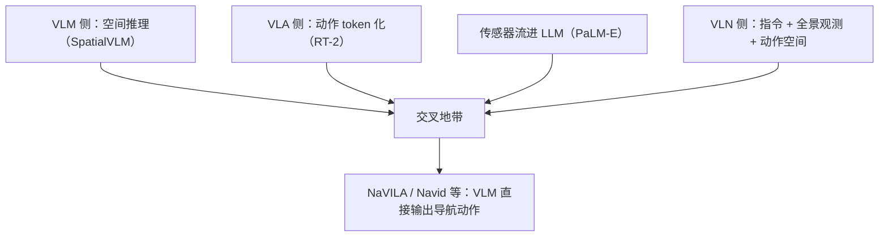

# 阶段 4 · 具身智能与 VLA（视觉-语言-动作模型）

> VLM 的"下半场"：从看图说话到指导行动。本阶段与 VLN 方向直接汇合——导航就是最典型的"视觉-语言-动作"任务。

### 1. PaLM-E · 《PaLM-E: An Embodied Multimodal Language Model》
- **出处**：arXiv `2303.03378` · ICML 2023 · Google
- **一句话**：把传感器观测（视觉、状态估计）直接编码成 token 注入 562B 语言模型，联合训练视觉-语言与机器人任务，VLM→VLA 融合的里程碑。
- **方法**：多模态句子 = 文本 token + 视觉 token + 连续状态 token 混排；输出可直接是决策序列/控制信号；跨"通用 VLM 任务 + 机器人规划任务"联合训练。
- **关键结论**：具身数据与视觉语言数据联合训练存在**正迁移**（具身数据反而提升 VQA）；单一模型可驱动多种真实机器人任务（抓取规划等）。
- **局限**：562B 规模、实时性差；导航并非其主战场。
- **对本方向的启示**：确立了"传感器流 → token → LLM → 动作/计划"的范式；VLN-CE 的观测流（RGB-D、里程计）完全可以按此处理。

### 2. RT-2 · 《RT-2: Vision-Language-Action Models Transfer Web Knowledge to Robotic Control》
- **出处**：arXiv `2307.15818` · 2023 · Google DeepMind
- **一句话**：把机器人动作"token 化"，让互联网图文知识直接转化为机器人控制能力。
- **方法**：动作离散化为 token，与视觉-语言 token 一起训练（VLA 模型）；用 web 预训练的 VLM 微调到机器人数据。
- **关键结论**：动作 token 化使模型能将网络知识泛化到未见物体/指令的操控任务，涌现出语义推理驱动的动作。
- **局限**：端到端训练需要大量机器人数据；成功率离实用仍有距离。
- **对本方向的启示**：**动作 token 化**是 VLA 的核心设计——NaVILA 把导航动作（走/转/停）做同样的处理，是 VLN 从"策略网络"转向"VLM 输出动作"的关键桥梁。

### 3. SpatialVLM · 《SpatialVLM: Endowing Vision-Language Models with Spatial Reasoning Capabilities》
- **出处**：arXiv `2401.12168` · 2024 · Google DeepMind
- **一句话**：给 VLM 补上空间推理：用带真值 3D 标注的场景自动合成千万级空间问答数据，直接增强距离/方向/物体关系推理。
- **方法**：在 2D 图像上叠加可靠 3D 信息（来自激光/深度真值）生成空间 QA 对；VLM 微调后获得"空间对话"能力；下游可用于机器人空间任务与稠密奖励标注。
- **关键结论**：合成数据 + 真值监督有效解锁空间推理；"能不能回答'前方 2 米有什么'"这类问题成为可训练能力。
- **局限**：依赖带 3D 标注的场景数据，开放环境的可扩展性有限。
- **对本方向的启示**：**导航的核心能力 = 空间推理**。VLN 模型长期缺的正是这种显式空间问答能力；该合成数据思路可直接迁移到导航数据增强。

### 4. EmbodiedGPT · 《EmbodiedGPT: Vision-Language Pre-Training via Embodied Chain of Thought》
- **出处**：arXiv `2305.15021` · 2023 · 商汤等
- **一句话**：轻量级具身 agent：用具身数据做指令微调 + 思维链规划，外接策略网络执行动作。
- **方法**：冻结 LLaMA + 可训练视觉适配器（低成本）；Ego4D 具身规划数据指令微调 + 思维链；任务规划输出交给低层策略控制器执行。
- **关键结论**：以较小代价获得具身任务规划能力，"高层规划 + 低层执行"解耦路线可行。
- **局限**：低层执行依赖环境特定控制器，泛化弱；规划-执行脱节导致误差累积。
- **对本方向的启示**：与 VLN 的经典架构（高层决策 + 低层 waypoint 控制器）同构；其"规划与执行解耦"的利弊在 VLN 社区早有充分讨论。

### 阶段小结：VLA 与 VLN 的汇合点

- 方向判断：VLN 正在从"专门策略网络"转向"VLM/VLA 通用骨干 + 导航适配"，本阶段的论文是该转向的理论来源。
