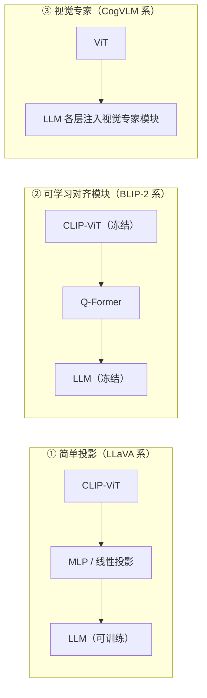

# 多模态大模型（multimodal-llm）调研

> 该方向四个阶段的脉络与阅读顺序。条目细节见各阶段文件。

## 一句话脉络

**视觉编码器 + 对齐模块 + 大语言模型** 是贯穿始终的三件套。四个阶段争的是：视觉信息怎么接进去（Q-Former vs 简单投影）、该不该动 LLM 参数、视觉编码器该做多大、数据从哪来。

## 阅读顺序（按阶段）

| 阶段 | 文件 | 代表工作 | 该阶段的"灵魂问题" |
|---|---|---|---|
| 1. 基础 | `01-foundations.md` | ViT、CLIP、Flamingo、BLIP、BLIP-2 | 图像特征如何与文本对齐？ |
| 2. 浪潮 | `02-instruction-tuning.md` | LLaVA 系列、MiniGPT-4、InstructBLIP | 如何让 VLM"听话"（跟随指令）？ |
| 3. 规模化 | `03-scaling-and-engineering.md` | GPT-4V、Qwen-VL、InternVL、Cambrian-1 | 能力天花板由什么决定？ |
| 4. 具身 | `04-embodied-vla.md` | PaLM-E、RT-2、SpatialVLM | 从"说"到"做"（VLA），与 VLN 汇合 |

## 三条技术路线（先记住这个图）

- 路线①：架构最简单、数据驱动，成为开源社区默认 baseline（LLaVA-1.5）。
- 路线②：训练最省（双方都冻结），适合算力受限场景（MiniGPT-4、InstructBLIP）。
- 路线③：融合最深，但工程复杂、推理开销大，未成主流。
- 2024 后的共识转向：**架构差异被数据与视觉编码器规模抹平**（Cambrian-1 的结论，对做 VLN 的同学最关键）。

## 对本项目（VLN）最有参考价值的 5 篇

1. **Cambrian-1**（2406.16860）：证明视觉表征是瓶颈，并给出多视觉编码器聚合范式 → VLN 同样受制于细粒度视觉理解。
2. **PaLM-E**（2303.03378）：把传感器数据当 token 塞进 LLM → VLN-CE 的观测流可以照此处理。
3. **SpatialVLM**（2401.12168）：合成数据 + 空间推理 → 导航最缺的就是空间问答能力。
4. **LLaVA-1.5**（2310.03744）：学术数据 + 简单架构即可 SOTA → 提示 VLN 数据工程价值大于模型花活。
5. **BLIP-2**（2301.12597）：冻结大模型的低成本多模态化 → VLN 小实验室预算的可行路线。
