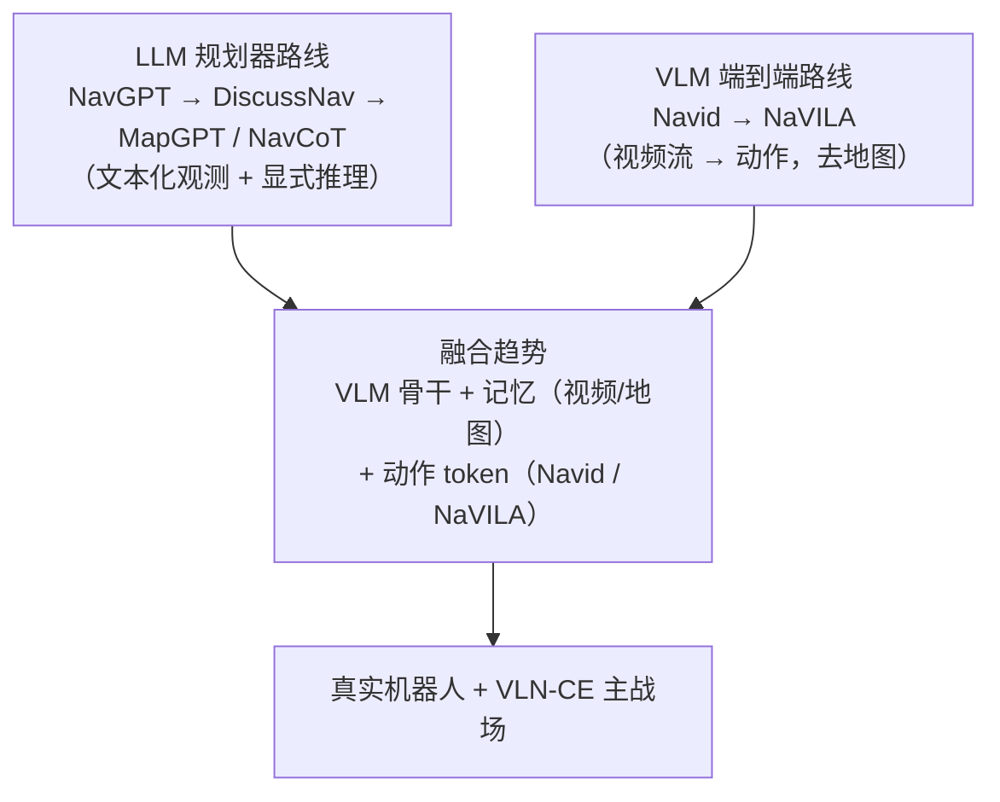

# VLN 的 LLM/VLM 时代（2023–2025）

> 第三代：让大语言模型做"导航大脑"。两条子路线——**LLM 规划器**（GPT-4/开源 LLM 看文本化的观测做决策）与 **VLM 端到端**（视觉-语言模型直接输出动作）。最终走向真实机器人。

### 1. NavGPT · 《NavGPT: Explicit Reasoning in Vision-and-Language Navigation with Large Language Models》
- **出处**：arXiv `2305.16986` · 2023
- **一句话**：零训练范式：把历史、观测、候选动作全部文本化，让 GPT-4 显式推理选路，探索 LLM 的导航推理上限。
- **方法**：多类"专家提示"（动作专家、摘要专家等）协作；观测文本化（物体清单/空间描述）；GPT-4 输出动作选择与理由。
- **关键结论**：零样本 LLM 能完成基本导航决策并给出可解释理由，但成功率远低于监督模型——**纯语言大脑不够，缺视觉与经验**。
- **对本方向的启示**：确立了"LLM 规划器"的研究起点；其失败点（视觉信息瓶颈、幻觉）定义了后续工作要解决的问题。

### 2. DiscussNav · 《Discuss Before Moving: Visual Language Navigation via Multi-expert Discussions》
- **出处**：arXiv `2309.11382` · ICCV 2023
- **一句话**：多专家讨论范式：指令专家、视觉专家、总结专家在 GPT-4 上"开会"做决策，大幅提升零样本导航。
- **方法**：专家分组讨论（含"讨论"阶段显式交换意见）；结合指令生成扩充数据；零样本 + 微调两档。
- **关键结论**：零样本 SR 大幅超过 NavGPT，逼近当时部分监督模型；讨论机制提升决策质量。
- **对本方向的启示**：多智能体/多视角辩论在导航决策中的有效性证据（与 VLN-Copilot 的"行动-反思"同源）。

### 3. MC-GPT · 《MC-GPT: Empowering Vision-and-Language Navigation with Memory Map and Reasoning Chains》
- **出处**：arXiv `2405.10620` · ICRA 2024
- **一句话**：拓扑记忆地图 + 推理链 + 多专家候选动作，让 LLM 在"图上思考"。
- **方法**：在线构建拓扑地图作为 LLM 上下文；多专家（语言/视觉/历史）生成候选动作；LLM 输出推理链与动作。
- **关键结论**：地图增强的 LLM 导航显著优于纯文本 LLM，验证"结构记忆 + LLM 推理"组合。
- **对本方向的启示**：经典拓扑图（DUET/ETPNav 遗产）与 LLM 融合的代表配方。

### 4. MapGPT · 《MapGPT: Map-Guided Prompting with Adaptive Path Planning for Vision-and-Language Navigation》
- **出处**：arXiv `2401.07314` · AAAI 2024
- **一句话**：边走边画地图：在线建图 + 地图引导提示 + 自适应路径规划，把空间结构持续注入 LLM 决策。
- **方法**：从全景观测在线构建地图（含已探索区域）；地图信息文本化进 prompt；路径级自适应规划（失败后回退）。
- **关键结论**：与建图结合的 LLM 规划提升明显；"地图即记忆"降低了 LLM 的上下文负担。
- **对本方向的启示**：把外部空间记忆交给地图而不是塞满 prompt——工程上对长导航更可行。

### 5. NavCoT · 《NavCoT: Boosting LLM-Based Vision-and-Language Navigation via Learning Disentangled Reasoning》
- **出处**：arXiv `2403.07376` · ACL 2024
- **一句话**：给导航 LLM 教"怎么想"：解耦的导航思维链（观测分析 → 规划 → 决策），模仿训练 + 自训练。
- **方法**：构造导航链式思考（CoT）数据；小模型模仿 GPT-4 推理；自训练迭代；CoT 解耦为多个子步。
- **关键结论**：显式推理显著提升导航成功率与可解释性，小模型也能获益。
- **对本方向的启示**：CoT 在导航中的落地方式；"推理链数据化"与 VLM 训练的路线可互通。

### 6. GOAT · 《GOAT: GO to Any Thing》
- **出处**：arXiv `2311.06430` · 2023
- **一句话**：统一目标导航：目标可以是语言、图像、类别或实例，一个模型"去任何东西"。
- **方法**：多模态目标表征（语言/视觉统一编码）；即时学习（instantiation 目标物体概念）；语义地图 + 模块化策略。
- **关键结论**：零样本下跨四类目标的通用导航能力，家居环境零样本成功率显著。
- **对本方向的启示**：VLN 目标形式的泛化（不只是"按指令到位置"）；目标 grounding 是 VLM 导航的必修课。

### 7. Navid · 《NaVid: Video-based VLM Plans the Next Step for Vision-and-Language Navigation》
- **出处**：arXiv `2402.15852` · 2024
- **一句话**：把观测当作**视频流**：VLM 看历史视频帧直接输出下一步动作，无需地图、无需里程计、无需传感器融合。
- **方法**：视频帧序列 token 输入 VLM（Vicuna-7B + 视频编码）；动作输出为离散动作 token；在 510K 导航样本（仿真 + 视频）上训练。
- **关键结论**：仅凭视频流 + VLM 达到 VLN-CE SOTA；**零改动迁移到真实机器人**成功运行。
- **对本方向的启示**：端到端 VLM 导航的里程碑；"去地图"与"视频即记忆"两个命题都有直接证据。

### 8. NaVILA · 《NaVILA: Legged Robot Vision-Language-Action Model for Navigation》
- **出处**：arXiv `2412.04453` · 2024 · NVIDIA / UCSD
- **一句话**：VLA 落地：四足机器人上以 VLM 直接输出导航动作，从仿真训到真实世界部署。
- **方法**：VILA 骨干 + 导航动作 token（去地图）；空间-时间增强的仿真数据（跨场景大规模合成）；真实世界收集数据联合训练。
- **关键结论**：真实四足机器人上完成室外指令导航，sim-to-real 走通；证明 VLA 路线可支撑实体导航。
- **对本方向的启示**：**当前 VLN 的终点指向**：仿真 benchmark → 真实机器人。VLM 骨干 + 动作 token + 大规模仿真数据是通行配方。

### 9. NavRAG · 《NavRAG: Generating User Demand Instructions for Embodied Navigation through Retrieval-Augmented LLM》
- **出处**：arXiv `2502.11142` · 2025
- **一句话**：RAG 生成导航指令：检索增强 LLM 批量生成更真实、更多样的"用户需求式"指令，反哺训练。
- **方法**：检索环境信息（场景图/知识库）作为上下文；LLM 生成多样化指令；用于指令生成与数据增强。
- **关键结论**：生成指令的多样性与真实性提升下游导航模型效果。
- **对本方向的启示**：Speaker-Follower 数据增广的 LLM 升级版——**数据问题在 VLM 时代依然是第一性问题**。

### 10. 通用具身导航 · 《Towards Learning a Generalist Model for Embodied Navigation》
- **出处**：arXiv `2312.02010` · CVPR 2024
- **一句话**：统一 schema 的多任务导航模型：语言目标、视觉目标等多类任务一个模型。
- **方法**：统一导航任务表示与训练 schema；多任务联合训练共享表征。
- **关键结论**：多任务协同带来正迁移，迈向"导航通才"。
- **对本方向的启示**：VLN 只是具身导航的一种任务形式；做 VLN 时要站在"通用导航智能体"的视角选设计。

### 时代小结与路线判断

- **共识**：通用 VLM 预训练 + 导航微调取代了专用预训练（PREVALENT 时代的终局）。
- **分歧**：要不要显式地图/拓扑结构（Navid 说不要，MapGPT 说要）。
- **机会**：空间推理（对接 SpatialVLM）、真实世界 sim-to-real、评测体系更新。
