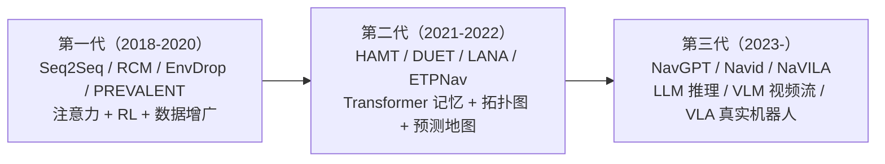

# 视觉语言导航（vln）调研

> VLN：给定自然语言指令 + 第一视角视觉观测，智能体在环境中移动到达目标位置。本目录按"数据集 → 经典方法 → LLM/VLM 时代"组织。

## 一句话脉络

**2018 年 R2R 定义任务与指标 → 2019-2022 预训练 + 图/记忆把离散环境刷到接近上限 → 2023 起 LLM/VLM 入场，战场转向连续环境（VLN-CE）与真实机器人。**

## 任务谱系与指标（先看这个）

| Benchmark | 年份 | 环境 | 指令形式 | 核心指标 |
|---|---|---|---|---|
| R2R | 2018 | Matterport3D 离散图 | 最短路径对应指令 | SR / SPL / nDTW |
| R4R | 2019 | Matterport3D | 拼接长指令 | SR / nDTW |
| CVDN | 2019 | Matterport3D | 多轮人机对话 | 目标进度 |
| REVERIE | 2020 | Matterport3D | 远程目标引用（物体） | SR / SPL / RGS / RGSPL |
| RxR | 2020 | Matterport3D | 多语言 + 路径监督 | nDTW 加权 SR |
| SOON | 2021 | Matterport3D | 对象为中心指令 | SR / SPL |
| VLN-CE (R2R-CE) | 2021 | Habitat 连续空间 | R2R 指令 | SR / SPL / nDTW |

指标速记：
- **SR**（成功率）：到达目标附近的比例。
- **SPL**（加权重径长度成功率）：既到得对、又走得近。
- **nDTW**（归一化动态时间规整）：整条路径与参考路径的贴合度。
- 离散环境已接近饱和（部分 SOTA SR 超 80%），连续环境（VLN-CE）仍有大量空间。

## 阅读顺序

1. `01-datasets.md` —— 先搞清"任务长什么样、怎么打分"。
2. `02-classical-methods.md` —— 预训练、拓扑图、记忆三大技术流。
3. `03-llm-era.md` —— LLM/VLM 如何改变游戏规则，以及未解决的问题。

## 三代技术范式对比

## 进入该领域的最短路径（建议）

1. 精读 R2R（`1711.07280`）—— 任务定义与所有指标都从这里来。
2. 精读 VLN-CE（`2110.02207`）—— 离散 → 连续的关键转折，现在的"主战场"。
3. 精读 Navid（`2402.15852`）—— VLM 直接输出动作的现代表征。
4. 浏览 VLN Survey（`2203.12667`）补全 2022 年之前的方法全景。

## 当前开放问题（调研得到的 gap 清单）

- **空间推理弱**：多数模型不会"问路/记地图"，空间问答能力是明显短板（对接 SpatialVLM 思路）。
- **连续环境低层控制**：waypoint 预测与真实机器人控制之间的 gap（对接 VLA 路线）。
- **真实世界迁移**：仿真 SOTA 到真实部署的鸿沟（NaVILA 迈出一步，远未解决）。
- **评测饱和与指标单一**：离散环境指标到顶，缺乏对"理解/规划"的独立评测。
- **数据规模**：VLN 数据量比 VLM 小 4-5 个数量级，如何借力通用 VLM 是大问题。
