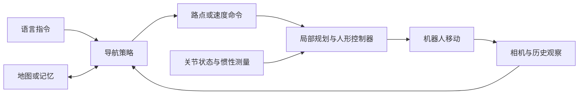

# 零基础先读：人形机器人 VLN 到底研究什么

> 本文是针对本项目编写的入门解释。论文事实可沿文内一手来源核查；阅读顺序和例子是学习建议。

## 一句话理解

视觉语言导航（Vision-and-Language Navigation，VLN）研究：机器人接收自然语言指令，观察环境，并逐步决策如何移动、何时停止。例如“走出卧室，经过沙发，在餐桌旁停下”。它必须把语言里的房间、物体、方向和顺序，与当前及历史观察对应起来。[R2R 原论文](https://arxiv.org/abs/1711.07280)

对人形机器人，还要解决“这条路能否被当前身体执行”：双脚是否站稳，身体能否穿过门口，转弯时手臂是否碰墙，相机因行走而晃动后还能否识别地标。VLN 上层决策和下层运动控制之间的接口，是你需要重点学习的地方。[VLN-PE 官方论文页](https://openaccess.thecvf.com/content/ICCV2025/html/Wang_Rethinking_the_Embodied_Gap_in_Vision-and-Language_Navigation_A_Holistic_Study_ICCV_2025_paper.html)

## 先分清这些任务

| 任务 | 给机器人的目标（自拟示例） | 主要学习问题 |
|---|---|---|
| PointNav | “到相对坐标 (3, 2)” | 已知目标坐标，如何避障到达 |
| ObjectNav | “找一把椅子” | 去哪里搜索某类物体 |
| 路径指令 VLN | “经过椅子再右转进书房” | 对齐语言、地标和移动顺序 |
| 目标指代导航 | “去窗边那张有红垫子的椅子” | 区分具体实例，导航并定位它 |
| 移动操作 | “去桌边把杯子拿来” | 导航之外还要抓取、搬运和放置 |
| Locomotion | “以给定速度前进和转向” | 稳定控制身体运动，不一定理解语言 |

任务定义来源：[导航评测建议](https://arxiv.org/abs/1807.06757)、[ObjectNav 评测建议](https://arxiv.org/abs/2006.13171)、[REVERIE](https://arxiv.org/abs/1904.10151)。这里把“目标指代导航”单列是为教学；学术文献也会把它纳入广义 VLN。

## 看懂一个导航系统的六个部件

1. **输入**：指令、RGB 图像；某些方法还有深度、位姿、历史视频。先问这些信息在真实机器人上从哪里来。
2. **感知与语言对齐**：辨认门、沙发、走廊，并判断哪一部分指令正在执行。VLM（视觉语言模型）通常在这里提供语义能力。
3. **记忆**：记住刚才经过了哪里、哪条路已走过、哪些任务已完成。可以是历史特征、地图或压缩的视频表示。
4. **导航决策**：选择邻接节点、局部路点、离散动作，或一段未来轨迹。
5. **运动控制**：把路点或速度变成身体可执行的动作；对人形机器人通常还需要本体状态和稳定控制。
6. **反馈与停止**：执行后重新观察；发现偏差时修正；确认目标后停止。

以下图示是常见分层系统的教学示意，并非所有论文都采用同一结构。

读到“端到端”也要继续问：端到哪个端？输出 `forward`、速度、关节目标和力矩，意味着完全不同的控制责任。使用 VLA（视觉语言动作模型）这个名字本身不能回答这个问题。

## 三类环境不要混淆

- **图环境**：机器人从一个预定义观察点转移到相邻观察点。适合研究语言理解与路径选择。[Matterport3D Simulator](https://github.com/peteanderson80/Matterport3DSimulator)
- **连续环境**：位置可连续变化，需要处理局部移动与碰撞；动作仍可能只有前进、左转、右转、停止。VLN-CE 中“连续”不等于连续关节控制。[VLN-CE](https://github.com/jacobkrantz/VLN-CE)
- **具身物理环境与实机**：机器人身体、运动控制、相机运动和执行时间进入闭环。仿真中的物理模型仍需经过实机检验。[HumanoidVLN](https://humanoid-vln.github.io/)

## 读论文前需要会什么

| 基础 | 学到什么程度即可开始 | 小练习 |
|---|---|---|
| Python、NumPy、PyTorch | 理解张量、数据加载、训练/推理和配置文件 | 看懂一批图像和一批指令的张量形状 |
| 深度学习 | 交叉熵、过拟合、训练/验证划分、预训练与微调 | 解释“验证集选模型”为何不能用测试集 |
| Transformer / VLM | token、attention、视觉编码器、上下文长度 | 画出图像与文字进入模型的路线 |
| 机器人几何 | 世界/机体/相机坐标系、位姿、深度、速度 | 解释“机器人左侧”和“图像左侧”为何可能不同 |
| 导航 | 地图、最短路、局部规划、定位误差 | 在纸上画带障碍的平面图与两条路径 |
| 模仿学习与强化学习 | 专家动作监督、策略、奖励、闭环误差 | 区分训练时使用真值与测试时泄漏真值 |

不必先掌握所有人形强化学习算法再读 VLN。建议先能解释“导航输出什么、控制器接受什么”，再按遇到的问题补控制知识。

## 第一天完成三件事

1. 读 R2R 和 VLN-CE 的“一分钟总结”，画出两者动作空间的差别。
2. 读 VLN-PE 的总结，列出从虚拟相机到人形机器人新增的三个误差来源。
3. 用自己的话写一句话：你更想研究指令理解、长程记忆、导航与控制接口，还是全身避障？暂时不要求确定创新点。

再进入 [学习路线](02_learning_path.md)。术语不懂时查 [术语表](04_glossary.md)。
