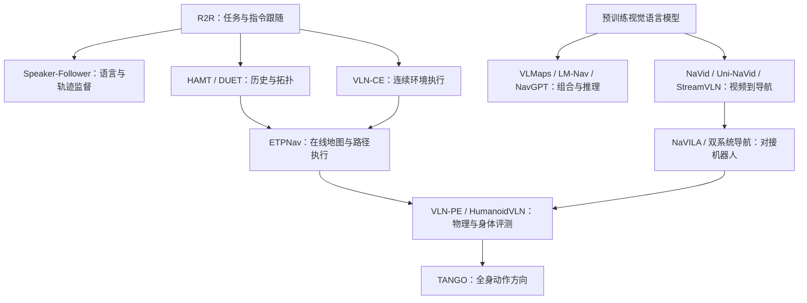

# 领域综述：从经典 VLN 到人形机器人

> 阅读目的：建立方法之间的联系，不用排行榜替代问题分析。事实来自链接的一手文献；“对本项目的建议”是综合判断。检索截至 2026-09-29，属于精选调研，不声称穷尽该日期前全部论文。

## 先记住四个层次

人形 VLN 可以拆成语言目标理解、视觉与空间记忆、导航决策、身体执行四个相互影响的层次。语义正确但身体过不去、步态稳定但找错目标、路线正确但停错位置，都是不同失败。选题时应先确定要改进哪一层，才能设计公平实验。

这个拆分是本项目的教学组织方式，并非某篇论文规定的唯一分类。它与 [2024 年基础模型 VLN 综述](https://arxiv.org/abs/2407.07035) 的环境表征、语言理解和智能体决策视角，以及 [VLN-PE](https://arxiv.org/abs/2507.13019) 对物理与视觉差异的分析互相补充。

## 第一条主线：任务、监督与泛化

R2R 建立了用自然语言描述室内路线、让智能体在新环境执行的标准问题。Speaker-Follower 进一步利用轨迹与语言之间的双向关系：既从指令预测路径，也从路径生成或评估指令。你应从这里学会区分“更多训练数据”“更强模型”和“推理时搜索”带来的收益。[R2R](https://arxiv.org/abs/1711.07280)、[Speaker-Follower](https://arxiv.org/abs/1806.02724)

RxR 把更丰富的语言和时间对齐导航行为引入数据侧；REVERIE、SOON 则强调描述目标而非逐步教走路线。它们对应不同的人机交互形式。若你的机器人只需执行“到厨房”，只测细粒度路线指令并不能覆盖产品需求；反过来，ObjectNav 能找到椅子也不证明它能理解“经过椅子，再右转”。[RxR](https://arxiv.org/abs/2010.07954)、[REVERIE](https://arxiv.org/abs/1904.10151)、[SOON](https://arxiv.org/abs/2103.17138)

**学习重点**：指令类型、场景划分、路径约束、停止条件。不要先背模型缩写。

## 第二条主线：历史记忆与空间结构

导航需要理解“刚才走过哪里”和“当前指令执行到了哪一步”。HAMT 以 Transformer 处理历史；DUET 结合全局拓扑信息与当前局部信息；ETPNav 将在线拓扑规划和连续环境执行连接起来。它们帮助你理解：模型记住图像与模型维护可规划的空间结构，是两种不同设计选择。[HAMT](https://arxiv.org/abs/2110.13309)、[DUET](https://arxiv.org/abs/2202.11742)、[ETPNav](https://arxiv.org/abs/2304.03047)

VLN-CE 使智能体必须实际执行较细粒度运动，而不能只选预设图节点。需要特别保留“环境是否连续”和“动作是否连续”的两列；把圆柱代理换成人形模型，还会引入额外控制问题。[VLN-CE](https://arxiv.org/abs/2004.02857)

**对人形的分析**：拓扑图适合长程路线推理，但图边不天然包含身体宽度、转身空间、支撑和平衡约束。相机位姿随步态改变也会扰动历史匹配。因此，“加一张地图”本身不足以证明完成了跨身体迁移。

## 第三条主线：借用基础模型的语义能力

这一支有两种值得对照的方式：一是组合已有模型、地图和规划器，二是通过导航数据训练图像/视频到动作的策略。

VLMaps 把视觉语言特征放进空间地图；LM-Nav 组合预训练语言、视觉语言和视觉导航模型；NavGPT 探索用语言模型推理导航过程。这些方法适合学习模块边界、语义地图和已有能力的组合。VLFM 则重点研究物体目标搜索，它与路线指令 VLN 的目标不同。[VLMaps](https://vlmaps.github.io/)、[LM-Nav](https://sites.google.com/view/lmnav)、[NavGPT](https://arxiv.org/abs/2305.16986)、[VLFM](https://github.com/rai-opensource/vlfm)

NaVid、Uni-NaVid 和 StreamVLN 等工作重视第一视角视频、历史压缩或统一导航任务；NavGPT-2 强调把 VLM 推理与导航策略衔接。比较时必须同时看输入传感器、历史长度、训练数据和控制接口。某方法的主模型输入 RGB，不代表整个系统不使用深度、定位或其他辅助信息。各篇的细节与已核查来源见 [论文索引](README.md)。

OpenVLA 用来认识 VLA 的动作表征与机器人适配思路，但原工作的机器人操作实验不构成人形 VLN 证据。这里保留它是为了防止只因都叫 VLA 就把不同任务混为一谈。[OpenVLA 官方项目](https://openvla.github.io/)

**学习重点**：语言模型究竟在做描述、评分、规划，还是直接输出动作？是否训练？训练数据是否包含目标基准？实际运动由谁完成？

## 第四条主线：物理执行、人形身体与全身动作

NaVILA 是从视频语言导航走向腿式机器人控制的重要桥梁；VLN-PE 把身体形态和视觉/物理差异纳入评测；InternVLA-N1/DualVLN 系列与 NavDP 有助于理解慢速语义推理和快速局部导航如何协作。这里需要读完整系统，不能只摘取大模型模块的输入输出。[NaVILA](https://navila-bot.github.io/)、[InternNav](https://github.com/InternRobotics/InternNav)

HumanoidVLN 针对不同人形身体建立物理基准。作者报告了多个人形配置及一个小规模 G1 sim-to-real 试验，发布承诺与实际可下载资源必须区分。TANGO 进一步将杂乱环境中的身体调整纳入语言条件全身动作学习；但其行为显式指令设置、低层跟踪器和实机试验规模，限制了可以外推的结论。[HumanoidVLN](https://arxiv.org/abs/2608.12860)、[TANGO](https://arxiv.org/abs/2609.09158)

**对本项目的判断**：人形特性最值得研究的地方，是语言与几何理解如何受到身体可达性、视角变化、执行误差和实时性约束。仅把原 VLN 模型接到人形速度接口上，是系统集成起点；是否有学术贡献，需要可重复的失败、明确的改动和受控比较来证明。

## 这些方法不是一条简单的替代链

箭头表示学习联系，不代表所有后续工作直接继承前者代码，也不表示后一项在相同条件下全面优于前一项。

## 调研之后的选择建议

1. **想先掌握 VLN 算法**：从 VLN-CE 的任务与评估读起，对照 ETPNav 和一种视频策略，复现其中一条清晰管线。
2. **想尽快进入人形研究**：仍需理解经典任务，但重点放在 VLN-PE、NaVILA 与人形基准的接口、传感器、延迟和失败分解。
3. **想做全身 VLA**：深入 TANGO，同时补运动生成、强化学习跟踪与全身控制知识；先确认能否拿到可复用数据和低层控制器。

这些是根据目前“方向零基础、资源未知”的建议。下一阶段先用一个 baseline 获得真实失败轨迹，再从 [待验证问题](../brainstorm.md) 中选一个验证，不把文献里的 open problem 直接当作已确认的新颖性。
