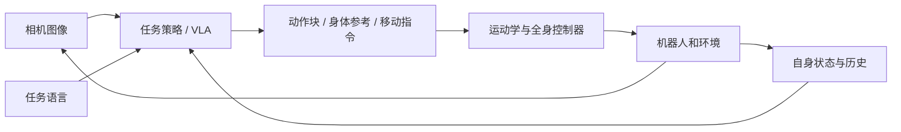

# 从零开始：先理解你要研究的系统

> 这是一份概念入门与学习建议，不是某篇论文的实验结论。检索日期：2026-09-29。

## 先读总结

- VLA（Vision-Language-Action，视觉—语言—动作）把视觉观察和任务语言转成机器人动作；机器人状态也常作为输入。
- 通用机械臂 VLA 是学习入口。人形机器人还需要处理双臂、手、躯干、移动、接触和平衡，不能只把动作向量加长。
- 模仿学习解决“示范里怎么做”，强化学习常用于让低层控制器在物理约束下执行，语言模型常提供语义理解或任务分解；三者能组合。
- 第一阶段的目标是读懂一条数据轨迹和一次闭环执行，再复现已有策略；不必立即从头训练大模型或购买人形机器人。

## 1. 用一个任务理解 VLA

任务：“走到桌边，把红杯子放到托盘上。”相机给出图像，编码器提取场景信息，语言编码器理解目标，自身传感器给出关节位置与姿态。策略决定下一段动作，控制器执行后再观察。这个循环使机器人能够对杯子滑动、抓取偏差作出反应。

用统一符号表示：

\[
A_t = \pi_\theta(I_{t-k:t},\, l,\, s_{t-k:t}),\qquad
A_t=(a_t,\ldots,a_{t+H-1}).
\]

这里 `I` 是图像，`l` 是语言指令，`s` 是可观测机器人状态，`H` 是预测的动作步数。**这只是便于比较论文的统一记号**：不是所有模型都用历史、状态或动作块，各论文的输入应单独核对。

“动作”可能是末端位姿增量、关节目标、夹爪开合、底盘速度，也可能是交给低层控制器的身体参考运动。它通常不是一句自然语言，也不一定直接是电机力矩。

这是概念结构图；具体方法可能合并或替换其中的模块。阅读人形论文时，必须指出哪些框是新训练的，哪些框是已有系统。

## 2. 四类工作，四种问题

| 类别 | 解决的问题 | 典型入口 | 不能由此直接推出 |
|---|---|---|---|
| 语言规划/具身理解 | 应该先做什么、哪个物体符合目标 | SayCan、PaLM-E | 已具备连续动作控制 |
| 视觉动作学习 | 怎样从示范学会一个动作或技能 | ACT、Diffusion Policy | 已使用语言或互联网知识 |
| 通用 VLA/机器人基础策略 | 如何将语义知识与多任务机器人数据结合 | RT-2、OpenVLA、π0、Octo | 已处理双足平衡或任意新机器人 |
| 人形全身控制及其与 VLA 的连接 | 如何同时移动、操作、保持接触和平衡 | HumanPlus、HOVER、WholeBodyVLA | 所有模块都是端到端训练或直接输出力矩 |

这些定位的论文证据见 [论文索引](PAPER_INDEX.md) 中对应笔记。Octo 作为通用策略基础阅读，不与“大型预训练 VLM 改造成 VLA”完全等同。

## 3. 动作学习的三个层次

BC 是训练范式，动作块是时间表示，生成式模型是策略分布形式；三者可以同时使用，不是互斥的三种算法。

**行为克隆（BC）**：训练集里每一步有观察和专家动作，用监督学习学对应关系。模型只见过专家去过的状态；部署时小错误可能把它带到陌生状态，再产生更大错误，这叫分布偏移与误差累积。低训练误差不代表闭环成功。

**动作块（action chunking）**：一次预测未来若干步，让动作在时间上更连贯。预测多少步、真正执行多少步、多久重新观察，是三个不同参数。执行太长会降低对意外的反应能力。ACT 是理解这一点的入口。

**生成式动作模型**：同一个观察下可能有多个可行抓法，平均动作未必可行。扩散模型和 flow matching 学习条件动作分布，从噪声逐步生成动作。两者目标与时间路径不完全相同，不应混成同一训练公式。Diffusion Policy、π0 分别是合适入口。

**动作 token** 是另一条表示路线：把连续数值离散成序列，用类似语言建模的目标学习。RT-2/OpenVLA 与 FAST 的编码方式不同。应同时考虑精度、序列长度、推理延迟，而不是只比较参数量。

以上是教学解释；具体方法与来源见各论文笔记，不作为新增实验发现。

## 4. 人形为什么额外困难

举杯会改变重心；迈步会改变支撑；身体移动使相机视角变化；双手握物又会形成额外接触约束。只优化“手到达目标点”可能让身体失稳。把机械臂策略接到人形机器人，需要检查：

1. 观察中有没有足够的自身状态和历史？动作坐标系是相机系、身体系还是世界系？
2. VLA 输出上肢目标、全身参考还是电机控制量？低层控制器承担了多少稳定性工作？
3. 数据来自真人动作、遥操作、仿真专家还是机器人示范？形态差异怎样处理？
4. 语言是否真的改变行为？是否只展示了固定任务、上肢操作或被辅助支撑的站立？
5. 实验是真机、物理仿真还是运动学动画？是否报告跌倒、碰撞、人工干预和失败恢复？

这些问题比“名字里有没有 humanoid/VLA”更适合判断论文适用性。

## 5. 零基础自测

阅读详细论文前，试着解释：一条 episode 与一帧数据有什么区别；训练 loss 和任务成功率为何不同；相机坐标如何变成机器人动作；动作块为什么仍需要反馈；语言规划与运动控制如何分工。答不全很正常，按 [学习路线](LEARNING_ROADMAP.md) 补齐即可。
