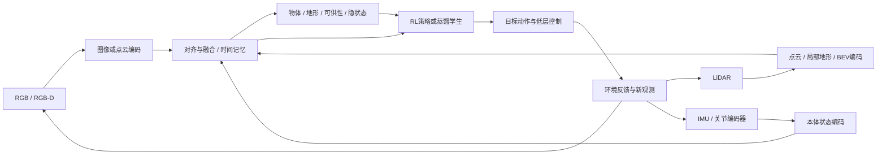

# 领域地图：外部感知与本体感知融合，不做SLAM

本轮范围以用户最新说明为准：RGB、RGB-D、LiDAR、IMU、关节编码器，以及这些观测与强化学习的结合。目标是环境、物体、地形、可供性与任务相关状态的感知，不以定位或建图算法作为研究对象。

## 1. 用一个人形任务理解

“看见台阶并把脚稳稳落上去”需要两类信息：外部感知告诉机器人台阶几何、边缘和障碍；本体感知告诉机器人身体倾斜、关节姿态和运动状态。看见可落脚区域不代表腿能到达，身体稳定也不代表前方没有沟。融合要建立环境信息与自身可行动作之间的联系。

“把物体拿起来”同理：RGB能区分外观，深度或点云提供形状与位置，关节状态描述当前手的位置和配置。任务可通过监督感知模型加控制器完成，也可以让RL学习如何利用融合表征。两者都属于本次范围。

这是研究问题图，不要求同一模型装齐全部传感器。论文可能只有深度+本体，或RGB+LiDAR；应比较每种组合到底提供了什么。

## 2. 你的五类传感信息

| 信息源 | 典型原始量 | 实际可能送入网络的量 | 初学者要特别检查 |
|---|---|---|---|
| RGB | 彩色图像 | CNN/ViT特征、分割分数 | 光照、遮挡、纹理捷径；RGB本身无直接度量深度 |
| RGB-D | 图像及深度 | 深度图、反投影点云、彩色点云 | RGB与深度是否配准；无效深度、单位、内参 |
| LiDAR | 距离/点云及部分属性 | 原始/体素点云、BEV、局部高程采样 | 点云稀疏、时间扫描、外参、视野；使用高程不等于原始点端到端 |
| IMU | 角速度、比力 | 角速度、姿态估计或投影重力 | 后两项通常是处理/估计量，不能假称全是原始读数 |
| 关节编码器 | 关节角，或驱动器提供速度 | q、dq、历史窗口；运动学派生量 | dq可能估计得到；关节状态不直接揭示物体接触与世界位置 |

速度、接触标签、地形高度、物体六维位姿等若来自仿真真值，必须标注训练特权信息。策略训练时使用它们，不等于机器人实测传感器能提供。所有模态需有明确坐标系、单位、时间戳与处理链。

## 3. 本库的三条核心线

**传感器融合方法。** DenseFusion（41）提供RGB外观与深度几何对应融合的入口，监督学习已知物体位姿，不是RL。 PointPainting、TransFusion、MIT BEVFusion展示RGB与LiDAR如何在点、对象查询或BEV表征上交互；PointNet++帮助理解点云编码。这些主要是监督学习，常在自动驾驶数据上验证。可借鉴融合结构，不能把车载实验叫作人形实验证据。见[29–32及41索引](03_论文索引.md)。

**感知运动与强化学习。** 从RMA理解本体历史，从Miki等野外感知运动理解外感知可靠性，再看LocoTransformer、跑酷及BeamDojo。需要分清直接RL训练融合策略，还是RL教师再蒸馏感知学生。已有VisualMimic、FootQuery则提供直接人形案例。见[RL专题](08_强化学习与多模态感知.md)。

**感知操作与强化学习。** DexPoint、TRANSIC、RialTo提供点云和本体状态服务操作的路线；其中可能包含仿真RL、模仿学习或真实人类纠正多个阶段。DP3作为非RL对照帮助辨认训练范式。人形上肢实例另见26。

## 4. 三个不应混为一谈的问题

1. **场景理解准确吗？** 看检测、分割、三维几何或对象检索。
2. **表征确实融合信息了吗？** 看匹配打乱、时延、缺失和固定预算消融。
3. **动作变好了吗？** 看任务成功、跌倒/碰撞、恢复及延迟，保持控制器和奖励一致。

高回报不必然意味着感知准确；模型可能借助固定场景捷径完成任务。感知指标提高也不必然产生动作收益。研究应选择其中一个主问题，同时用另一个作为辅助证据。

## 5. 明确边界

不研究SLAM不等于系统完全不需要几何、标定或上游位姿。本项目把这些当作固定接口或已知依赖，并说明误差，不以轨迹精度作为主成果。局部地形图是策略输入表示，是否依赖外部建图须逐篇记录。

本轮不以语言、触觉、音频为主线，旧笔记保留为拓展。不能把策略输出的动作当作传感器模态，也不能把PPO称作融合模块。有关“融合在哪里”和“RL在哪里”的拆解见[强化学习专题](08_强化学习与多模态感知.md)。
