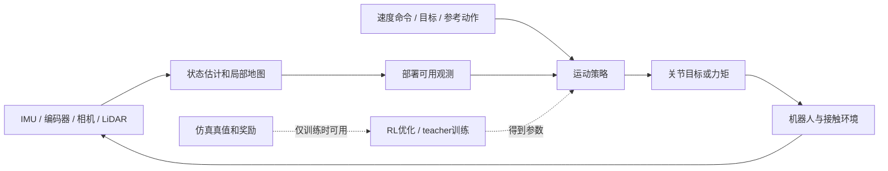

# 领域地图：你究竟要学哪一层

## 先给结论

对已有感知经验的人，第一条可执行路线是：理解PPO训练闭环 → 跑通本体感知运动策略 → 加入真实可获得的状态估计或局部地形输入 → 测试感知错误如何导致跌倒。动作模仿和大规模通用控制器帮助理解前沿，但不必成为第一项复现。

这是一项学习路线建议。代表文献和来源集中在[论文矩阵](02_论文对比矩阵.md)与逐篇解析中。

## 四个经常混在一起的层次

| 层次 | 输入与输出示例 | 主要问题 | 对你的意义 |
|---|---|---|---|
| 感知与估计 | IMU、编码器、深度 → 姿态/速度/局部地图 | 时空标定、漂移、遮挡、噪声、不确定性 | 最直接复用已有经验 |
| 导航与任务规划 | 目标、地图 → 路点/速度命令 | 去哪里、走哪条路、避开什么 | 可与低层策略分开研究 |
| 运动与全身控制 | 命令、机器人观测 → 关节目标/力矩 | 保持平衡、落脚、跟踪、接触切换 | 本次RL学习的核心 |
| 操作与技能组合 | 对象、手部目标 → 抓取/搬运/组合动作 | 接触丰富的操作、协调、数据 | 后续扩展，初学阶段宜缩小范围 |

RL可以用于其中多个层次，不能从论文里出现RL就推断整个系统都由RL训练。HumanPlus一类系统中，低层运动学习与高层视觉模仿的训练目标需分别看。

这是通用示意，不代表每篇都采用显式地图、PD控制或teacher–student。

## 把RL翻译成你熟悉的机器人语言

MDP把控制写成状态、动作、动力学、奖励和折扣；机器人实际拿到的是不完全观测，因此更接近POMDP。状态估计、历史窗口或递归网络可以帮助决策，但不能保证恢复全部隐藏状态。策略是从观测到动作的函数；深度网络只是其中一种参数化方式。[基础定义](https://spinningup.openai.com/en/latest/spinningup/rl_intro.html)

典型本体观测包括关节位置/速度、机体角速度、重力方向、命令和上一动作。机体线速度是否可用，需要问“来自仿真真值、估计器还是外部定位”。外感知观测可用深度、点云、局部高程或占据表示。每增加一个输入，都增加坐标系、时延、缺测和部署可获得性的责任。

很多运动策略输出关节目标，再由低层控制执行。一个便于理解的示意是

\[
q_t^{\mathrm{des}}=q^{\mathrm{nominal}}+\alpha a_t,\qquad
\tau_t=K_p(q_t^{\mathrm{des}}-q_t)-K_d\dot q_t.
\]

它不是所有论文的标准动作空间。读代码时必须检查关节顺序、单位、动作缩放、限幅、PD增益、policy频率与physics频率；这些错误可以让正确的PPO也学不出行走。

## PPO：先理解它解决什么

策略收集一批轨迹，critic估计长期收益，用优势估计判断某个动作相对当前策略有多好，再更新actor。PPO-Clip在目标函数中限制某些大幅改变概率比的收益；它不是对真实机器人风险的硬约束。简化目标为

\[
L^{\mathrm{clip}}(\theta)=\mathbb{E}[\min(r_t(\theta)\hat A_t,
\operatorname{clip}(r_t(\theta),1-\epsilon,1+\epsilon)\hat A_t)],
\quad r_t(\theta)=\frac{\pi_\theta(a_t|o_t)}{\pi_{\mathrm{old}}(a_t|o_t)}.
\]

这里的概率比记号与奖励常用的`r_t`冲突，读不同代码要看上下文。先理解采样、优势、策略更新三件事，再学习value loss、entropy和归一化。[PPO官方教学](https://spinningup.openai.com/en/latest/algorithms/ppo.html)

GAE在较低方差与估计偏差之间调节；它不解决奖励设计、接触建模或传感器偏差。初学时应能沿代码找到`observation → action → reward → value → advantage → loss`的数据流，而不只是记住公式。

## 三种训练套路要分清

| 套路 | 训练信号 | 部署输入 | 代表阅读 |
|---|---|---|---|
| 任务奖励的RL | 速度跟踪、姿态、能耗、接触等 | 可部署的本体/外感知 | Massive Parallel、Humanoid-Gym |
| 参考动作跟踪 / 动作先验 | 跟踪误差或判别器产生的风格信号，再结合任务 | 本体、命令、参考/潜变量等，逐篇核实 | DeepMimic、AMP、BeyondMimic |
| 特权训练与蒸馏 / 适应 | 利用特权信息训练基础策略/teacher，再学习可部署输入到动作或潜变量的映射 | 传感器、历史、估计的隐变量 | RMA、Miki、感知跑酷 |

RMA的适应模块学习的是历史到环境潜变量的映射，不是直接拟合teacher动作。非对称actor–critic不一定存在单独teacher；teacher–student也不一定是PPO。行为克隆是拟合示范动作，RL是优化交互回报；二者可在同一系统不同阶段使用。

## 为什么在人形上更难

从四足迁移到双足，接触结构、支撑区域和跌倒代价改变；人形还增加躯干、双臂与任务的耦合。局部高程图对落脚很有用，却无法单独表达悬空障碍、栏杆或所有可抓扶表面。由此得到的是待验证的问题：策略到底需要什么几何表示，何时需要历史记忆，感知质量如何影响全身决策？

这些是跨论文的分析，不是“四足不行、人形必须采用某种网络”的结论。先用受控实验确认失败源，再选择表示。

## 容易误读的证据

“zero-shot sim-to-real”通常描述一种迁移流程，并不意味着从未做机器人建模、参数标定或训练随机化。“实时”必须同时看传感器处理、推理和通信时延。“通用”要看训练动作与测试任务的分布。“成功视频”证明至少一个示例可行，无法给出总体失败概率。后文每篇都把这些边界写入解析。
