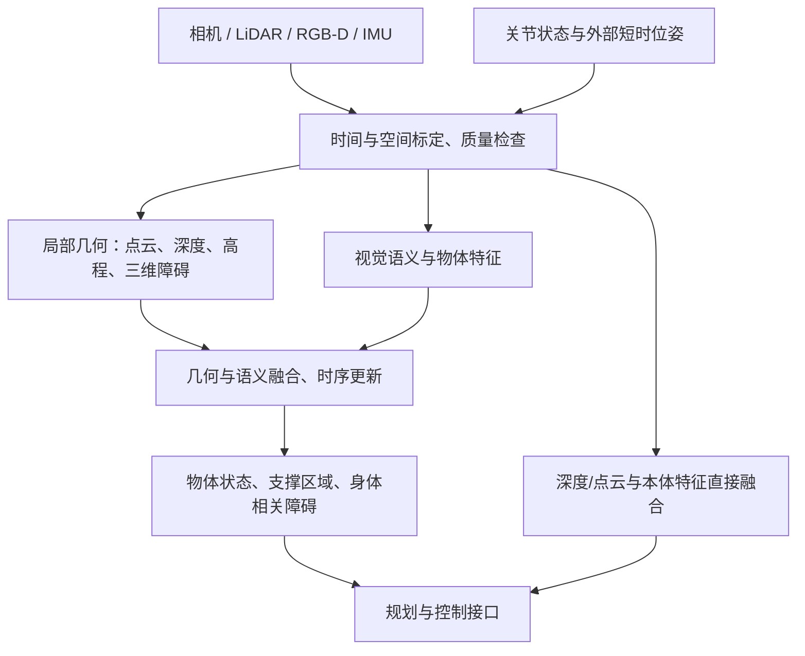

# 从轮式感知走向人形多传感器感知

> 范围已按你的补充收敛为相机、LiDAR、深度相机和 IMU；不研究 SLAM。以下主线是针对岗位学习的综合判断，具体论文事实与证据见各篇解析。调研日期：2026-09-29。

## 先给结论

你不需要从零重学机器人感知。点云处理、检测分割、坐标变换、传感器标定和部署经验都能复用。最值得补的是三件事：**运动和关节如何改变观测；环境几何如何转换成脚、手、头部可用的信息；融合在某个传感器失效时是否仍可信。**

建议先建立一条可解释的链路：时间与坐标对齐 → 局部几何 → 几何与语义融合 → 人形任务指标。然后再读直接将深度或 LiDAR 接入策略的近期方法。VLA 与语言模型仅列为扩展，不是你当前入门的起点。

## 1. 哪些经验能迁移，哪些假设要改

| 维度 | 轮式经验中可复用的部分 | 人形学习时额外检查 |
|---|---|---|
| 安装与坐标系 | 内外参、投影、点云坐标变换 | 头颈、腰、手臂运动使跨刚体外参随关节变化 |
| 运动状态 | 帧间对齐、动态目标处理 | 躯干摆动、落脚冲击、快速俯仰带来的模糊和畸变 |
| 感知空间 | 近场/远场、遮挡、占据 | 脚边、头顶、手臂扫过的空间都与任务相关 |
| 环境表示 | 检测框、语义、点云、BEV | 单一地面高度难表达桌下、横杆等多层结构 |
| 成功标准 | mAP、mIoU、深度误差 | 台阶边缘偏移、薄障碍漏检、支撑区误判、数据年龄 |
| 数据 | 标注、划分、长尾样本 | 自遮挡、低视角/俯视切换、动作阶段和跨安装泛化 |

这是工程对照，不暗示所有轮式系统都只用固定相机或平面假设，也不暗示所有人形都必须使用同一套传感器。

## 2. 本调研的感知链路

图中的位姿是接口输入。本资料不要求你学习或实现定位后端。局部高程与占据用于描述身边环境；即使论文标题含 mapping，也只保留这部分感知贡献。

## 3. 四条主线及代表工作

### A. 先保证观测能对齐

读 [Kalibr](papers/2013_kalibr/README.md) → [iKalibr](papers/2024_ikalibr/README.md) → [iKalibr-RGBD](papers/2024_ikalibr_rgbd/README.md)。分别理解连续时间标定、异构传感器统一标定和深度带来的速度约束。后续投影融合依赖这些基础。[Kalibr 官方教程](https://github.com/ethz-asl/kalibr/wiki/camera-imu-calibration)、[iKalibr 原文](https://arxiv.org/abs/2407.11420)

### B. 从图像和点云得到度量几何与语义

深度方向比较单目相对深度、使用内参的度量估计和双目匹配；三者不能混用尺度假设。点云方向掌握特征编码和三维语义，物体方向再看位姿与抓取几何。Grounding DINO、SAM 2、DINOv2 属于可用组件，不会自动解决时空同步和三维定位。具体阅读入口见 [论文矩阵](01_论文矩阵.md)。

### C. 理解相机与 LiDAR 在哪里融合

PointPainting 在点上附加图像语义，TransFusion 使用查询与跨模态特征，MIT BEVFusion 在统一 BEV 表示中融合两条分支。它们主要来自车载任务，可用于学习融合思想；部署到人形时应重新考虑尺度、视场、类别、近场结构与标定扰动。BEVFormer 和 BEVDepth 则是**纯相机方法**，用于理解 BEV 构造与深度监督，不应列成运行时相机—LiDAR 融合。[MIT BEVFusion](https://github.com/mit-han-lab/bevfusion)

对你的入门而言，推荐先做几何可解释的投影融合，再读更复杂的网络。这样能判断提升来自语义补充、几何改进，还是更好的数据处理。这里是学习顺序建议，并不是方法性能排名。

### D. 环境怎样成为人形动作的输入

显式路线：[GPU 高程图](papers/2022_elevation_mapping_gpu/README.md) → [MEM](papers/2023_mem/README.md)。直接特征路线：DPL、RPL、[CReF](papers/2026_cref/README.md)、[稀疏三维结构 LiDAR 感知](papers/2026_sparse_3d_traversal/README.md)。前者易可视化和定位错误，后者将感知表示与具体任务共同训练；二者都应对延迟、遮挡和失效进行验证。[MEM 原文](https://arxiv.org/abs/2309.16818)、[CReF 原文](https://arxiv.org/abs/2603.29452)

## 4. 各种表示到底输出什么

| 表示/输出 | 最适合回答 | 需要补充的信息或边界 |
|---|---|---|
| 2D 框与掩码 | 图像中哪里是什么 | 度量距离、遮挡后的形状、坐标变换 |
| RGB-D / 点云 | 可见表面的三维位置 | 缺测不等于自由，薄物体可能没有足够回波 |
| 3D 检测框 | 已定义类别的空间范围 | 不规则障碍、类别外物体和精细边界 |
| 局部高程 | 近处地面的高度与坡度 | 单值高度无法完整表达悬空、多层结构 |
| 三维占据/距离场 | 身体各部位是否有几何碰撞风险 | 未观测空间与动态时效，计算开销 |
| 物体 6D 位姿 | 物体相对机械手的空间变换 | 对称性、遮挡、模型或参考条件 |
| 策略隐特征 | 为特定动作保留有用信息 | 不一定可解释、度量准确或可迁移到其他任务 |

## 5. 最重要的七个误区

1. **多模态等于视觉语言。**本项目主要是多物理传感器；语义基础模型只是其中一层。
2. **IMU 能直接给出绝对姿态与位置。**IMU 原始测量是角速度和比力，状态需要估计，误差随条件变化。
3. **做了同步订阅就是同步采样。**必须区分硬件采样、曝光、传输和处理时间。
4. **一套外参适用于整个机器人。**固定参数只应绑定刚体；跨关节需运动学与同一时刻的关节状态。
5. **语义更强就等于几何更准确。**识别“台阶”不代表边缘和高度达到落脚要求。
6. **数据补全提高完整度就是提升可靠性。**补全来源、置信度和未知状态必须保留。
7. **动作视频代表通用感知已经解决。**需要读传感器配置、训练特权、实机次数、失败模式和平台限制。

## 6. 岗位上的优先落点

最先做出一套可以回放、能展示错误来源的近场多传感器管线，比一次性训练“大一统网络”更便于形成工程判断。建议第一个交付是：带时间、坐标系和不确定性说明的台阶/障碍输出，再测转头和走动时是否仍稳定。

你已有轮式经验，读论文时可以跳过通用检测基础，重点追问：投影在哪个时刻？谁提供位姿？网络看到的是原始 IMU 还是估计状态？无效深度怎么编码？移除一个传感器会发生什么？这些问题构成后续 [学习路线](02_学习路线.md) 和 [统一测评](../experiment/evaluation.md) 的主轴。
