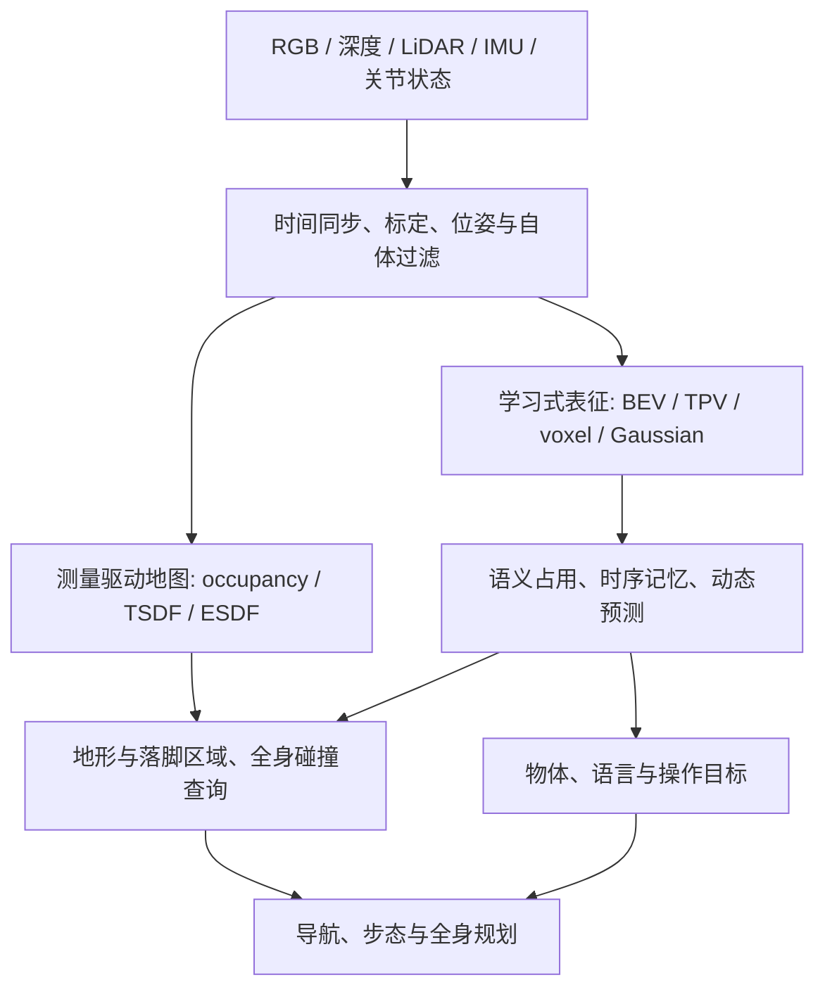

# 领域地图：BEV、OCC 与人形机器人的关系

> 本文是跨论文综合与工程分析。具体方法事实、来源和证据范围见链接的逐篇笔记。本文的系统组合不是已验证的新算法。

## 1. 把问题拆成四层

| 层次 | 回答的问题 | 代表工作 |
|---|---|---|
| 几何观测与融合 | 哪里测到表面？哪里有自由证据？离障碍多远？ | [OctoMap](papers/octomap/README.md)、[Voxblox](papers/voxblox/README.md)、[nvblox](papers/nvblox/README.md) |
| 学习式空间表征 | 图像特征如何落到 BEV/体素/高斯？ | [LSS](papers/lift_splat_shoot/README.md)、[BEVFormer](papers/bevformer/README.md)、[TPVFormer](papers/tpvformer/README.md)、[GaussianFormer](papers/gaussianformer/README.md) |
| 场景状态理解 | 几何、类别、实例、时间变化是什么？ | [MonoScene](papers/monoscene/README.md)、[EmbodiedOcc](papers/embodiedocc/README.md)、[ConceptGraphs](papers/conceptgraphs/README.md)、[FIERY](papers/fiery/README.md) |
| 任务接口 | 哪能踩、身体能否通过、目标在哪里？ | [高程建图](papers/elevation_mapping_gpu/README.md)、[ViPlanner](papers/viplanner/README.md)、[VLMaps](papers/vlmaps/README.md) |

图中“IMU/关节状态参与变换和自体过滤”“几何与语义双通路”等是面向人形的候选工程设计，不表示每篇列出的论文都采用这些输入。

## 2. 传统知识如何接到新方法

传统占用栅格按传感器模型更新体素的占用信念。学习式 OCC 通常把图像/点云变成空间特征，再对体素做分类，能够利用语义先验预测没有直接表面点的区域。二者都可以输出栅格，但来源和错误机制不同。

以椅子为例：深度点只能描述当前可见部分；学习模型可能补出靠背和椅腿。补全有利于场景理解，却可能把细腿抹掉，也可能在椅子已经搬走后保留先验。合适的评估应区分可见表面、遮挡空间与在线变化，不能只看整张地图的平均分。[MonoScene](papers/monoscene/README.md) 与 [EmbodiedOcc](papers/embodiedocc/README.md) 提供两种学习式设置；[OctoMap](papers/octomap/README.md) 提供测量驱动参照。

### 表征之间不是简单的替代关系

| 表征 | 擅长 | 主要代价或盲区 |
|---|---|---|
| 2D costmap / 单层高度图 | 平面导航、局部地形接口紧凑 | 同一 xy 上多层结构和悬空物体难表达 |
| BEV 特征 | 多视角融合、二维算子成熟 | 高度是否保留取决于通道和解码器；输出不能自动当三维碰撞地图 |
| TPV / 多平面 / slices | 降低中间表征存储，保留更多高度关联 | 多层细节和交互依赖重建/插值方式 |
| 密集 voxel | 固定位置直接查询三维占用 | 空间分辨率增加导致体素数立方增长 |
| 稀疏 voxel | 聚焦非空或候选区域 | 早期误删候选可能漏掉细小障碍 |
| 语义 Gaussian | 以可变尺度区域表达场景、易构建显式记忆 | 重叠、尺度、贡献权重（部分方法含透明度）、解码阈值与几何误差相互作用 |
| TSDF / ESDF | 表面融合 / 距离与规划查询 | 未知区域、动态清除和语义需另外设计 |
| 物体场景图 | 语言检索与物体关系 | 不替代连续几何与碰撞检查 |

上述效率和失效模式是表示层面的分析；实际速度要测具体实现。[SparseOcc](papers/sparseocc/README.md)、[GaussianFormer](papers/gaussianformer/README.md)、[SliceOcc](papers/sliceocc/README.md) 是三条可比较路线。

## 3. 学术脉络与阅读主线

### BEV：先理解二维到三维，再理解时序

[LSS](papers/lift_splat_shoot/README.md) 建立深度分布提升图像特征的直觉；[BEVDet](papers/bevdet/README.md) 展示基于 BEV 的检测框架；[BEVDepth](papers/bevdepth/README.md) 强调深度质量；[BEVFormer](papers/bevformer/README.md) 展示空间查询和时序融合；[Simple-BEV](papers/simple_bev/README.md) 用简单结构帮助分辨算法复杂度与实验条件的贡献。[BEVFusion](papers/bevfusion_mit/README.md) 则讨论多传感器在共享空间融合。这些核心结果来自驾驶任务，迁移价值主要在表征和工程方法。

### 3D OCC：从补全到高效表示

[SSCNet](papers/sscnet/README.md) → [MonoScene](papers/monoscene/README.md) → [VoxFormer](papers/voxformer/README.md)，串起深度输入、单目输入与几何引导的补全；[TPVFormer](papers/tpvformer/README.md)、[SurroundOcc](papers/surroundocc/README.md)、[OccFormer](papers/occformer/README.md) 展示平面/体素/Transformer 的不同组合；[SparseOcc](papers/sparseocc/README.md) 与 [GaussianFormer](papers/gaussianformer/README.md) 将效率问题放在表示本身上。[SelfOcc](papers/selfocc/README.md) 学习不依赖稠密三维标签的路线，但自监督所需的位姿和图像一致性仍需检查。

[Occ3D](papers/occ3d/README.md) 和 [OpenOccupancy](papers/openoccupancy/README.md) 应与网络论文一起读：标签怎样生成、可见性怎样处理、动态物体如何累积，会决定模型能学到什么，也决定表格能否比较。

### 室内与具身：连续观察与记忆变成核心

[EmbodiedScan](papers/embodiedscan/README.md) 提供室内多模态任务与基准；[EmbodiedOcc](papers/embodiedocc/README.md) 维护高斯记忆并渐进更新；[SliceOcc](papers/sliceocc/README.md) 研究高度切片；[EmbodiedOcc++](papers/embodiedocc_plus/README.md) 引入平面约束和不确定性采样；[RoboOcc](papers/roboocc/README.md) 强化高斯几何与透明度交互。它们与人形室内工作更接近，但室内扫描序列依然不能代表真实步行时的图像质量、定位误差和接触扰动。

### 人形：已经出现直接数据与方法，证据仍需细读

[Humanoid Occupancy](papers/humanoid_occupancy/README.md) 与 [Humanoid-OmniOcc](papers/humanoid_omniocc/README.md) 是重点跟踪对象。阅读时先查采集主体、仿真/真实比例、相机布局、重力对齐、近场覆盖，再看排名。全景视觉的足式方案还可比较 [OneOcc](papers/oneocc/README.md)。

2026 年还值得跟踪 [GEM-Occ](papers/gem_occ/README.md) 的观测证据与长期层级记忆，以及 [PanoMMOcc](papers/panommocc/README.md) 的四足全景多模态和姿态扰动设置。前者的静态室内假设、后者的四足证据和不同模态组合，均需与人形闭环需求分开判断。

### 行走、语义操作与未来预测的边界

高程图和 [ViPlanner](papers/viplanner/README.md) 帮助理解几何如何进入可通行性判断；[VLMaps](papers/vlmaps/README.md) 和 [ConceptGraphs](papers/conceptgraphs/README.md) 帮助把对象语义接到任务查询；[FIERY](papers/fiery/README.md)、[OccWorld](papers/occworld/README.md)、[RoboOccWorld](papers/robooccworld/README.md) 则讨论未来状态。预测“新视角能看到什么”与预测“物体真正怎样运动”需分别辨认。

## 4. 从汽车移到人形，优先检查什么

下表是本调研给出的工程检查项，不是已证实的统一行业方案。

| 改变 | 为什么影响 BEV/OCC | 首先做的验证 |
|---|---|---|
| 躯干有 roll/pitch 和高度变化 | 水平地面在机体系里会晃动 | 比较机体坐标与重力对齐局部坐标，注入姿态误差 |
| 头颈可动、手臂遮挡 | 相机到基座外参可能随关节变化 | 核对运动链、时间戳和自体掩码 |
| 近场细腿、台阶、桌沿 | 道路尺度体素可能过粗 | 分近/中距离、细障碍/大平面报召回和边界误差 |
| 足底接触与支撑要求 | 空间不碰撞不等于可落脚 | 分离支撑面、坡度、边缘裕度与碰撞查询 |
| 上身和手臂运动范围大 | 底盘圆形膨胀不足 | 用机器人各链节几何验证整段轨迹的碰撞 |
| 室内长尾类别和遮挡 | 平均 mIoU 掩盖小目标漏检 | 逐类别、逐尺寸、可见/遮挡分别评估 |
| 回头、转身、动态人与移动家具 | 时序记忆会产生残影 | 测地图老化、再观测一致性与动态清除延迟 |
| 定位不是给定真值 | 累积地图和历史特征可能错位 | 分真实位姿、扰动位姿、在线估计三种设置 |

## 5. 第一套系统的候选分工

一个值得验证的组合是：由深度或 LiDAR 提供局部几何及自由证据，由图像网络提供语义和遮挡预测；保留地图的观测状态、更新时间和置信度；向行走模块输出地形信息，向全身规划输出三维占用/距离查询，向操作模块输出物体语义和关系。

这并非要求必须多传感器。若仅有 RGB，应明确位姿和尺度从哪里来，并把几何不确定性当作实验变量。即使学习模型输出的可视化非常完整，也需要检查是否以额外计算、标定依赖或错误自由空间为代价。

## 6. 当前可提出的问题，不能直接宣布的结论

- 增加时序帧是否一定更好？先对照不同位姿误差和遮挡；更多帧可能放大错位。
- Gaussian 是否一定更适合人形？先比较相同范围、体素精度、延迟和薄物体召回。
- 开放词汇语义是否改善行走？必须通过任务指标证明，语义更丰富可能只改善目标查询。
- 更高 mIoU 是否减少碰撞？需要相同规划器和场景下的对照，且检查危险的“误判自由”。

这些问题保存在 [brainstorm.md](../brainstorm.md)，在 baseline 复现后再决定研究切入点。
