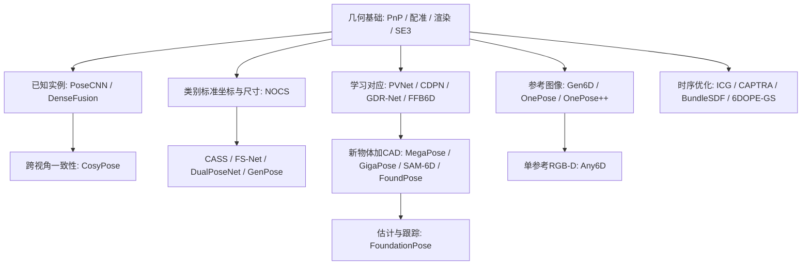

# 问题定义与知识地图

> 面向已有轮式机器人感知经验的读者。建议先读本文，再读逐篇解析。检索截至 2026-09-29；这里的路线选择属于调研建议，不是实机测试结论。

## 先明确你要估计谁的位姿

本项目默认研究**人形机器人看到、抓取和操作的刚体物体**。人形是应用平台，主要算法谱系来自通用物体位姿估计；不能因为论文做了机械臂实验，就称其在人形机器人上完成了验证。

| 问题 | 未知量 | 典型用途 | 本轮范围 |
|---|---|---|---|
| 物体 6D 位姿估计 | 物体相对相机/机器人坐标系的旋转和平移 | 抓取、放置、插接、工具使用 | 主线 |
| 机器人自身位姿/状态估计 | 机身相对世界的 SE(3)，常同时估计速度、偏置 | VIO/SLAM、导航、平衡控制 | 仅解释接口 |
| 人体姿态估计 | 人的关节位置、骨架或人体模型参数 | 模仿学习、人机协作 | 不作为物体 6D 方法 |
| 抓取位姿生成 | 夹爪/手的目标位姿及接触配置 | 可达且稳定的抓取 | 下游任务，不等于物体位姿 |
| 关节物体/非刚体估计 | 根节点位姿 + 关节或形变参数 | 开抽屉、折衣服 | 需要扩展刚体假设，未系统覆盖 |

检测器给出“杯子在哪里”的框，6D 估计还需要“杯子如何朝向”；抓取规划进一步决定“手放在哪里、怎么接近、哪里接触”。这三步分别可能失败。

## 统一坐标约定

定义 `T_A_B` 为**把 B 坐标系中的点变换到 A 坐标系**：

```text
p_A = R_A_B p_B + t_A_B
T_A_B = [ R_A_B  t_A_B ] ∈ SE(3)
        [  0 0 0     1  ]
T_A_C = T_A_B T_B_C
```

6D 指三维平移 + 三维旋转的自由度，不要求网络输出刚好六个数。旋转矩阵、四元数、轴角、连续 6D rotation representation 是不同表示；其中“6D 旋转表示”本身只表示旋转，不是完整物体 6D pose。

对针孔模型：`λ [u,v,1]^T = K (R_C_O p_O + t_C_O)`。已知物体三维点、对应二维像素和内参，可以用 PnP 求 `T_C_O`。OpenCV 的 `solvePnP` 输出模型/物体到相机的变换；相机 x 向右、y 向下、z 向前。坐标系方向需要在接机器人之前显式转换。[OpenCV PnP 文档](https://docs.opencv.org/4.13.0/d5/d1f/calib3d_solvePnP.html)

RGB-D 用深度把像素反投影为相机系三维点，常可利用 3D–3D 对应或表面对齐；无论网络多强，深度单位、RGB/深度注册和内参必须正确。RGB 也可以恢复度量平移，但通常需要已知尺寸/CAD，或者具有尺度约束的参考重建；仅有无尺度单目重建时，不能凭空得到米制距离。

## 从你已有的经验迁移

| 轮式机器人经验 | 可迁移能力 | 新增重点 |
|---|---|---|
| 激光/视觉里程计、ICP | 刚体变换、对应、鲁棒优化、退化分析 | 被遮挡的局部小物体、对象对称性 |
| 目标检测/分割 | 前端、误检漏检、数据闭环 | 对象身份、精细 mask、与位姿估计解耦评测 |
| 多传感器融合 | 时间同步、外参、坐标变换 | 头部/腕部相机的时变运动学链 |
| 动态目标跟踪 | 状态预测、关联、重定位 | 完整 SE(3)、手物接触、旋转歧义 |
| 地图和定位评估 | 漂移、闭环、场景分层 | 相对物体模型的姿态、任务容差、抓取成功 |

通常最值得优先补的是：物体坐标系与对称性、可学习的 2D–3D 对应、类别标准坐标与尺度、对象初始化和跟踪的区别。

## 划分方法要用多个轴

| 维度 | 常见取值 | 决定什么 |
|---|---|---|
| 观测 | RGB、RGB-D、点云、多视角、视频 | 尺度来源、弱纹理/深度失效时的能力 |
| 对象先验 | 精确 CAD、参考图像/扫描、类别训练数据、在线建模 | 新物体准备成本 |
| 训练范围 | 训练见过该实例、已知类别新实例、跨类别新物体 | 泛化结论是否成立 |
| 时间条件 | 单帧全局初始化、局部跟踪、失效后重初始化 | 能否从任意状态启动和恢复 |
| 输出 | SE(3)、SE(3)+尺寸、相对参考帧位姿、姿态分布 | 能否直接接抓取坐标系 |
| 前端条件 | GT mask、给定检测、自动检测/分割 | 是位姿模块结果还是端到端结果 |

例如 FoundationPose 的“新物体不用微调”与“有 CAD 的 RGB-D 分支”可以同时成立；NOCS 的“新实例”是在训练类别内，而不是任意新类别。详见各篇解析，不要把不同轴压成“传统 vs 大模型”。

## 方法发展脉络



图中箭头表示建议的学习依赖，**不是论文严格的继承或引用关系**。

## 三个核心建模思想

**对应后求解。** 网络给二维关键点、稠密物体坐标或三维关键点，几何求解器给位姿。学习模块的误差可以通过对应可视化定位。PVNet、CDPN、FFB6D 值得对照读。

**渲染后比较。** 给定候选位姿，把模型渲染到相机中，再通过图像/特征差异优化和打分。学习时重点追踪：候选怎么来，平移尺度怎么定，优化收敛范围多大，打分能否区分对称解。MegaPose、FoundationPose、GigaPose 是重要入口。

**在规范坐标或物体表示中消除外观变化。** NOCS 学类别标准坐标；参考图像方法建立对象表示；BundleSDF 等在跟踪中更新形状。它们都需要回答：对象坐标系如何定义、尺寸从哪里来、对象表示准备成本谁承担。

## 常见误读

- “无需重训练”仍可能需要预训练模型、模板渲染、参考扫描或对象重建。
- “无 CAD”不代表输出在你希望的 CAD/抓取坐标系中；参考帧到操作坐标系可能还需配准。
- 跟踪一般需要初始化。稳定跟踪不等于能从任意错误姿态恢复。
- 几何对称的两个旋转可能等价；带把手、标签或任务接触面的物体未必仍然任务等价。
- BOP、NOCS 和跟踪论文往往采用不同数据、先验和指标，不能直接按一个数字排名。
- 论文峰值 FPS 不等于机器人端到端延迟，前处理、分割、模型准备和重初始化需分别核算。

下一步读 [方法对比](02_方法对比与选型.md) 和 [学习路线](04_八周学习路线.md)。
