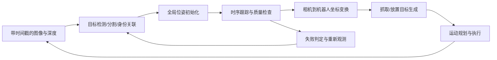

# 人形机器人落地要点

> 本文为基于文献条件和机器人几何的工程分析，尚无本项目实机结果。先把系统误差分解清楚，再决定是否需要改位姿网络。

## 先建立可解释的完整链路

`T_B_O(t) = T_B_C(t) T_C_O(t)`。对头部相机，`T_B_C(t)` 常由躯干/颈部关节运动学和固定相机外参组成；对腕部相机，同理由手臂运动学组成。两者要在**同一个采集时刻**求值。

若已定义物体系下的目标手/夹爪位姿 `T_O_G`，则 `T_B_G = T_B_O T_O_G`。这仍然没有解决可达性、自碰撞、桌面碰撞或稳定接触。

采集时刻与执行时刻不同。如果期间基座或物体移动，须通过状态传播、时间同步和必要的世界系转换求当前目标，不能把旧基座系中的数值直接当作执行时目标。

## 人形平台让哪些问题更突出

| 条件 | 对估计造成的影响 | 建议验证方法 |
|---|---|---|
| 行走、躯干/头部运动 | 模糊、视角突变、时延放大 | 分别录静止、转头、躯干运动序列 |
| 头部远视角与手腕近视角 | 分辨率与遮挡不同、重识别和坐标融合 | 同一物体、同一时刻比较两视角 |
| 手指/手掌遮挡物体 | mask 缺失、可见几何退化、跟踪漂移 | 以遮挡比例和可见表面分层 |
| 抓取后物体运动 | 不再满足静态环境假设 | 区分相机运动、物体运动和两者同时运动 |
| 松握、滑动、重新抓取 | 固定手物变换约束失效 | 视觉与运动学预测残差的时间曲线 |
| 透明/反光物体 | RGB-D 空洞或错误深度 | 标注深度有效率，另测 RGB 分支 |
| 机载资源受限 | 排队和长尾时延、显存竞争 | 测 p50/p95 延迟与队列长度 |
| 对称物体、任务相关方向 | 姿态跳变但几何拟合仍正确 | 同时给对称感知误差和任务成功率 |

HOT3D 提供第一视角手物交互的多视角数据，可以帮助研究手部遮挡与运动视角；它的传感器、手部外形和动作来自人类，不代表人形机器人实机数据。[HOT3D 官方项目](https://facebookresearch.github.io/hot3d/)

## 标定、同步与单位：优先于换网络

建议按顺序检查以下可视化：原始 RGB/深度对齐 → 反投影点云 → 用 GT/已知位姿投影模型 → 相机系估计 → 机器人基座系叠加 → 抓取目标。

一个有助于建立量级感的示例（我们计算的例子，不是论文结果）：目标相对运动速度为 0.4 m/s，端到端延迟为 0.10 s，仅时延就对应约 4 cm 位置变化；若物体距相机约 0.8 m，外参角误差 1° 的横向误差量级约为 `0.8 × sin(1°) ≈ 1.4 cm`。两者都可能超过小物体抓取容差。

不要简单将两个误差数相加作为精确总误差。实际影响取决于方向、相关性、运动和接触约束，必要时用 SE(3) 扰动和误差传播分析。

## 初始化、跟踪与恢复应分开设计

1. **初始化：** 使用检测/分割和全局估计，输出对象 ID、位姿、分数及时间戳。人工框或人工 mask 必须记录为输入条件。
2. **跟踪：** 在局部邻域更新位姿，记录几何/外观残差、有效点数、可见率或算法可提供的质量量。
3. **恢复：** 对连续低质量、深度不足、姿态突跳或对象出画触发重新检测；在日志中计入重初始化时间和失败帧。
4. **操作接口：** 输出变换方向、米制单位、时间、状态（有效/降级/丢失），避免沿用过期姿态。网络分数未必是校准的概率。

可比较“逐帧全局估计”“初始化后跟踪”“带明确重定位策略的跟踪”。否则无法判断时序方法的收益是否只是使用了更好的初值。

## 手物接触和主动观察的机会

抓稳后可把运动学提供的物体预测作为约束候选，但需要区分刚性接触、滑动和触碰。错误地固定 `T_hand_object` 会让视觉无法纠正物体滑落。建议先离线比较约束开启/关闭、故意滑动/不滑动，再讨论融合方法。

如果当前视角只看到近似平面或对称区域，机器人可改变头部或手腕视角。应将“移动造成的耗时与动作成本”计入比较，而不是只报告多视角之后的精度。相关研究想法要等 baseline 失败分析后再写成正式假设。

## 推荐的第一个工程闭环

以下是默认具备 RGB-D 与一个可靠 CAD 时的验证建议，传感器若不同需要调整：

- 先用一个不透明、非对称、几何尺寸已知的物体，离线评测 FoundationPose，核对初始化和跟踪输出。
- 同一段数据使用给定 mask 与自动 mask，分离位姿模块和感知前端的误差。
- 加入遮挡和运动相机，保持同一对象、固定评测划分和失败案例。
- 标定误差、时间偏差和 CAD 尺寸误差分别扰动，识别主要瓶颈。
- 最后接入低速抓放任务，并记录成功、碰撞、掉落及重试；先定义成功条件再做实验。

选择 FoundationPose 是基于任务匹配和公开实现的起点建议，**不表示它在你的平台上已经最快或最准确**。其输入条件和版本限制见对应单篇解析。
